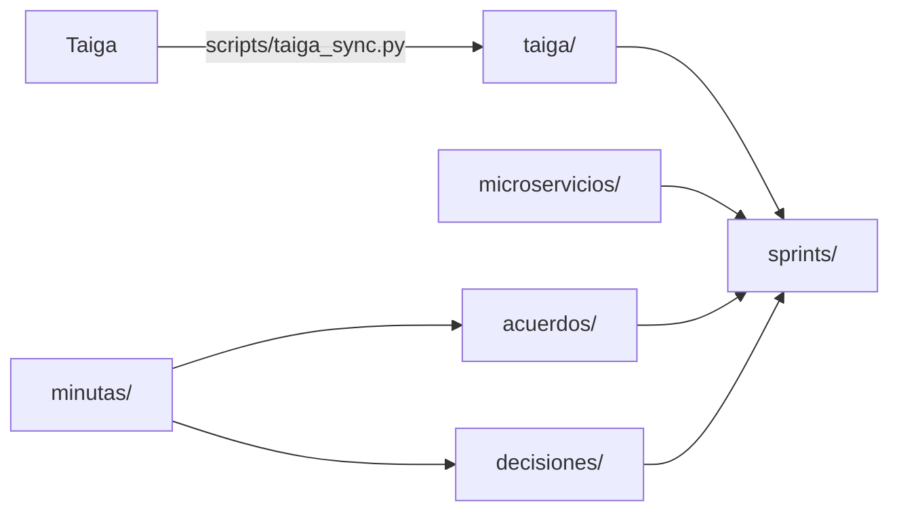

# Cerebro G10 — roadmap-service

Todo lo que el grupo necesita saber sin tener que preguntarle a nadie: qué está hecho, qué falta, qué se acordó con otros grupos y por qué se decidió cada cosa.

## Secciones

| Carpeta | Qué hay | Quién la mantiene |
|---|---|---|
| [[microservicios/README\|microservicios/]] | **Ficha y documentación canónica por cada microservicio/repo de la plataforma** (evita dispersión de información) | El equipo |
| [[taiga/README\|taiga/]] | Épicas, historias y tareas de G10, con estado y responsable | **Generada** por `scripts/taiga_sync.py`. No editar a mano |
| [[sprints/sprint-3/00-indice\|sprints/]] | Planificación y análisis por sprint. Hoy: propuesta del Sprint 3 | El equipo |
| [[acuerdos/README\|acuerdos/]] | Acuerdos por grupo o servicio con el que integramos | El equipo, cada vez que se acuerda algo |
| [[decisiones/README\|decisiones/]] | Decisiones técnicas (DEC-xxx): contexto, alternativas y consecuencias | El equipo |
| [[contratos/README\|contratos/]] | Contratos OpenAPI, AsyncAPI y esquemas de eventos Kafka | El equipo |
| [[arquitectura/contexto-integral\|arquitectura/]] | Arquitectura y contexto del micro: contexto integral, estructura de paquetes/BD, E2E, CORS y rutas | El equipo, cuando cambie el código |
| [[tareas/README\|tareas/]] | Especificaciones de tareas técnicas implementadas (T-xx, HU3, P-11) y su histórico | Histórico de tareas |
| [[backlog/README\|backlog/]] | Notas de backlog técnico y funcionalidades futuras | El equipo |
| `minutas/` | Notas de reuniones (daily, profes, otros grupos) | Quien estuvo en la reunión |
| [[deuda-tecnica]] | Deuda técnica general (no son HU): código muerto, mocks, seguridad, docs, ramas. Vive entre sprints | El equipo |
| [[equipo]] | Integrantes, áreas que conoce cada uno | El equipo |
| [[revision-de-prs]] | Criterios para aprobar PRs de front y back (bloqueantes, importantes, nits) | El equipo |
| `plantillas/` | Plantillas para acuerdo, decisión y minuta | — |

## Lo urgente ahora

- [[sprints/sprint-3/02-pendientes|Pendientes del Sprint 2]]: historias en Done que no lo están.
- [[sprints/sprint-3/09-epicas-e-historias|Épicas e historias del Sprint 3]]: qué vamos a hacer, con criterios de aceptación.
- [[deuda-tecnica|Deuda técnica]]: lo que hay que limpiar aunque no sea una HU. Empezar por las 🔴.
- [[sprints/sprint-3/08-dudas|Dudas del sprint]]: para los profes, otros grupos y el equipo. Empezar por las 🔴.
- [[sprints/sprint-3/07-correcciones-profes|Correcciones de los profes]]: qué piden y qué ya estaba planteado.
- [[decisiones/DEC-016-neo4j-para-la-estructura-del-roadmap|DEC-016: Neo4j para la estructura del roadmap]].

## Reglas del cerebro

1. **Si se acordó algo con otro grupo, va a `acuerdos/`** el mismo día, con link al contrato o al mensaje.
2. **Si se decidió algo técnico que alguien podría cuestionar después, va a `decisiones/`.**
3. **Taiga es la fuente de verdad del estado de las HU.** Para actualizar `taiga/`, correr el script. No editar esas notas.
4. **Los contratos técnicos y documentación viven centralizados en este cerebro** (`contratos/`, `arquitectura/`, `tareas/`). El repo de código (`tpi-roadmap`) queda limpio de documentación estática y apunta a este cerebro como fuente canónica.
5. Antes de preguntar en el grupo, buscar acá (`Ctrl/Cmd + Shift + F`).
   - ¿Qué es CORS, qué topics usamos, cómo son las rutas? → [[arquitectura/cors-topics-rutas]].
   - ¿Cuál es la arquitectura y contexto completo? → [[arquitectura/contexto-integral]].
   - ¿Cómo levanto el front y el back (estable o de prueba), qué claves hacen falta? → [[arquitectura/levantar-entorno]].

Cómo instalarlo y sincronizarlo: [[COMO-USAR]].
