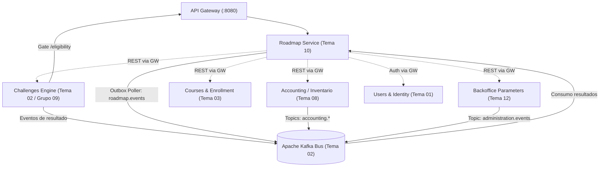

# Contexto Integral del Microservicio Roadmap (`tpi-roadmap`)

> **Documento de contexto técnico y funcional para Agentes y Desarrolladores.**  
> **Ubicación:** Vault Cerebro G10 (`arquitectura/contexto-integral.md`).  
> **Fuente de verdad:** El archivo [`AGENTS.md`](https://github.com/2026-P4-BE/tpi-roadmap/blob/develop/AGENTS.md) de `tpi-roadmap` y las notas de acuerdos y decisiones en este cerebro. Todo lo expuesto en este documento se deriva de él y queda subordinado a sus definiciones.

---

## 1. Misión e Identidad del Microservicio

El microservicio **`tpi-roadmap`** es el componente central de progresión pedagógica y gamificación de la plataforma.

### Responsabilidades Core (Ownership Exclusivo)
1. **Grafo de Aprendizaje:** Modelado y navegación de cursos, secciones, nodos y dependencias/prerrequisitos lógicos (AND / OR a elección del docente, RF-CUR-06).
2. **Gate de Elegibilidad:** Habilitación previa y validación de condiciones para que un alumno inicie un desafío (matrícula activa en Courses, curso no archivado, prerrequisitos del grafo satisfechos, materiales obligatorios leídos, vidas > 0 consultadas a Inventario).
3. **Ledger de XP Propio:** Registro inmutable (append-only en `xp_movement`) e idempotente por `eventId` del XP **ya calculado que envía el motor de desafíos**. Roadmap **no calcula XP** ni multiplicadores (`RF-CFG-06`).
4. **Ranking y Gamificación:** Tablas de clasificación por cohorte, zonas de rendimiento (P90, MIDDLE, P10 con umbral de ≥ 10 alumnos) y resolución de desempates en cascada (`RF-RNK-11`).
5. **Outbox Transaccional:** Garantía de publicación at-least-once de eventos de dominio a Kafka sin inconsistencias con la base de datos relacional.

### Parámetros de Identidad en la Plataforma
| Entorno / Superficie | Propiedad | Valor |
|---|---|---|
| **Repositorio** | Nombre del repo | `tpi-roadmap` |
| **Eureka Service Discovery** | `spring.application.name` | `roadmap-service` |
| **Gateway Routing** | Prefijo de ruta externa | `/api/roadmap/**` |
| **Consumer Group Kafka** | `spring.kafka.consumer.group-id` | `roadmap-service` |
| **Producer Identifier** | Campo `producer` en eventos | `roadmap-service` |

---

## 2. API Gateway, Eureka y Seguridad de Plataforma

Toda la comunicación externa (cliente frontend) e interna (micro a micro) fluye a través del **API Gateway**. Los microservicios no exponen puertos directamente en producción.

### 2.1 Configuración de Eureka (Obligatoria)
```properties
spring.application.name=roadmap-service
eureka.client.service-url.defaultZone=${EUREKA_URL:http://localhost:8761/eureka/}
eureka.client.register-with-eureka=true
eureka.client.fetch-registry=false
eureka.client.healthcheck.enabled=true
eureka.instance.prefer-ip-address=true
```

### 2.2 Rutas Públicas vs Privadas
- **Rutas Públicas (`${app.api.public-path}/**` -> `/api/roadmap/public/**`):** Exentas de autenticación en el Gateway. Destinadas a healthchecks (`/ping`), documentación OpenAPI/Swagger o validaciones públicas.
- **Rutas Privadas (`${app.api.private-path}/**` -> `/api/roadmap/**`):** Requieren obligatoriamente autenticación validada por el Gateway (JWT de usuario o token técnico de servicio).
- **Regla estricta:** Nunca usar el literal `"/api/"` en mappings de controladores; inyectar siempre `${app.api.public-path}` o `${app.api.private-path}`.

### 2.3 Headers Inyectados por el Gateway (`IdentityPropagationFilter`)
El Gateway elimina cualquier header `X-*` entrante desde internet (anti-spoofing) e inyecta los headers verificados:

| Header | Tipo | Descripción |
|---|---|---|
| `X-Principal-Type` | `String` | `"user"` (estudiante/docente) o `"service"` (llamada técnica micro a micro). |
| `X-User-Id` | `UUID` | ID del usuario autenticado (extraído del claim `sub`). |
| `X-User-Roles` | `String` | Lista separada por comas de roles verificados: `ADMIN`, `MANAGER`, `PROFESSOR`, `STUDENT`. |
| `X-Service-Id` | `String` | Identificador del microservicio emisor cuando `X-Principal-Type=service`. |
| `X-Service-Scopes` | `String` | Scopes asignados al servicio (ej. `roadmap.gate.read`). |
| `traceparent` | `String` | W3C Trace Context (`00-<traceId>-<spanId>-<flags>`). |
| `X-Request-Id` | `UUID` | ID de correlación único para trazabilidad distribuida. |

### 2.4 Roles y Autorización en Roadmap
El Gateway autentica criptográficamente el JWT; **la autorización por rol y pertenencia al curso la realiza el microservicio** (`@PreAuthorize`):
- Los valores del header `X-User-Roles` según contrato son: `ADMIN`, `MANAGER`, `PROFESSOR`, `STUDENT`.
- En el código de Roadmap (`Roles.java`), las constantes utilizadas son:
  - `ADMIN`: Administrador de la plataforma (acceso total).
  - `PROFESSOR`: Docente a cargo del curso (gestión del roadmap y cierre).
  - `STUDENT`: Estudiante inscripto en la cohorte.
- Para llamadas técnicas de servicio a servicio, el Gateway envía `X-Principal-Type: service` y el microservicio autoriza contra la identidad de servicio (`ServiceIdentity`), no contra roles de usuario humano.

### 2.5 Llamadas Micro a Micro (Service-to-Service)
Para invocar otros microservicios:
1. Roadmap solicita un token de servicio al microservicio de Usuarios:
   - `POST ${GATEWAY_URL}/api/users/public/auth/token`
   - Parámetros: `grant_type=client_credentials`, `client_id`, `client_secret`, `audience` (obligatorio, identifica un único destino), `scope`.
2. El token resultante se incluye como header:
   - `Authorization: Bearer <service_token>`
3. La petición se envía a través del Gateway (`${GATEWAY_URL}/api/<target-service>/...`).
4. **Prohibido:** Mandar JWT de persona, cookies de sesión (`fu_at`), credenciales directas de usuarios o conectar directo a puertos/IPs internos de otros contenedores.

### 2.6 Formato Canónico de Errores (RFC 9457 / RFC 7807)
Todo error HTTP devuelto por Roadmap debe usar `Content-Type: application/problem+json`:
```json
{
  "type": "https://tpi.utn.frc/errors/not-enrolled",
  "title": "Student Not Enrolled",
  "status": 403,
  "detail": "El alumno no se encuentra matriculado o activo en la cohorte indicada.",
  "instance": "/api/roadmap/courses/6f70dc0d.../students/09819779.../eligibility",
  "trace_id": "550e8400-e29b-41d4-a716-446655440000"
}
```

---

## 3. Mapa de Microservicios Colaboradores y Contratos



---

### 3.1 Motor de Desafíos (`challenges-service` — Tema 02 / Grupo 09)

* **Ruta Base Gateway:** `/api/engine-challenge/**`
* **Formato de Errores:** Problem Details RFC 9457.

#### A. Consulta de Catálogo (`existsChallenge`)
- **Endpoint:** `GET /api/engine-challenge/challenges/{challengeId}`
- **Auth:** Token de servicio con scope `challenges.catalog.read` o sesión docente/admin.
- **Respuesta (200 OK):**
  ```json
  {
    "id": "6f70dc0d-e25f-4053-9387-e07085ea38a3",
    "status": "PUBLISHED",
    "currentVersion": 3,
    "type": "PRACTICAL"
  }
  ```

#### B. Gate de Habilitación / Elegibilidad (Llamada entrante desde Motor)
Antes de que un estudiante inicie un intento, el Motor consulta al Gate de Roadmap:
- **Base en `develop`:**
  - `GET /api/roadmap/courses/{courseId}/students/{studentId}/nodes/{nodeId}/eligibility`
  - Devuelve `EligibilityResponse` (`eligible: boolean`, `reason: String`).
  - Auth: Servicio autenticado con `X-Principal-Type: service`.
- **Evolución en PR #53 (`feature/hu01-motor-v2`, pendiente de merge):**
  - Soporte de contrato Motor v2 con emisión de `openingAuthorizationId` y firma criptográfica para inicio de intento.

#### C. Evento Kafka de Resultado (`CHALLENGE_COMPLETED`)
- **Tópico Kafka:**
  - **Vigente (evento de cierre v3, `docs/contracts/motor-desafios-evento-cierre.md`):** `${KAFKA_TOPIC_CHALLENGE_EVENTS:challenges.events}`, key `userId`.
  - **Formato anterior (v1/v2), mientras el Motor migra:** `${KAFKA_TOPIC_CHALLENGE_RESULT:challenges.results}`. Un listener por topic; nunca el mismo topic en las dos variables.
- **Productor:** `tema-03-challenges-service` en el evento vigente (se filtra por `producer`, Tema 05 comparte el topic); `challenges-service` en el formato anterior.
- **Regla Fundamental de XP:**
  > **Roadmap NO calcula XP.** El motor de desafíos calcula el XP base y todos los multiplicadores asociados. Roadmap recibe el XP ya calculado en el evento y lo acredita directamente en su ledger inmutable (`xp_movement`), sumándolo a `StudentCourse.total_xp`.
- Si `verdict == "PASSED"`, Roadmap:
  1. Registra el movimiento en el Ledger de XP (idempotente por `eventId`).
  2. Marca el nodo como completado en `completed_node`.
  3. Evalúa y desbloquea nodos dependientes en el grafo.
  4. Recalcula ranking y zonas (`P90`, `MIDDLE`, `P10`) si la cohorte tiene ≥ 10 alumnos.
  5. Encola eventos en el outbox transaccional (`NODE_COMPLETED`, `COURSE_LEVEL_UP`, etc.).

---

### 3.2 Accounting / Inventario y Monedero (`accounting-service` — Tema 08)

* **Ruta Base Gateway:** `/api/accounting/**`
* **Ownership:** Accounting es la fuente única de verdad para saldo de monedas, vidas disponibles e inventario de ítems. Roadmap **no almacena vidas como saldo propio**.

#### Endpoints Consumidos por Roadmap
1. **Disponibilidad de Vidas para el Gate:**
   - `GET /api/accounting/courses/{courseId}/accounts/{studentId}/lives-availability`
   - Respuesta: `{ "currentLives": 2, "reservedLives": 1 }`
   - Cálculo en Roadmap: `freeLives = currentLives - reservedLives`.
   - **Regla:** Si `freeLives <= 0`, el Gate bloquea con motivo `no_lives` (salvo desafíos de recuperación de vida `LIVES`, RF-REC-04/06).
2. **Histórico de Vidas para Promoción y Desempate:**
   - La condición "nunca perdió una vida en este curso" se mantiene históricamente a partir de los eventos del motor para las reglas de promoción P90 (`RF-RNK-05/12`) y desempate (`RF-RNK-11`).
3. **Movimientos de vidas (`accounting.events`):**
   - Roadmap consume `LIFE_CREDITED` / `LIFE_DEBITED` para proyectar `student_course.recovery_pending` (informativo): relee las vidas de Accounting y guarda `!hasLives()`. **No** decide el Gate ni la elegibilidad, que siguen leyendo `lives-availability`/`equip-summary` en el momento del pedido.

---

### 3.3 Courses & Enrollment (`course-service` — Tema 03)

* **Ruta Base Gateway:** `/api/course/**`
* **Mapeo de Identificadores:**
  > **El `courseId` de Roadmap equivale exactamente al `courseCohortId` de Courses.** Roadmap opera a nivel de cohorte específica.
* **Reglas Compartidas:**
  - Si una cohorte pasa a `ARCHIVED`, el Roadmap y el Ranking pasan a **solo lectura** (`RF-CUR-09`).
  - Matrícula activa: El estudiante debe estar matriculado (`status == "VALIDATED"`). Si no, el Gate rechaza con `not_enrolled`.

---

### 3.4 Backoffice / Parámetros Globales (`tema-12-backoffice-service` — Tema 12)

* **Ruta Base Gateway:** `/api/backoffice/parameters/**` (el Gateway no enruta `/api/administration/**`), con token de servicio: audience `backoffice-service`, scope `backoffice.parameters.read`.

#### Parámetros Relevantes para Roadmap
| Parámetro | Concepto | Detalle y Uso |
|---|---|---|
| **`PAR-01`** | XP Base por Dificultad | Escala de referencia (`100/250/500`) utilizada por el Motor para calcular el XP que envía a Roadmap. |
| **`PAR-08`** | Umbral por Defecto Desbloqueo | **RETIRADO.** El desbloqueo opera exclusivamente por prerrequisitos específicos de grafo (AND/OR, `RF-CUR-06`). |
| **`PAR-09`** | Curva Oficial de 10 Niveles | Escala oficial de puntos requeridos por nivel: `0 / 250 / 600 / 1.100 / 1.800 / 2.800 / 4.200 / 6.000 / 8.500 / 12.000`. |
| **`PAR-12`** | Vidas Iniciales / Máximas | `3/3` (solo muestra; la gestión activa reside en Inventario). |

- **Kafka Listener:** Topic `administration.events`. Evento `GLOBAL_CONFIGURATION_CHANGED` actualiza la caché local de parámetros de Roadmap sin reinicio.

---

### 3.5 Users & Identity (`users-service` — Tema 01)

* **Ruta Base Gateway:** `/api/users/**`
* **Endpoints:**
  - `POST /api/users/public/auth/token`: Emisión de JWT técnico de servicio con `grant_type: client_credentials`.
  - `GET /.well-known/jwks.json`: Publicación de claves públicas para verificación de firmas en el Gateway.

---

### 3.6 Notificaciones y Bus de Eventos (`notifications-service` — Tema 02)

* **Gobierno de Kafka:** Notificaciones rige el estándar del bus. Prohibido crear topics arbitrarios sin acuerdo previo (P-09).

---

## 4. Convenciones de Eventos en Apache Kafka

### 4.1 Envelope Estándar Obligatorio (Contrato del Bus)
Todos los eventos respetan el contrato de **5 campos obligatorios** establecido por el PDF del bus y la clase [`EventEnvelope.java`](../src/main/java/com/utn/tpi/roadmap/events/EventEnvelope.java). **No contiene `eventVersion`**:

```json
{
  "eventId": "550e8400-e29b-41d4-a716-446655440000",
  "eventType": "NOMBRE_DEL_EVENTO",
  "timestamp": "2026-09-24T10:00:00.000Z",
  "producer": "roadmap-service",
  "payload": {}
}
```

- `eventId`: UUID único por evento (crítico para idempotencia en el ledger).
- `eventType`: Nombre en inglés, MAYÚSCULAS con guión bajo (`_`).
- `timestamp`: Marca temporal en formato ISO 8601 UTC.
- `producer`: Identificador del microservicio emisor (`roadmap-service`).
- `payload`: Objeto JSON con el cuerpo específico del evento.

> **Resiliencia en Casing:** `EventEnvelope.java` serializa en **camelCase** y deserializa tolerantemente tanto **camelCase** (`eventId`, `eventType`) como **snake_case** (`event_id`, `event_type`).

### 4.2 Matriz de Tópicos
| Topic | Tipo | Origen | Destino / Consumidor | Key | Eventos |
|---|---|---|---|---|---|
| `challenges.events` (vigente) | Consumo | `tema-03-challenges-service` | `roadmap-service` | `userId` | `CHALLENGE_COMPLETED`, `CHALLENGE_ABORTED` |
| `challenges.results` (formato anterior, hasta que el Motor migre) | Consumo | `challenges-service` | `roadmap-service` | `attemptId` | `CHALLENGE_COMPLETED`, `CHALLENGE_ABORTED` (v2), `ATTEMPT_CORRECTED`, `ATTEMPT_CANCELED` (v1) |
| `accounting.ledger.events` | Consumo | `accounting-service` | `roadmap-service` | `studentId` | `LIVES_EXHAUSTED`, `LIVES_AVAILABLE` |
| `accounting.events` (`${KAFKA_TOPIC_ACCOUNTING}`) | Consumo | `accounting-service` | `roadmap-service` | `studentId` | `LIFE_CREDITED`, `LIFE_DEBITED` (proyecta `recovery_pending`, informativo) |
| `administration.events` | Consumo | `tema-12-backoffice-service` | `roadmap-service` | `param_key` | `GLOBAL_CONFIGURATION_CHANGED` |
| `roadmap.events` (`${KAFKA_TOPIC_ROADMAP}`) | Publicación | `roadmap-service` | Notificaciones / Plataforma | `studentId` | `NODE_COMPLETED`, `NODE_UNLOCKED`, `COURSE_LEVEL_UP`, `PERFORMANCE_ZONE_CHANGED` |

### 4.3 Eventos Publicados por Roadmap (Vía Outbox Pattern)

1. **`NODE_COMPLETED`:**
   ```json
   {
     "eventId": "uuid-v4",
     "eventType": "NODE_COMPLETED",
     "timestamp": "2026-09-26T20:00:00.000Z",
     "producer": "roadmap-service",
     "payload": {
       "courseId": "uuid-cohorte",
       "studentId": "uuid-alumno",
       "nodeId": "uuid-nodo",
       "challengeId": "uuid-desafio",
       "sectionId": "uuid-seccion"
     }
   }
   ```

2. **`NODE_UNLOCKED`:**
   ```json
   {
     "eventId": "uuid-v4",
     "eventType": "NODE_UNLOCKED",
     "timestamp": "2026-09-26T20:00:00.000Z",
     "producer": "roadmap-service",
     "payload": {
       "courseId": "uuid-cohorte",
       "studentId": "uuid-alumno",
       "nodeId": "uuid-nodo"
     }
   }
   ```

3. **`COURSE_LEVEL_UP`:**
   ```json
   {
     "eventId": "uuid-v4",
     "eventType": "COURSE_LEVEL_UP",
     "timestamp": "2026-09-26T20:00:00.000Z",
     "producer": "roadmap-service",
     "payload": {
       "courseId": "uuid-cohorte",
       "studentId": "uuid-alumno",
       "newLevel": 3,
       "totalXp": 1250
     }
   }
   ```

4. **`PERFORMANCE_ZONE_CHANGED`:**
   ```json
   {
     "eventId": "uuid-v4",
     "eventType": "PERFORMANCE_ZONE_CHANGED",
     "timestamp": "2026-09-26T20:00:00.000Z",
     "producer": "roadmap-service",
     "payload": {
       "courseId": "uuid-cohorte",
       "studentId": "uuid-alumno",
       "previousZone": "MIDDLE",
       "currentZone": "P90"
     }
   }
   ```
   *(Zonas: `P90`, `MIDDLE`, `P10`. Aplica únicamente en cohortes con ≥ 10 alumnos).*

### 4.4 Idempotencia y Transactional Outbox
- **Idempotencia Estricta:** La tabla `xp_movement` posee una restricción única `uq_xp_movement_event_id`. Todo evento ya procesado se descarta sin duplicar XP ni desbloqueos.
- **Transactional Outbox:** Nunca se invoca `KafkaTemplate` directamente desde la lógica transaccional de negocio. La entidad del dominio y el registro en la tabla `outbox_event` se persisten en la misma transacción `@Transactional`. El poller asíncrono (`OutboxPoller`) publica a Kafka y actualiza el estado a `PUBLICADO`.

---

## 5. Lógica de Dominio y Reglas de Negocio en Roadmap

### 5.1 Grafo de Nodos y Secciones
- Un Roadmap está compuesto por **Secciones** y **Nodos**.
- **Desbloqueo por Prerrequisitos (`RF-CUR-06`):** Cada nodo puede requerir que se aprueben desafíos de nodos previos. El profesor configura si exige el cumplimiento de **TODOS** los predecesores (`AND`) o de **CUALQUIERA** de ellos (`OR`).

### 5.2 Gate de Elegibilidad
Condiciones evaluadas antes de autorizar el inicio de un intento:
1. **Matrícula:** Alumno validado y activo en la cohorte indicada.
2. **Estado de Cohorte:** Curso activo (si está archivado es solo lectura, `RF-CUR-09`).
3. **Prerrequisitos:** Desafíos previos completados según la regla lógica (AND/OR).
4. **Lecturas:** Materiales obligatorios previos leídos (`CONTENT_READ`).
5. **Vidas:** `freeLives > 0` consultadas a Inventario (o desafío de tipo `LIVES`).

### 5.3 Ledger de XP y Niveles
- **Inmutabilidad:** Cada acreditación de XP se registra en `xp_movement` (append-only). Nunca se edita ni recalcula el XP histórico (`RF-CFG-06`).
- **Niveles:** Curva oficial de 10 niveles (`PAR-09`). Al alcanzar el umbral se actualiza el nivel y se emite `COURSE_LEVEL_UP`.

### 5.4 Ranking y Criterios de Desempate
- El ranking ordena a los estudiantes de la cohorte por:
  - **XP Total Acumulado** (criterio principal descendente, `RF-RNK-01`).
- **Desempate en Cascada (`RF-RNK-11` per `agent.md` §3.4):**
  1. **1° Más insignias** obtenidas.
  2. **2° Menos vidas perdidas** (contador histórico del curso).
  3. **3° Más ejercicios completados**.
  4. Si persiste la igualdad, **comparten la misma posición**.

### 5.5 Módulos y Capacidades Incorporados (Release v2.0.0 / Migraciones V1..V26)
1. **Avatar 3D del Estudiante (`StudentAvatarController`, V26):**
   - Almacenamiento de personalización del avatar 3D por cohorte (`student_avatar`).
   - Validación de esquema/tamaño de payload y soporte de baja lógica (`deleted_at`).
2. **Prerrequisitos por Unidad (`section_prerequisite`, V25):**
   - Habilita dependencias a nivel de secciones/unidades completas además de las dependencias nodo a nodo.
   - Evaluado por el Gate y la lógica de progresión (`PrerequisiteService`).
3. **Sincronización con Courses (`SectionSyncController`, HU-36):**
   - Endpoint `POST /courses/{courseId}/sections/sync` para crear y anclar unidades del roadmap desde las secciones de Courses.
   - Controlado por el flag `app.sections.sync-enabled` (`SECTIONS_SYNC_ENABLED`).
4. **Roadmap por Comisión (`GroupProgressController`, HU-44):**
   - Recorrido y avance segmentado por comisiones escolares mediante toggle `app.features.roadmap-by-group.enabled` (`ROADMAP_BY_GROUP_ENABLED`).
   - Consulta dinámica a Courses para validar pertenencia a comisiones activas.
5. **Pool de Desafíos Sin Filtro Restrictivo de Autor (`ChallengePoolController`):**
   - Soporte para que administradores y gestores (`MANAGER`) accedan al catálogo completo de desafíos publicados para asignarlos al roadmap.
6. **Integración Reactiva con Accounting para Vidas Informativas (V24):**
   - Consumo de eventos `LIFE_CREDITED` y `LIFE_DEBITED` desde `accounting.events`.
   - Proyección en `student_course.recovery_pending` para señalizar recuperación de vidas en la UI.
7. **Metadatos Visuales de Nodos y Secciones:**
   - Biomas temáticos por sección (`section_biome`, V22).
   - Iconos configurables por desafío (`node_icon_key`, V20).
   - Coordenadas y layout de editor gráfico (`node_editor_fields`, V23).
   - Log de auditoría de modificaciones docentes (`node_edit_log`, V18).

---

## 6. Checklist de Definition of Done para Nuevos Cambios

Antes de dar por finalizada cualquier funcionalidad en `tpi-roadmap`:
- [ ] ¿El endpoint respeta los prefijos `${app.api.public-path}` o `${app.api.private-path}` (sin `"/api/"` literal)?
- [ ] ¿Los errores se emiten en formato RFC 9457 (`application/problem+json`)?
- [ ] ¿Las llamadas a otros servicios pasan por el Gateway con token de servicio?
- [ ] ¿Los eventos Kafka respetan el envelope estándar de 5 campos (sin `eventVersion`)?
- [ ] ¿Se garantiza idempotencia mediante `eventId` en la base de datos?
- [ ] ¿Los eventos publicados se persisten en `outbox_event` dentro de la transacción de negocio?
- [ ] ¿Los tests (`mvn -B verify`: JUnit 5, BDD Cucumber, Checkstyle y PMD) pasan con 0 violaciones?
