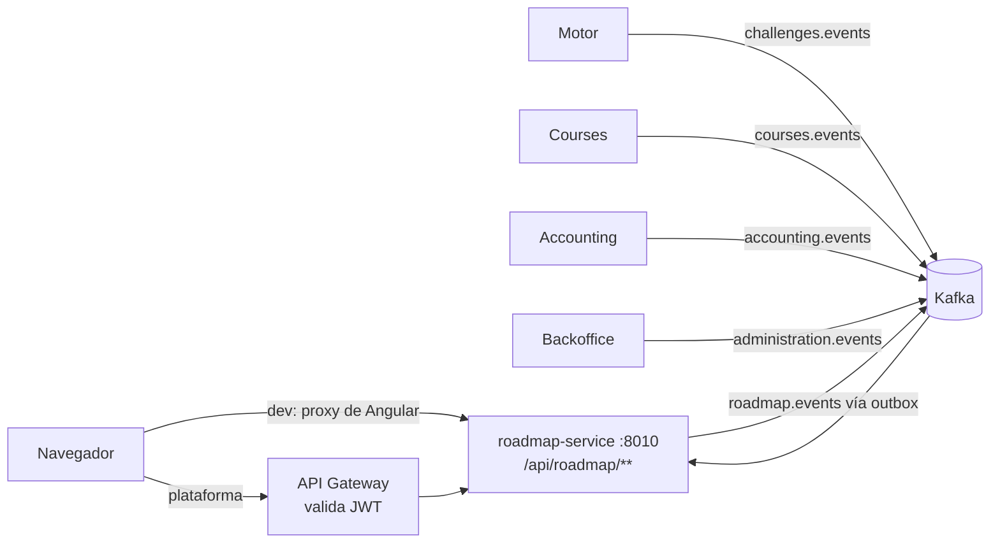

# CORS, topics y rutas del roadmap-service

> [!info] Para qué sirve esta nota
> Cuando en una reunión se hable de CORS, topics de Kafka o rutas del Gateway: qué es cada cosa y **qué manejamos hoy**.
> Si cambia algo en el código, actualizar esta nota (ver [[#Dónde verificarlo en el código]]).

## CORS

**Qué es:** una regla **del navegador**. Si una página de un origen (ej. `http://localhost:4200`) le pega con `fetch` a otro origen (ej. `http://localhost:8010`), el navegador bloquea la respuesta salvo que el servidor la autorice con headers `Access-Control-Allow-*`. Entre micros, Postman o curl no existe.

> Origen = protocolo + host + puerto. `localhost:4200` y `localhost:8010` son orígenes distintos.

**Qué manejamos hoy: nada, y no hace falta.** El front nunca le pega a otro origen:

| Entorno | Cómo llega el pedido | ¿CORS? |
|---|---|---|
| Desarrollo (`ng serve`) | El navegador llama a `localhost:4200/api/roadmap/...` y el proxy de Angular (`proxy.conf.json`) lo reenvía a `localhost:8010` | No: mismo origen |
| Plataforma | Front y Gateway se sirven bajo el mismo host | No: mismo origen |

- **roadmap-service no tiene configuración de CORS**, y no hay que agregarla.
- Si algún día el front se sirve desde otro dominio, CORS se configura **una sola vez en el Gateway**, no en cada micro.
- El único CORS configurado en la plataforma es el del **storage de archivos** (`AllowedOrigins` en `tpi-system-compose/docs/storage.md`), porque ahí el navegador sube archivos directo.

> [!tip] Si aparece un error de CORS en la consola
> Casi siempre es que el front está llamando a una URL absoluta (`http://localhost:8010/...`) en vez de una relativa (`/api/roadmap/...`), o que la ruta no está en `proxy.conf.json`. La solución es usar la ruta relativa, no agregar CORS al back.

## Topics de Kafka

**Qué es un topic:** un canal con nombre en Kafka. Un micro publica eventos y los suscriptos los leen, sin llamarse entre sí (si el otro está caído, el evento espera).

**Reglas de la plataforma:**
- Los topics los crea **Tema 11** (Kafka). El broker tiene `auto.create.topics.enable=false`: si nos suscribimos a uno que no existe, falla (`UNKNOWN_TOPIC_OR_PARTITION`).
- Consumimos con `group-id` = `roadmap-service`.
- Los mensajes van en **snake_case** ([[decisiones/DEC-001-wire-kafka-v8-snake-case|DEC-001]]).
- Lo que publicamos sale por el **outbox transaccional** ([[decisiones/DEC-002-outbox-transaccional-eventos-salientes|DEC-002]]): se guarda en la base junto con el cambio y después se envía.
- Un mensaje que falla al procesarse va al topic `<topic>.DLT` (dead letter).

**Qué manejamos hoy:**

| Topic | Variable de entorno | Dirección | Quién lo procesa | Para qué |
|---|---|---|---|---|
| `challenges.events` | `KAFKA_TOPIC_CHALLENGE_EVENTS` | Motor → Roadmap | `RoadmapEventListener` | Resultado del desafío: suma XP y desbloquea nodos (HU-03) |
| `challenges.results` | `KAFKA_TOPIC_CHALLENGE_RESULT` | Motor → Roadmap | `RoadmapEventListener` | Formato viejo. **Apagado** (`KAFKA_TOPIC_CHALLENGE_RESULT_ENABLED=false`) |
| `courses.events` | `KAFKA_TOPIC_COURSES` / `KAFKA_TOPIC_COURSES_LIFECYCLE` | Courses → Roadmap | `CoursesLifecycleEventListener` | Matrículas, docentes, secciones y ciclo de vida del curso |
| `accounting.events` | `KAFKA_TOPIC_ACCOUNTING` | Accounting → Roadmap | `AccountingEventsListener` | Vidas e ítems |
| `administration.events` | `KAFKA_TOPIC_BACKOFFICE` | Backoffice → Roadmap | `ParRefreshListener` | Cambió un parámetro global (ej. curva PAR-09): se vacía la caché |
| `roadmap.events` | `KAFKA_TOPIC_ROADMAP` | **Roadmap → otros** | Outbox | Nuestros eventos: `NODE_COMPLETED`, `NODE_UNLOCKED`, `BADGE_AWARDED`, progreso. DLT: `roadmap.events.DLT` |

El nombre de la tabla es el **default**; la variable de entorno lo pisa. Contratos y acuerdos: [[acuerdos/notificaciones-bus]], [[acuerdos/motor-desafios-g09]], [[acuerdos/courses-g01]], [[acuerdos/accounting]], [[acuerdos/backoffice]].

## Rutas

**Cómo se arma la URL:** el Gateway genera una ruta por cada servicio registrado en Eureka con la forma `/api/{serviceId sin "-service"}/**`. Para nosotros, `roadmap-service` → **`/api/roadmap/**`**, puerto **8010**. **Sin `/v1`.**

| Tipo | Prefijo | Propiedad | Autenticación |
|---|---|---|---|
| Privadas | `/api/roadmap/**` | `app.api.private-path` | El Gateway valida el JWT y nos pasa `X-User-Id` y `X-User-Roles`. Cada endpoint chequea el rol con `@PreAuthorize` |
| Públicas | `/api/roadmap/public/**` | `app.api.public-path` | Ninguna. Hoy solo `/ping` |

**Endpoints que manejamos hoy** (todos detrás de `/api/roadmap`):

| Grupo | Rutas |
|---|---|
| Vista del alumno | `/courses/{courseId}` · `/progress` · `/ranking` · `/badges` · `/inventory` · `/materials` · `/nodes/{nodeId}` · `/sections/{sectionId}/reading-progress` · `/students/me/level` · `/students/me/avatar` |
| Datos de un alumno (profesor) | `/courses/{courseId}/students/{studentId}/progress` · `/level` · `/badges` · `/xp-history` |
| Comisiones | `/courses/{courseId}/groups/{groupId}/progress` (con `ROADMAP_BY_GROUP_ENABLED`) |
| Edición (profesor o gestor) | `POST /courses/{courseId}/sections` · `/sections/{sectionId}` (+ `/rules`, `/nodes`) · `/nodes/{nodeId}` (+ `/rules`, `/mandatory`, `/availability`, `/content`, `/prerequisites`, `/prerequisite-mode`, `/edit-log`) · `/courses/{courseId}/badges` |
| Sync con Courses | `POST /courses/{courseId}/sections/sync` (con `SECTIONS_SYNC_ENABLED`) |
| Entre servicios | `GET /courses/{c}/students/{s}/nodes/{n}/eligibility`: el **Gate**, lo llama el Motor con token técnico y scope `roadmap.gate.read` |
| Pool del Motor | `GET /courses/{courseId}/challenge-pool` |

**Recorrido de un pedido:** navegador → proxy de Angular (dev) o Gateway (plataforma) → `roadmap-service:8010/api/roadmap/...`.

**Scopes** (permisos entre servicios, en `tpi-system-compose/registry/services.yml`):
- Ofrecemos: `roadmap.gate.read`.
- Necesitamos: `course.enrollment.read`, `course.teaching-membership.read`, `course.sections.read`, `course.activities.read`, `course.groups.read`, `course.restrictions.read`, `accounting.account.read`, `challenges.catalog.read`, `backoffice.parameters.read`, `users.assets.write`.

Más detalle: [[acuerdos/plataforma-gateway-kafka]].

## Dónde verificarlo en el código

| Qué | Dónde |
|---|---|
| Topics | Back: `src/main/resources/application.properties` (`app.kafka.topics.*`) y los `@KafkaListener` en `com.utn.tpi.roadmap.events` |
| Prefijos de rutas | Back: `app.api.private-path` / `app.api.public-path`; `docs/contexto.md` |
| Endpoints | Back: `@GetMapping`/`@PostMapping`/… en los controllers (`git grep -E '@(Get\|Post\|Put\|Patch\|Delete)Mapping' origin/develop -- src/main`) |
| Proxy de desarrollo | Front: `proxy.conf.json` (entrada `/api/roadmap`, puerto 8010) |
| Puerto y scopes | `tpi-system-compose/registry/services.yml` (`roadmap-service`) |
| CORS del storage | `tpi-system-compose/docs/storage.md` |
