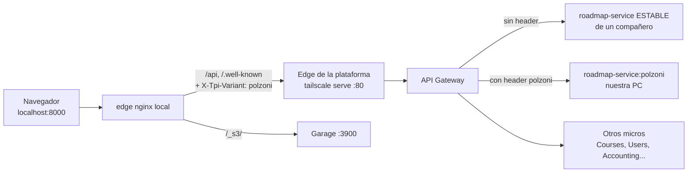

# Levantar el entorno: front + back (estable o de prueba)

> [!info] Resumen en una línea
> No corremos la plataforma completa en la PC. Nos conectamos por **Tailscale** a la plataforma compartida (`tpi-plataforma.tail767776.ts.net`). El **back estable** ya está ahí; el **back de prueba** es una *variante* de nuestro micro (`roadmap-service`) que se registra en la misma malla y a la que solo llegan los pedidos que llevan nuestro nombre. El **front** corre local (nginx de borde + sidecar de Tailscale) y le pega a la API compartida.

Runbook paso a paso de la variante del roadmap: [[microservicios/11-levantar-variante-roadmap]]. Contexto del micro: [[microservicios/10-roadmap-service]].

## Cómo funciona (modelo mental)



- **Front local** = 3 contenedores: `mesh` (sidecar Tailscale, nodo `group-10-frontend-polzoni-2`), `webapp` (build o dev server) y `edge` (nginx). Solo sale a TCP 80 y 3900 de la plataforma; publica el puerto **solo en loopback** (`127.0.0.1:8000`).
- **Back** = el micro + su sidecar Tailscale + su base Postgres propia + (por defecto) su Kafka propio. Entra a la malla con una clave `tag:microservicio` y se registra en Eureka.
- **Variante** = el gateway elige instancia por el header `X-Tpi-Variant` (o cookie). El front local lo inyecta en todo `/api/` cuando se activa con `front-variant.sh on`. Sin header → instancia estable.
- Identidad: el login lo resuelve users-service; el gateway propaga la identidad. El micro no valida JWT, solo `GatewayIdentityFilter`.

## Back estable vs. back de prueba

| | Estable | De prueba (variante) |
|---|---|---|
| Quién la corre | **Un compañero** (no esta PC) | Esta PC |
| `APP_VARIANT` | vacío | `polzoni` (rama de trabajo, `Backend/tpi-roadmap`) o `polzoni-develop` (contingencia, worktree `Backend/tpi-roadmap-stable` en `origin/develop`) |
| Qué hacemos nosotros | Nada: usamos la plataforma tal cual (front sin variante) | `up.sh mesh` + `front-variant.sh on` |
| Datos / Kafka | Reales | Base propia **vacía**; Kafka aislado (sin eventos reales) salvo `KAFKA_MODE=routed` |

> [!danger] NUNCA levantar el roadmap estable desde esta PC
> Con `APP_VARIANT` vacío pisamos la instancia del compañero (mismo id de Eureka `roadmap-service:8010` y mismo nodo en la tailnet). Antes de cualquier `up.sh mesh`, **verificar que `.tpi/platform/.env` tenga `APP_VARIANT`**. Esta PC es la secundaria.

**Usar el back estable desde el front** = levantar el front local *sin* overlay de variante (`front-variant.sh off`): todo va a la estable.
**Usar el back de prueba** = variante levantada + `front-variant.sh on --name polzoni`.

## Skills (en `~/.claude/skills/`)

| Skill | Cuándo |
|---|---|
| `own-variant-of-a-micro-beside-the-stable` | **La principal para el back de prueba.** Elige el nombre, instala la plantilla, pide Kafka, levanta, verifica y (opcional) apunta el front. |
| `local-front-through-tailscale-mesh` | Arma el front local (compose + nginx + sidecar), build o dev server con hot reload, y `/_s3/` para Garage. |
| `levantar-micro` | Levantar un micro **sin** variante (`APP_VARIANT` vacío). **No usar para roadmap** (ver aviso). |
| `integrate-micro-gateway` | Integrar un micro Spring MVC con el gateway; genera `tpi-integration.yml`. Roadmap ya lo tiene. |

Plantilla del equipo de plataforma: repo `2026-P4-BE/tpi-system-compose` (carpeta `team/`), docs `docs/variants.md` y `docs/mesh.md`. Se instala en `Backend/<micro>/.tpi/platform/` (`up.sh`, `verify.sh`, `front-variant.sh`).

## Claves y secretos

| Variable | Dónde va | Qué es / de dónde sale |
|---|---|---|
| `TS_AUTHKEY` (back) | `Backend/tpi-roadmap/.tpi/platform/.env` | Clave Tailscale reutilizable con tag `tag:microservicio` |
| `DB_PASSWORD` | ídem | Contraseña de la base del micro (la elige el equipo) |
| `APP_CLIENT_SECRET` | ídem | Secreto **propio** del roadmap para pedir service-token a otros micros. Sin él, el micro arranca pero las llamadas micro→micro dan 401. No reusar el de otro micro |
| `TS_AUTHKEY` (front) | `Frontend/local-edge/.env` | Clave **distinta**, efímera, tag `tag:frontend-edge` (solo TCP 80 y 3900 de la plataforma). No pedir `tag:microservicio` para el front |
| `S3_ACCESS_KEY` / `S3_SECRET_KEY` | `.env` del micro | Solo si el micro guarda archivos en Garage (las da quien administra Garage) |
| `NODE_AUTH_TOKEN` | `.env` del front | Solo para el dev server con hot reload: PAT `read:packages` para el UI kit privado. Sin token se instala desde el tarball de `Frontend/local-edge/build/ui-kit.tgz` |

Variables no secretas del `.env` del back: `SERVICE_ID=roadmap-service`, `SEGMENT=roadmap`, `PORT=8010`, `DATABASE=postgres`, `BUILD_CONTEXT=../..`, `APP_VARIANT=polzoni`, `KAFKA_MODE` (vacío = aislado; `routed` = Kafka real con grupo propio; `shared` solo si el micro soporta `APP_VARIANT_GROUP_SUFFIX`). Del front: `LOCAL_PORT=8000`, `TS_HOSTNAME=group-10-frontend-polzoni-2`, `WEBAPP_IMAGE=tpi-front-webapp:<commit>`.

- Las claves las dan **Rami Ibazeta** o **Santiago Moya** por canal privado.
- Van **solo** en esos `.env` (ignorados por git). Nunca en chat, log, commit ni en este vault.
- Convención de ubicación de la clave recibida: `~/.config/tpi-plataforma-unificada/front/`.

## Receta corta

Prerrequisito: **Docker Desktop corriendo** (lo arranca el usuario, no el asistente).

```bash
# 1. Back de prueba (desde Backend/tpi-roadmap, rama que se quiera probar checked out)
grep APP_VARIANT .tpi/platform/.env          # debe decir polzoni
.tpi/platform/up.sh mesh                     # el Dockerfile compila el jar; minutos la primera vez
.tpi/platform/verify.sh mesh                 # repetir tras ~1 min si Eureka no la vio

# 2. Front local (una vez) apuntado a la variante
FRONT=~/dev/TPI_2026/Frontend/local-edge
.tpi/platform/front-variant.sh "$FRONT" on --name polzoni

# 3. Chequeos
curl -s localhost:8000/healthz                                          # ok
curl -s -o /dev/null -w '%{http_code}\n' localhost:8000/.well-known/jwks.json   # 200
curl -s -o /dev/null -w '%{http_code}\n' localhost:8000/_s3/            # 403 = llega a Garage
curl -si localhost:8000/api/roadmap/public/ping | grep -i served-by     # roadmap-service:polzoni
```

Abrir siempre `http://localhost:8000` (nunca el `4200`: las URLs de storage reescritas son relativas al origen).

**Bajar todo**
```bash
.tpi/platform/front-variant.sh "$FRONT" off   # el front vuelve a la estable
.tpi/platform/up.sh mesh --down               # --volumes también borra los datos
docker image rm roadmap-service-polzoni-app
```

**Front: build vs. hot reload.** La imagen sale de un commit (`WEBAPP_IMAGE`), no del árbol de trabajo. Para ver cambios del front al instante: `docker compose -f docker-compose.yml -f docker-compose.dev.yml up -d` (overlay del dev server, ver skill `local-front-through-tailscale-mesh`). Reconstruir tras cambios de nginx: `docker compose up -d --force-recreate` (un `up -d` simple deja el nginx viejo).

## Reglas que no se rompen

- Nunca `ports:`, `networks:`, `dns:` ni `extra_hosts:` en el servicio del micro. Nunca publicar `:8082` ni puertos de la plataforma (JWKS pasa por el gateway).
- Nombres de la tailnet siempre con FQDN (`tpi-plataforma.tail767776.ts.net`).
- Dos personas con el mismo nombre de variante pisan la misma instancia del mismo micro: usamos `polzoni`; un micro de G10 que se sume al camino se levanta con el mismo `APP_VARIANT`.
- Con `KAFKA_MODE=routed`, tras bajar la variante borrar **solo** su grupo `.variant.<grupo>`; nunca el grupo de la estable.
- La plantilla puede quedar vieja (`verify.sh` avisa "template is behind main"): repetir el paso 1 de `levantar-micro` (conserva el `.env`).

## Síntomas frecuentes

| Síntoma | Causa / acción |
|---|---|
| `502` en el edge tras reconstruir | El edge quedó apuntando al contenedor viejo → `docker compose up -d --force-recreate` |
| `503` problem+json que nombra un micro | Ese micro está caído o sin registrar en Eureka; no es el front |
| `404 page not found` en `/api` con el front cargando | `Host` mal: las locations de API deben mandar el FQDN de la plataforma |
| `400` en `/api` | Dos headers `Host` (puesto en el include y en la location) |
| La página se recarga sola cada 30 s | nginx viejo: copiar `default.conf` y `proxy-common.inc` de la plantilla y recrear |
| El sidecar no llega a `Running` | `TS_AUTHKEY` vacía/truncada/con comillas → `docker compose logs mesh` |
| Verify FAIL de Eureka al inicio | Normal 30–60 s; repetir |
| Variante responde pero sin datos de cohortes | Base propia vacía: cargar seed (HT-21) o mirar contra Courses con cohorte real |
| Sin eventos del Motor/inscripciones | Kafka aislado: usar `KAFKA_MODE=routed` (sin garantía de efectos únicos) |
| `ERR_NAME_NOT_RESOLVED` hacia `...:3900` | Página abierta fuera de `localhost:8000` o nginx sin la ruta `/_s3/` |
| `400 challengeId: must not be blank` tras el 2FA | Desajuste camelCase/snake_case front↔users-service (ver `decisiones/`) |
