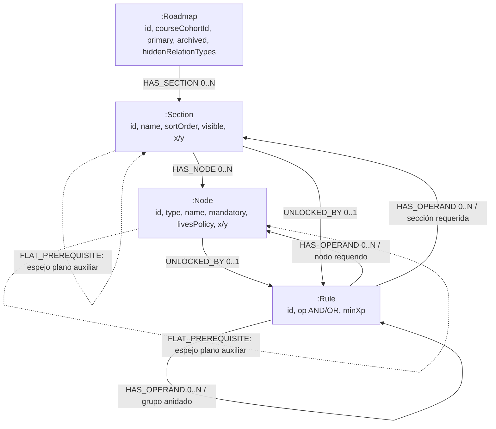

# Mapa del modelo de Neo4j — Roadmap / Cerebro

**Alcance:** modelo que implementa `roadmap-service`, no un inventario de datos de una instancia en ejecución. Este mapa contrasta el código y las decisiones documentadas; la base live no estuvo disponible para una auditoría de contenido.

## Resumen ejecutivo

Neo4j almacena una **proyección de lectura** de la estructura del roadmap: roadmaps, secciones, nodos, reglas de desbloqueo y relaciones tipadas. **Postgres es la fuente de verdad y el único destino de escritura** de esa estructura; el proyector copia el roadmap completo a Neo4j. El estado académico/de actividad del alumno permanece en Postgres.

La estructura general es adecuada para el dominio: `REQUIRES` se expresa como regla AND/OR (también con grupos anidados y XP mínimo), mientras que las cuatro relaciones informativas son aristas propias. La principal divergencia identificada para revisar es `UNIT`: el diseño T-16.4 propone convertirlo en una subsección, pero el enum y el mapper actuales conservan `UNIT` como `:Node`.

## Diagrama del grafo implementado



El diagrama representa tipos de relación y rangos del modelo; no implica que Neo4j imponga todas esas cardinalidades. En código, `GraphRoadmap` contiene una lista de secciones, `GraphSection` una lista de nodos/subsecciones y una regla raíz opcional; un `GraphNode` también puede tener una regla raíz opcional. La proyección actual agrega nodos a secciones y secciones al roadmap (`RoadmapGraphMapper`).

### Entidades, propiedades y semántica

| Etiqueta / elemento | Propiedades destacadas | Semántica y referencias |
|---|---|---|
| `:Roadmap` | `id`, `courseCohortId`, `primary`, `name`, `archived`, `deletedAt`, `hiddenRelationTypes` | Un roadmap por configuración; puede haber varios por cohorte y uno principal. El curso/cohorte no es un nodo `:Course`; se guarda su UUID. [`GraphRoadmap.java`](../../Backend/tpi-roadmap/src/main/java/com/utn/tpi/roadmap/graph/model/GraphRoadmap.java) |
| `:Section` | `id`, `name`, `sortOrder`, `courseSectionId`, `visible`, `x`, `y`, `deletedAt` | Sección/unidad; puede contener nodos y subsecciones, tiene posición, puede tener regla de desbloqueo. [`GraphSection.java`](../../Backend/tpi-roadmap/src/main/java/com/utn/tpi/roadmap/graph/model/GraphSection.java) |
| `:Node` | `id`, `type`, `name`, `description`, `iconKey`, `mandatory`, `livesPolicy`, `available`, `challengeId`, `contentId`, `x`, `y`, `deletedAt` | Contenido, desafíos, examen y límites `START`/`END`. El enum vigente también incluye `UNIT`. [`GraphNode.java`](../../Backend/tpi-roadmap/src/main/java/com/utn/tpi/roadmap/graph/model/GraphNode.java), [`NodeType.java`](../../Backend/tpi-roadmap/src/main/java/com/utn/tpi/roadmap/models/NodeType.java) |
| `:Rule` | `id`, `op` (`AND`/`OR`), `minXp`, `createdAt` | Grupo de la expresión de desbloqueo. Sus operandos pueden ser nodos, secciones o grupos anidados. [`GraphRule.java`](../../Backend/tpi-roadmap/src/main/java/com/utn/tpi/roadmap/graph/model/GraphRule.java) |
| Propiedades de arista | Según clase: `id`, `label`, `visible`, `createdAt`, `deletedAt`; operandos tienen `position` | `GraphEdge` comparte propiedades de las aristas que el profesor puede ver/eliminar. El orden de operandos determina el orden del árbol. [`GraphEdge.java`](../../Backend/tpi-roadmap/src/main/java/com/utn/tpi/roadmap/graph/model/GraphEdge.java) |

### Relaciones y cardinalidad del modelo

| Relación | Desde → hacia | Cantidad documentada / observada | Significado |
|---|---|---|---|
| `HAS_SECTION` | `Roadmap → Section` | Roadmap `0..N`; cada sección de primer nivel pertenece a un roadmap | Secciones principales del roadmap. |
| `HAS_SUBSECTION` | `Section → Section` | `0..N` hijas por sección; profundidad acordada/documentada de un nivel | Agrupación jerárquica. La restricción de profundidad es validación de aplicación. |
| `HAS_NODE` | `Section → Node` | `0..N` nodos por sección; el diseño T-16.4 contempla nodos de inicio/fin de roadmap colgados del roadmap | Ubicación estructural. **La entidad Java `GraphRoadmap` no declara una colección `HAS_NODE` y el mapper actual cuelga los nodos de sección**; por eso el caso roadmap→nodo queda como diferencia entre documento y código, no se debe presumir en la instancia. |
| `UNLOCKED_BY` | `Node/Section → Rule` | `0..1` regla raíz por elemento | Regla ausente significa sin prerequisito configurado. |
| `HAS_OPERAND` | `Rule → Node/Section/Rule` | `0..N` operandos | Hojas apuntan a elementos requeridos; los grupos permiten expresiones como `A AND (B OR C)`. `minXp` se guarda en el grupo. |
| `RECOMMENDS` | `Node → Node`, `Section → Section` | `0..N` | Sugerencia; no bloquea. |
| `BELONGS_TO` | `Node → Node`, `Section → Section` | `0..N` | Relación informativa de pertenencia. |
| `RELATED_TO` | `Node → Node`, `Section → Section` | `0..N` | Relación informativa; puede formar ciclos. |
| `PART_OF` | `Node → Node`, `Section → Section` | `0..N` | Relación informativa de parte/todo. |
| `FLAT_PREREQUISITE` | `Node → Node`, `Section → Section` | `0..N` auxiliar | Copia plana de prerequisitos relacionales anteriores, utilizada para lectura/edición de compatibilidad. No sustituye a la regla efectiva ni es otro tipo del catálogo. |

Las cuatro relaciones informativas llevan `id` UUID propio, `label` opcional (null usa el nombre por defecto), `visible`, `createdAt` y `deletedAt`. `REQUIRES` no es una arista Neo4j propia: cada hoja de `HAS_OPERAND` se representa visualmente como una arista “requiere”. Las reglas/operandos lógicos del árbol y el espejo plano `FLAT_PREREQUISITE` coexisten en el modelo Java; no deben contarse como requisitos independientes sin revisar `storedRule`/regla efectiva.

**Catálogo de `Node.type` actual:** `UNIT`, `CONTENT`, `THEORETICAL_CHALLENGE`, `PRACTICAL_CHALLENGE`, `EXAM`, `START`, `END`. Según la implementación, desafíos de IA/recuperación se distinguen con `livesPolicy` (`LLM`/`RECOVERY`), no con un tipo de nodo nuevo. Fuente: `models/NodeType.java`, `graph/model/GraphNode.java` y decisión [DEC-018](../decisiones/DEC-018-catalogo-de-relaciones-y-tipos-de-nodo.md).

## Qué va en cada base y cómo se sincroniza

| Almacén | Contenido | Función |
|---|---|---|
| **Postgres** | `roadmap`, `section`, `node`, reglas/prerrequisitos, relaciones tipadas y posiciones; además progreso, lecturas, XP, vidas, insignias y demás estado transaccional del alumno | Fuente de verdad y única base de escritura para la estructura. Cambios se marcan en `graph_sync_pending`. |
| **Neo4j** | Proyección de la estructura completa del roadmap, sus reglas y relaciones tipadas | Lectura/recorridos/representación de grafo. Se reconstruye desde Postgres; no se edita directamente. |

DEC-021 define que el proyector toma una foto completa de Postgres, escribe idempotentemente con UUID compartidos, proyecta tras commit y reintenta marcas pendientes; la reconciliación vuelve a marcar divergencias. El flag `GRAPH_READ_ENABLED` está apagado por defecto y exige sync habilitado más una reconstrucción previa. Fuentes: [`DEC-021`](../decisiones/DEC-021-postgres-fuente-de-verdad-neo4j-proyeccion.md), `graph/sync/RoadmapGraphMapper.java`, `RoadmapProjector.java`, `GraphReconciliation.java`, `db/migration/V50__graph_sync_pending.sql` y `src/main/resources/application.properties`.

## Esquema e integridad declarada

Las migraciones Neo4j vigentes son:

- `Backend/tpi-roadmap/src/main/resources/neo4j/migrations/V0001__Unique_ids_and_lookup_indexes.cypher`: unicidad de `id` por etiqueta `Roadmap`, `Section`, `Node`, `Rule`; índices en `Roadmap.courseCohortId`, `Section.courseSectionId` y `Node.type`.
- `Backend/tpi-roadmap/src/main/resources/neo4j/migrations/V0002__Unique_relationship_ids.cypher`: unicidad de `id` para relaciones `HAS_OPERAND`, `RECOMMENDS`, `BELONGS_TO`, `RELATED_TO`, `PART_OF`.

No se declaran constraints para la cardinalidad de ownership, la existencia de propiedades obligatorias, el tipo de propiedades, la profundidad máxima de subsecciones ni ausencia de ciclos en `REQUIRES`; son reglas que deben validar aplicación/proyector. No inferir constraints extras a partir de este documento: confirmarlas con `SHOW CONSTRAINTS` en la instancia autorizada.

## Hallazgos y brechas priorizadas

| Prioridad | Hallazgo | Evidencia / impacto | Recomendación |
|---|---|---|---|
| **P1 — verificar antes de migrar/usar en producción** | `UNIT` se conserva como `NodeType` y como `:Node`; el diseño T-16.4 propone que `UNIT` se convierta en `:Section`/`HAS_SUBSECTION`. | `RoadmapGraphMapper.node()` asigna `source.getType()` y añade cada nodo al contenedor `GraphSection`; `NodeType.java` sigue incluyendo `UNIT`. Una copia/proyección literal no ejecuta esa transformación. | Confirmar si se descartó la conversión o si falta migración explícita. Si unidad significa subsección, definir conversión y reglas de UUID/relaciones antes de aceptar datos. |
| **P1 — verificar antes de habilitar lectura Neo4j** | El diseño habla de nodos de inicio/fin de roadmap directamente bajo el roadmap, pero el código actual solo expone `HAS_SECTION` en `GraphRoadmap` y el mapper agrega cada nodo a una sección. | Contraste entre tabla de relaciones de `docs/T-16-4-MODELO-GRAFO.md` y `GraphRoadmap.java`/`RoadmapGraphMapper.java`. Podría dejar el caso de inicio/fin de roadmap sin representación directa. | Acordar si `START`/`END` son por sección (unidad) únicamente o también por roadmap; alinear documentación, DTO, mapper y consultas. |
| **P2 — validación en aplicación** | Las constraints protegen unicidad de IDs, no cardinalidad ni consistencia entre roadmaps. | El modelo documenta límites de ownership, mismo roadmap/nivel y no-self-relations; Community no los fuerza mediante las constraints actuales. | Ejecutar queries de huérfanos y validar ownership/nivel/ciclos durante proyección/reconciliación. |
| **P2 — claridad de interpretación** | Coexisten `UNLOCKED_BY/HAS_OPERAND` (regla efectiva) y `FLAT_PREREQUISITE` + `requirementIds` (representación plana auxiliar). | Campos en `GraphNode` y `GraphSection`; el gate sigue leyendo Postgres según DEC-021. Contar ambas como prerequisitos produce doble conteo visual/analítico. | Mantener el asterisco de auxiliar en documentación y usar `storedRule`/regla efectiva en consumidores. Revisar divergencias entre árbol y forma plana. |
| **P3 — confirmar en instancia** | No hay evidencia local sobre constraints aplicadas, inventario de nodos/aristas, estado del proyector o diferencias Postgres–Neo4j. | La única instancia visible durante el relevamiento tenía etiquetas Docker de Testcontainers y Ryuk, sin servicio local `roadmap` de producto. No se consultó. | Ejecutar las consultas read-only de abajo en la instancia explícitamente autorizada y comparar IDs/conteos por roadmap con Postgres. |
| **P3 — despliegue** | La configuración local habilita migraciones/healthcheck de Neo4j en Compose; el feature de lectura/sync mantiene defaults apagados. | `docker/docker-compose.yml`, `.env.example`, `application.properties`; la nota de responsables deja pendiente Neo4j en plataforma/demo (T-16.2). | Confirmar configuración/secretos por entorno sin copiar credenciales al informe. No habilitar lectura hasta rebuild y reconciliación. |

## Verificación de la base live

**Estado: no verificada.** No hubo conexión autorizada a una base Neo4j de desarrollo/producción, y no se ejecutaron consultas contra el contenedor local. El contenedor que apareció en Docker (`neo4j:5.26-community`) tenía metadata `org.testcontainers=true` y sesión Testcontainers; es efímero de pruebas y **no se considera la base del sistema**. Por ello, el diagrama anterior describe el **modelo del código/documentación**, no certifica el contenido real de Neo4j ni la sincronización de una instancia.

## Consultas Cypher read-only para una instancia autorizada

Ejecutar con una cuenta de lectura y en la base correcta. Son consultas de lectura; no incluyen `CREATE`, `MERGE`, `SET`, `DELETE` ni `DROP`. En Neo4j Browser/Bolt puede correrse cada bloque por separado.

### Versión, constraints e índices

`SHOW CONSTRAINTS` y `SHOW INDEXES` son comandos de administración de Cypher 5. En versiones que no reconozcan `SHOW INDEXES`, probar `CALL db.indexes()`; en versiones anteriores `CALL db.constraints()` puede sustituir `SHOW CONSTRAINTS`. Consultar la documentación que corresponda exactamente a la versión desplegada.

```cypher
SHOW CONSTRAINTS;
```

```cypher
SHOW INDEXES;
```

Comprobar que hay unicidad para IDs de las cuatro etiquetas y para IDs de las cinco relaciones versionadas; no marcar como error constraints de sistema/migraciones que también aparezcan.

### Conteo de nodos por etiqueta

```cypher
MATCH (n)
UNWIND labels(n) AS label
RETURN label, count(*) AS nodos
ORDER BY label;
```

### Conteo de relaciones por tipo

```cypher
MATCH ()-[r]->()
RETURN type(r) AS relacion, count(*) AS cantidad
ORDER BY relacion;
```

### Inventario de los tipos esperados

Incluye ceros cuando no haya datos de ese tipo:

```cypher
CALL {
  MATCH (n:Roadmap) RETURN 'Roadmap' AS etiqueta, count(n) AS cantidad
  UNION ALL
  MATCH (n:Section) RETURN 'Section' AS etiqueta, count(n) AS cantidad
  UNION ALL
  MATCH (n:Node) RETURN 'Node' AS etiqueta, count(n) AS cantidad
  UNION ALL
  MATCH (n:Rule) RETURN 'Rule' AS etiqueta, count(n) AS cantidad
}
RETURN etiqueta, cantidad
ORDER BY etiqueta;
```

```cypher
CALL {
  MATCH ()-[r:HAS_SECTION]->() RETURN 'HAS_SECTION' AS tipo, count(r) AS cantidad
  UNION ALL MATCH ()-[r:HAS_SUBSECTION]->() RETURN 'HAS_SUBSECTION' AS tipo, count(r) AS cantidad
  UNION ALL MATCH ()-[r:HAS_NODE]->() RETURN 'HAS_NODE' AS tipo, count(r) AS cantidad
  UNION ALL MATCH ()-[r:UNLOCKED_BY]->() RETURN 'UNLOCKED_BY' AS tipo, count(r) AS cantidad
  UNION ALL MATCH ()-[r:HAS_OPERAND]->() RETURN 'HAS_OPERAND' AS tipo, count(r) AS cantidad
  UNION ALL MATCH ()-[r:FLAT_PREREQUISITE]->() RETURN 'FLAT_PREREQUISITE' AS tipo, count(r) AS cantidad
  UNION ALL MATCH ()-[r:RECOMMENDS]->() RETURN 'RECOMMENDS' AS tipo, count(r) AS cantidad
  UNION ALL MATCH ()-[r:BELONGS_TO]->() RETURN 'BELONGS_TO' AS tipo, count(r) AS cantidad
  UNION ALL MATCH ()-[r:RELATED_TO]->() RETURN 'RELATED_TO' AS tipo, count(r) AS cantidad
  UNION ALL MATCH ()-[r:PART_OF]->() RETURN 'PART_OF' AS tipo, count(r) AS cantidad
}
RETURN tipo, cantidad
ORDER BY tipo;
```

### Cardinalidades/huérfanos estructurales

La consulta considera ownership conforme al **mapper actual** (Section dentro de Roadmap; Node dentro de Section). Revisar manualmente resultados con `deletedAt` antes de tratarlos como errores: las bajas lógicas deberían conservar el grafo/relaciones hasta que el proyector aplique su estrategia. No se incluyen `:Rule` de `__Neo4jMigration`.

```cypher
// Secciones sin dueño estructural: no llegan desde Roadmap ni como subsección.
MATCH (s:Section)
WHERE NOT ( (:Roadmap)-[:HAS_SECTION]->(s) )
  AND NOT ( (:Section)-[:HAS_SUBSECTION]->(s) )
RETURN s.id AS sectionId, s.name AS name, s.deletedAt AS deletedAt
ORDER BY sectionId;
```

```cypher
// Nodos que no cuelgan de una sección (posible discrepancia con el mapper actual).
MATCH (n:Node)
WHERE NOT ( (:Section)-[:HAS_NODE]->(n) )
RETURN n.id AS nodeId, n.type AS type, n.name AS name, n.deletedAt AS deletedAt
ORDER BY nodeId;
```

```cypher
// Reglas sin dueño directo ni como grupo anidado.
MATCH (rule:Rule)
WHERE NOT ( (:Node)-[:UNLOCKED_BY]->(rule) )
  AND NOT ( (:Section)-[:UNLOCKED_BY]->(rule) )
  AND NOT ( (:Rule)-[:HAS_OPERAND]->(rule) )
RETURN rule.id AS ruleId, rule.op AS op, rule.createdAt AS createdAt;
```

```cypher
// Aristas con extremos incompatibles con el modelo tipado. Devuelve solo casos anómalos.
MATCH (a)-[r]->(b)
WHERE (type(r) = 'HAS_SECTION' AND (NOT a:Roadmap OR NOT b:Section))
   OR (type(r) = 'HAS_SUBSECTION' AND (NOT a:Section OR NOT b:Section))
   OR (type(r) = 'HAS_NODE' AND (NOT a:Section OR NOT b:Node))
   OR (type(r) = 'UNLOCKED_BY' AND (NOT (a:Node OR a:Section) OR NOT b:Rule))
   OR (type(r) = 'HAS_OPERAND' AND (NOT a:Rule OR NOT (b:Node OR b:Section OR b:Rule)))
RETURN type(r) AS tipo, labels(a) AS origen, a.id AS origenId,
       labels(b) AS destino, b.id AS destinoId;
```

> Si la instancia precede a Neo4j 5 o tiene una versión de Cypher que no admita `CALL { ... UNION ALL ... }`, ejecutar cada `MATCH ... RETURN` de los bloques de inventario por separado. No sustituir una query no compatible por una de escritura.

### Comparar proyección con Postgres

Las queries Neo4j anteriores solo revelan la vista Neo4j. Para concluir que está alineada, ejecutar el reconciliador/contador de la aplicación o comparar por roadmap IDs y cantidades contra Postgres, sin editar Neo4j directamente. DEC-021 indica que cualquier corrección se origina en Postgres y se vuelve a proyectar.

## Referencias del relevamiento

- Modelo formal: `Backend/tpi-roadmap/docs/T-16-4-MODELO-GRAFO.md`.
- Esquema/migraciones: `Backend/tpi-roadmap/docs/T-18-1-MODULO-GRAPH.md`, `Backend/tpi-roadmap/src/main/resources/neo4j/migrations/`.
- Entidades: `Backend/tpi-roadmap/src/main/java/com/utn/tpi/roadmap/graph/model/`.
- Proyector y reconciliación: `Backend/tpi-roadmap/src/main/java/com/utn/tpi/roadmap/graph/sync/`.
- Decisiones del cerebro: `tpi-g10-cerebro/decisiones/DEC-016-neo4j-para-la-estructura-del-roadmap.md`, `DEC-018-catalogo-de-relaciones-y-tipos-de-nodo.md`, `DEC-021-postgres-fuente-de-verdad-neo4j-proyeccion.md`.
- Estado de tareas: `tpi-g10-cerebro/sprints/sprint-3/12-responsables.md`.
