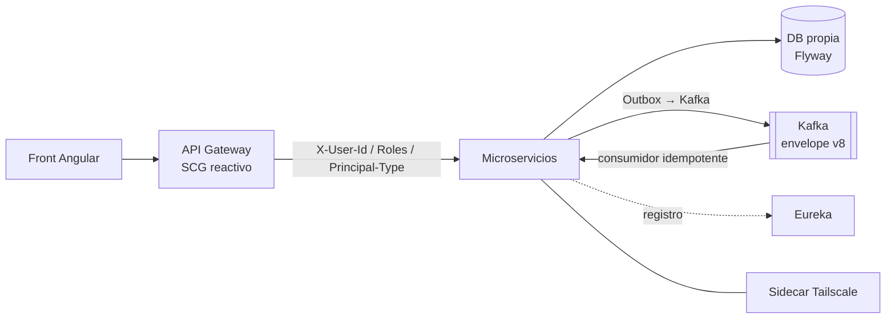

---
tags:
  - tpi
  - plataforma
  - arquitectura
  - patrones
fecha: 2026-10-19
estado: vigente
---

# Patrones de diseño y arquitectura — toda la plataforma

Comparación de los patrones que usa cada backend Java del org `2026-P4-BE`. Sirve para saber **a quién copiarle** cuando hay que implementar algo. El detalle de Roadmap está en [[arquitectura/patrones-de-diseno|patrones de roadmap-service]], y las fichas de cada micro en [[microservicios/README|microservicios/]].

> [!info] Cómo se armó
> Relevamiento del 2026-10-19 sobre `develop` de cada repo (clon superficial). Cuatro agentes Antigravity recorrieron unos 7.000 archivos Java. Se verificaron a mano: presencia de Resilience4j y de outbox por repo, la publicación de Courses, el formato de error de Backoffice, los nombres de clases de Notifications y el outbox de Sandbox. Lo demás sale de los reportes de los agentes, con ruta y línea. Si algo choca con el código, manda el código.

## 1. Arquitectura común (lo que todos comparten)

| Patrón arquitectónico | Dónde | Estado |
|---|---|---|
| Microservicios + **API Gateway** | `tpi-api-gateway` (Spring Cloud Gateway, WebFlux) | ✅ Todos |
| **Service Discovery** | Eureka | ✅ Todos |
| **Database per Service** + Flyway | Postgres (la mayoría), MySQL (`accounting`, `users`) | ✅ Todos |
| **Event-Driven** sobre Kafka | Envelope v8, topics por dominio | ✅ Todos |
| **Identidad propagada** (trusted subsystem) | Los micros no validan JWT: leen `X-User-*` del Gateway | ✅ Todos |
| **Sidecar** Tailscale | `.tpi/platform/docker-compose.mesh.yml` | ✅ Todos |
| **Externalized config** / Vault | `@ConfigurationProperties`, `/run/secrets/app.env` | ✅ Casi todos |
| **Feature toggles** | `@ConditionalOnProperty` | ✅ Casi todos |

## 2. Matriz por repo

| Repo | Estilo | Outbox | Inbox / idempotencia | Circuit breaker | Problem Details | Extra destacable |
|---|---|---|---|---|---|---|
| `tpi-roadmap` (G10) | Capas + puertos en `clients/` y `rules/` | ✅ (con detalle, ver nota de roadmap) | ✅ `UNIQUE(event_id)` en ledger | ❌ solo timeouts | ✅ | Composite + Interpreter de reglas |
| `tpi-accounting` | Capas + puertos (`services/*/ports`) | ✅ + lock `GET_LOCK` | ✅ `processed_events` | ❌ | ✅ | Ledger append-only `@Immutable` |
| `tpi-course` | Capas, contract-first (OpenAPI) | ❌ publica `AFTER_COMMIT` | 🟡 solo invitaciones | ❌ | ✅ | Interfaces generadas desde `swagger.yaml` |
| `tpi-users` | Package-by-feature (`auth`, `users`, `shared`) | ✅ con *leases* y purga | ✅ | ❌ | ✅ | Locks distribuidos en Redis con Lua |
| `tpi-api-gateway` | Pipeline de filtros reactivos | n/a | n/a | ✅ + bulkhead + rate limit | ✅ | Ruteo por variante (`X-Tpi-Variant`), caché L1+L2 de sesión |
| `tpi-backoffice` | Package-by-feature (`administration`, `reporting`) | ✅ | ✅ | ❌ | ❌ DTO propio `ErrorApi` | **CQRS**: read models de reporting alimentados por eventos |
| `tpi-engine-challenge` | Vertical slices + shared kernel | ✅ | ✅ | ❌ | ✅ | **Saga coreografiada** con compensación ante rechazo de Accounting |
| `tpi-notifications` | Multi-módulo, vertical slices | ✅ | ✅ | ❌ | ✅ | Retry topics escalonados + DLT, STOMP/WebSocket |
| `tpi-theoristcal-challenge` | Capas | ✅ | ✅ | ✅ `CoursesCallGuard` | ✅ | **Strategy** de correctores (17 clases en `grading/impl`), `NoDeleteRepository` |
| `tpi-llm` | **Hexagonal** + DDD, multi-módulo con SPI de proveedores | ✅ | ✅ | ✅ breaker por credencial | ✅ | CQRS en RAG, modelo de dominio rico |
| `tpi-community` | Feature + capas + puertos (`StoragePort`) | ✅ | ✅ `AbstractConsumer` | ❌ | ✅ | Búsqueda full-text con `websearch_to_tsquery` |
| `tpi-practical-challenge` | Híbrido: capas (legado) + hexagonal (módulos nuevos) | ✅ | ✅ | ❌ | ✅ | **Claim check** con Sandbox |
| `tpi-sandbox` | **Hexagonal** estricto, multi-módulo | ✅ **sin tx durante el envío** | ✅ fingerprint SHA-256 | ❌ | ✅ | Ejecución aislada en contenedores efímeros |
| `tpi-market` | Capas + DDD táctico | ✅ | ✅ | ✅ solo hacia Courses | ✅ | **Saga orquestada** de compra con compensación, entidades ricas |

## 3. Patrones GoF más usados en la plataforma

- **Lo da Spring (todos):** Singleton (beans), Proxy (`@Transactional`, `@PreAuthorize`, Spring Data), Template Method (`KafkaTemplate`, `JdbcTemplate`, `ResponseEntityExceptionHandler`), Observer (`@KafkaListener`, `@EventListener`), Chain of Responsibility (filtros servlet o WebFlux), Builder (Lombok, `RestClient.Builder`).
- **Escritos a mano, con buenos ejemplos:**
  - **Strategy:** correctores de `tpi-theoristcal-challenge`; adaptadores de proveedor en `tpi-llm` (SPI `AiProviderAdapter`).
  - **Composite + Interpreter:** árbol de reglas de `tpi-roadmap` (`rules/`).
  - **Adapter / ACL:** clientes HTTP de todos. Lo más prolijo está en `tpi-llm` (`ProviderFailureNormalizer`) y en `tpi-roadmap`.
  - **Decorator:** `BreakerWrappedClassifier` en `tpi-llm`; filtros del Gateway.
  - **Command:** las filas de outbox (todos los que lo tienen).
  - **State** (como máquina de estados en la entidad): `OrderEntity.transitionTo` en `tpi-market`, `CalibrationStateMachine` en `tpi-llm`.

## 4. Veredicto de plataforma

### ✅ Referencias para copiar

| Para… | Copiarle a… |
|---|---|
| Outbox que no retiene conexiones mientras envía | `tpi-sandbox` (`executions/adapter/OutboxRelay`, `TransactionTemplate`) |
| Outbox con varias réplicas | `tpi-users` (*leases* + purga con lock en Redis) y `tpi-accounting` (`OutboxRelayLock`) |
| Circuit breaker hacia otro micro | `tpi-theoristcal-challenge` (`CoursesCallGuard`) y `tpi-market` (`CourseCircuitBreaker`) |
| Circuit breaker por credencial o tenant | `tpi-llm` (`GatewayExecutor`, `breakerKey = provider:credentialId`) |
| Saga | `tpi-market` (orquestada) y `tpi-engine-challenge` (coreografiada) |
| Read models (CQRS) | `tpi-backoffice/reporting` |
| Repositorio sin borrado físico | `tpi-theoristcal-challenge` (`NoDeleteRepository`) |
| Árbol de reglas componible | `tpi-roadmap` (`rules/`) |

### 🟡 Problemas que se repiten

1. **Sin circuit breaker:** 10 de los 14 repos no lo tienen. Solo hay Resilience4j en `tpi-api-gateway`, `tpi-llm`, `tpi-market` y `tpi-theoristcal-challenge`. El Gateway protege la entrada, pero no las llamadas micro a micro.
2. **God classes silenciadas con `@SuppressWarnings("PMD.GodClass")`:**
   - Roadmap: `GraphService`, `RankingService`, `RoadmapEventListener`.
   - Course: `CourseCohortsApiController`.
   - Otros: `ReadModelProjectorImpl` (backoffice), `ChallengeLifecycle` (engine), `EvaluationService` (theoretical), `AuditHibernateListener` (users).
   - La supresión pasa el quality gate pero esconde el problema.
3. **Exception handlers gigantes:** `tpi-llm` `ApiExceptionHandler` (~920 líneas) y `tpi-market` `GlobalExceptionHandler` (~970). Se reducen con un único handler polimórfico por excepción base con código.
4. **`switch` por tipo repetido en varios lugares** (oportunidad de Strategy):
   - `tpi-community`: `ReportService` y `ContentHiddenStateService` por `ReportTargetType`.
   - `tpi-practical-challenge`: `TimelineSummaryDerivation` (22 casos).
   - `tpi-market`: `StorefrontCatalogServiceImpl` por `ItemType`.
   - `tpi-engine-challenge`: `ChallengeLifecycle` por `ChallengeType`.

### 🔴 Desvíos puntuales del estándar

- **`tpi-course` no tiene outbox.** `services/kafka/KafkaEventPublisher` publica en `@TransactionalEventListener(AFTER_COMMIT)`. Si Kafka falla después del commit, el evento se pierde. A Roadmap le importa porque consume los eventos de ciclo de vida de Courses.
- **`tpi-backoffice` devuelve un DTO propio `ErrorApi`** y no `ProblemDetail` (`application/problem+json`). Los clientes (Roadmap con PAR) tienen que tratar su error de forma distinta.
- **`tpi-notifications` tiene clases en snake_case** (`chat_unread_window`, `unread_window_service`…), contra la convención Java.

> [!warning] Hallazgo descartado
> Un agente reportó una carrera de concurrencia en `tpi-community` `VoteService.voteAnswer`. Al revisarlo, la respuesta sí se bloquea con `findByIdForUpdate` (`:147`), así que no se confirmó.
