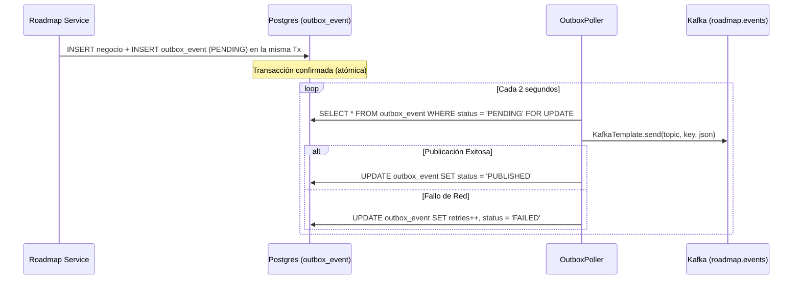

# Microservicio: Notifications & Event Bus (`tpi-notifications`)

> **Ficha Técnica Canónica y Estándar del Bus Kafka**  
> Tema: **Tema 02 — Notificaciones y Bus de Eventos de la Plataforma**  
> Equipo Responsable: **Grupo 02 (G02)**  
> Repositorio: `2026-P4-BE/tpi-notifications`  
> Estado: **Vigente (v2.0.0 / Contratos Kafka v8)**

---

## 1. Identidad y Componentes del Bus

| Parámetro | Valor |
|---|---|
| **Nombre de Aplicación (Eureka)** | `notifications-service` |
| **Prefijo en API Gateway** | `/api/notifications/**` |
| **Broker de Mensajería** | Apache Kafka KRaft (puerto interno `29092` / cluster plataforma) |
| **Modo de Serialización** | `StringSerializer` / `StringDeserializer` (Payloads en JSON plano UTF-8) |
| **Ack del Productor** | `acks=all` (garantía de durabilidad antes de confirmar commit) |
| **Gestión de Offset** | `enable.auto.commit=false` (confirmación manual tras procesamiento exitoso) |

---

## 2. Reglas del Bus y Gobernanza de Tópicos

### Prohibición de Creación Dinámica de Tópicos
- **Regla Estricta:** Ningún microservicio tiene permitido crear tópicos (`auto.create.topics.enable=false`).
- Los tópicos son aprovisionados centralmente por el equipo de plataforma con la convención:
  $$\text{<dominio>.events}$$
- El tipo de suceso se discrimina mediante el atributo `event_type` dentro del envelope.

### Matriz Oficial de Tópicos
| Tópico | Dirección respecto a Roadmap | Particionado (`Key`) | Eventos Principales |
|---|---|---|---|
| **`challenges.events`** | Consumo | `userId` | `CHALLENGE_COMPLETED`, `CHALLENGE_ABORTED` |
| **`accounting.events`** | Consumo | `studentId` | `LIFE_CREDITED`, `LIFE_DEBITED` |
| **`administration.events`** | Consumo | `param_key` | `GLOBAL_CONFIGURATION_CHANGED` |
| **`courses.events`** | Consumo | `courseId` | `STUDENT_ENROLLED`, `COURSE_ARCHIVED` |
| **`roadmap.events`** | Publicación (Outbox) | `studentId` | `NODE_COMPLETED`, `NODE_UNLOCKED`, `COURSE_LEVEL_UP`, `BADGE_AWARDED`, `PERFORMANCE_ZONE_CHANGED` |

---

## 3. Estándar de Eventos Kafka (Envelope Canónico)

Todo evento emitido al bus debe cumplir obligatoriamente con el sobre de **5 campos** en formato `snake_case`:

```json
{
  "event_id": "550e8400-e29b-41d4-a716-446655440000",
  "event_type": "EVENT_NAME_IN_PAST_TENSE",
  "timestamp": "2026-10-15T08:30:00.000Z",
  "producer": "roadmap-service",
  "payload": {
    "campo_especifico": "valor"
  }
}
```

### Reglas de los Campos:
1. `event_id`: UUID v4 generado por el emisor. Es la clave mandatoria de idempotencia en todos los consumidores.
2. `event_type`: Nombre en inglés, en mayúsculas, en tiempo pasado y separado por guiones bajos (`SNAKE_CASE`), ej. `CHALLENGE_COMPLETED`.
3. `timestamp`: Fecha y hora UTC del hecho en formato ISO 8601 con milisegundos (`YYYY-MM-DDTHH:mm:ss.sssZ`).
4. `producer`: Nombre del servicio emisor (en Roadmap: `tema-10-roadmap-service`).
5. `payload`: Objeto JSON con los atributos específicos del dominio.

---

## 4. Patrón Transactional Outbox (Eventos Salientes de Roadmap)

Para garantizar consistencia eventual sin recurrir a transacciones distribuidas (2PC), `roadmap-service` utiliza el patrón **Transactional Outbox**:



### Eventos Publicados por Roadmap en `roadmap.events`:
1. **`NODE_COMPLETED`:** Estudiante finalizó todos los requerimientos de un nodo.
2. **`NODE_UNLOCKED`:** Nuevo nodo disponible en el árbol tras cumplir prerrequisitos.
3. **`COURSE_LEVEL_UP`:** Estudiante alcanzó un nuevo nivel en base a la curva PAR-09.
4. **`BADGE_AWARDED`:** Estudiante recibió una insignia del sistema o del docente.
5. **`PERFORMANCE_ZONE_CHANGED`:** Estudiante ingresó o cambió de zona percentil (P90 / MIDDLE / P10).

---

## 5. Manejo de Errores, Reintentos y Dead Letter Topic (DLT)

- **Reintentos en Consumidores:** 3 intentos fijos espaciados por backoff de 2 segundos.
- **Derivación a DLT:** Si un mensaje presenta un error no recuperable (formato corrupto, validación de negocio insalvable tras 3 intentos), el listener lo deriva al Dead Letter Topic del dominio origen (ej. `<topic>.DLT`).
- **Idempotencia:** Ante reintentos de Kafka o reprocesamiento tras caída, los consumidores verifican `event_id`. Si ya fue procesado, se confirma el offset inmediatamente sin volver a ejecutar la mutación de estado.
