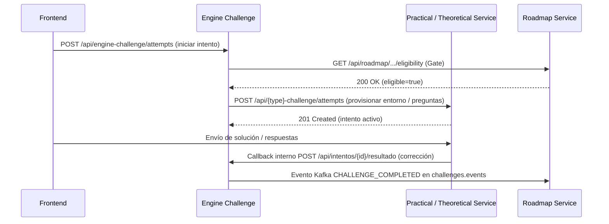

# Microservicios: Practical & Theoretical Challenges (`tpi-practical` / `tpi-theoretical`)

> **Ficha Técnica Canónica y Ejecutores de Desafíos**  
> Temas: **Tema 03 (Prácticos) y Tema 04 (Teóricos)**  
> Repositorios: `2026-P4-BE/tpi-practical-challenge` y `2026-P4-BE/tpi-theoretical-challenge`  
> Estado: **Vigente (v2.0.0)**

---

## 1. Identidad y Propósito

| Microservicio | Segmento Gateway | Puerto | Responsabilidad Principal |
|---|---|---|---|
| **`practical-challenge-service`** | `/api/practical-challenge/**` | `8092` | Ejecución de desafíos de código mediante contenedores Docker efímeros, compilación y test runners. |
| **`theoretical-challenge-service`** | `/api/theoretical-challenge/**` | `8094` | Cuestionarios teóricos, bancos de preguntas (multiple choice, verdadero/falso) y corrección diferida. |

---

## 2. Flujo de Ejecución y Orquestación con el Motor

Los servicios de desafíos prácticos y teóricos **no interactúan directamente con Roadmap**. Se integran aguas abajo del Motor de Desafíos (`engine-challenge-service`):

---

## 3. Integración con Roadmap: Catálogo y Pool de Desafíos

### 3.1 Vinculación de Desafíos a Nodos del Roadmap
- Cada nodo (`Node`) en el árbol de Roadmap de tipo `CHALLENGE` contiene una referencia a `challenge_id` y `challenge_type` (`PRACTICAL` o `THEORETICAL`).
- El docente configura esta relación en el diseñador de roadmap.

### 3.2 Pool de Desafíos sin Restricción de Autor (`ChallengePoolController`)
- Para facilitar la creación de roadmaps transversales, Roadmap cuenta con un endpoint de catálogo/pool de desafíos:  
  `GET /api/roadmap/courses/{courseId}/challenges/pool`
- Permite a los administradores y gestores (`ADMIN`, `MANAGER`) listar y seleccionar cualquier desafío del sistema para incorporarlo al mapa de aprendizaje, sin filtrar restrictivamente por autor.
