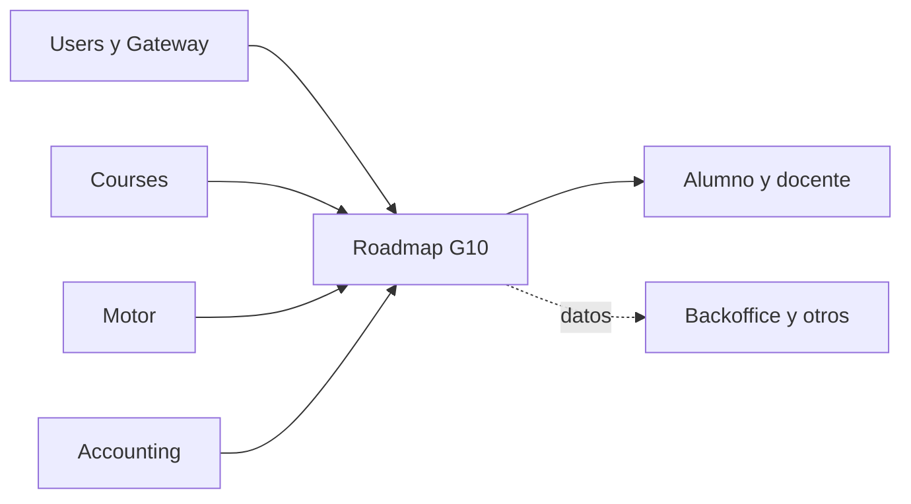

# 1. Dónde empieza nuestro trabajo

## Lo que decimos

«Hasta acá vimos cómo Users y Gateway trabajan con la identidad y los permisos; cómo Courses organiza la cursada, sus secciones, materiales y comisiones; cómo el Motor resuelve intentos y comunica resultados; y cómo Backoffice reúne capacidades de administración y salud. Ahí empieza nuestro trabajo. Nosotros somos Roadmap, el equipo G10, y tomamos esas piezas para convertirlas en un recorrido de aprendizaje que se puede organizar, recorrer y seguir.

Pensemos en la experiencia de una persona que cursa. Tener una lista de materiales y desafíos es importante, pero no alcanza para responder preguntas cotidianas: ¿por dónde empiezo?, ¿qué actividad sigue?, ¿qué tengo que resolver antes de llegar a esta práctica?, ¿cómo sé si avancé? Nuestro aporte es reunir estructura, condiciones y progreso en una experiencia coherente. Y para el docente, ofrecer una forma de organizar ese recorrido y observar qué pasa cuando sus estudiantes lo transitan.

Elegimos un alcance con fronteras claras. Courses sigue siendo el lugar donde vive la información académica de la cursada y de sus comisiones. El Motor sigue administrando y resolviendo los intentos de desafíos. Accounting administra información económica como las vidas. Users aporta identidad y perfiles. Nosotros coordinamos nuestro propio modelo con esas fuentes para representar el camino y el estado de cada estudiante. Esta separación permite que cada equipo profundice en su problema y que el producto conserve una experiencia integrada.

Cuando un docente configura una dependencia, esa decisión después se refleja en lo que el alumno encuentra al navegar. Cuando llega un resultado del Motor, Roadmap lo incorpora al progreso y puede mostrar su efecto en el mapa, la experiencia y los logros. Cuando el docente necesita una mirada de conjunto, nuestros datos pueden complementar las vistas de cohorte. Así conectamos tres momentos: diseñar, aprender y seguir el avance.

En esta presentación vamos a mirar primero cómo se arma el recorrido; después vamos a recorrerlo como alumno, que es donde se ve con más fuerza nuestra propuesta; y finalmente vamos a explicar cómo se transforma ese recorrido en información útil para el seguimiento. La pantalla es el punto de encuentro de capacidades que vienen de distintos equipos, y vamos a ir señalando qué aporta cada uno.

Esta presentación sigue justamente esa secuencia y los invita a mirar el producto tanto desde la experiencia de uso como desde las decisiones que la sostienen.

**Transición:** «Para entender cómo se arma esa experiencia, arranquemos por las piezas que usa el docente y por el primer roadmap de una cursada».»

## Qué se ve en pantalla
Abrimos una cohorte preparada en la aplicación compartida. Indicamos qué datos vienen de Courses y pasamos al mapa, sin navegar por otros productos.

## Preguntas probables

**¿Quién administra las comisiones?** Courses; Roadmap usa ese contexto para la audiencia y el seguimiento.

**¿Quién calcula el resultado de un desafío?** El Motor; Roadmap aplica el resultado informado.

**¿Qué valor agrega Roadmap?** Estructura, reglas de avance, experiencia visual y seguimiento del recorrido.

**¿Roadmap reemplaza a Courses?** No; se integra con su información académica.

**¿Backoffice consume todos los datos expuestos?** No se confirmó el consumo efectivo en el ambiente.
