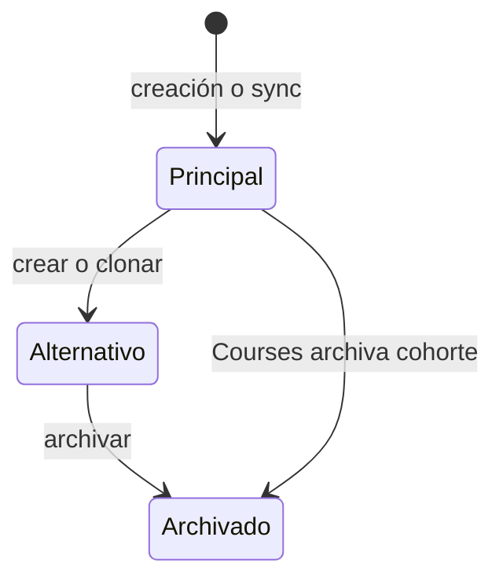

# 2. Del curso al primer recorrido

## Lo que decimos

«Antes de entrar al mapa, ubiquemos sus piezas. Trabajamos dentro de una organización y de una cohorte, es decir, una cursada concreta administrada por Courses. Esa cohorte puede tener comisiones y uno o varios roadmaps. Cada roadmap organiza secciones, subsecciones y nodos. En el lenguaje de la experiencia, una sección nos ayuda a dividir el recorrido; un nodo representa una actividad o un límite que el sistema utiliza para estructurarla.

Entre las actividades encontramos contenidos de lectura, desafíos teóricos, desafíos prácticos y exámenes. Los materiales académicos se administran desde Courses; los desafíos tienen su propio ciclo en los servicios correspondientes y el Motor resuelve los intentos. Roadmap vincula esas piezas con el lugar que ocupan en la cursada, su orden y las condiciones que necesita cumplir cada alumno para avanzar. Así evitamos pedirle al docente que mantenga dos cursos distintos para obtener una experiencia más rica.

Veamos el primer ingreso. El docente parte de una cohorte que ya tiene sus unidades en Courses. Al abrir la edición, la aplicación consulta el mapa y dispara la sincronización de secciones. Ese trabajo toma las secciones de origen, las vincula con el recorrido y refleja cambios como nombres, orden y estado. Si todavía no existe un roadmap y hay secciones activas, la sincronización puede crear el principal. Para el docente, el resultado es una base sobre la que puede comenzar a trabajar en lugar de tener que copiar la estructura a mano.

> [!info]- Detalle técnico: sincronización
> `POST /courses/{courseId}/sections/sync` encola un job y responde 202; la reconciliación crea o vincula, renombra, ordena y da baja o reactiva secciones. Ver `B/java/com/utn/tpi/roadmap/services/CourseSectionsReconciliationService.java` y `F/app/features/roadmap/embeds/course-status/roadmap-course-status.component.ts`.

Además está el asistente de configuración. En una cursada nueva ofrece preparar un recorrido compartido o borradores orientados a comisiones. El docente define los nombres y la audiencia y el asistente realiza la creación. Cuando hay más de un mapa, el listado permite reconocer cuál es el principal y cuáles son las alternativas, y administrar su nombre, asignación y estado. También se puede clonar una variante para partir de una estructura existente.

Esta capacidad sirve, por ejemplo, para organizar recorridos diferentes dentro de una misma cohorte sin perder el marco común de la cursada. La configuración de múltiples roadmaps habilita ese trabajo. El principal tiene una función especial en la resolución del recorrido, mientras que las variantes se pueden orientar a grupos determinados. El alumno accede según el contexto y las opciones que tenga disponibles; el docente puede elegir el mapa específico que está editando.

La gestión está pensada para personas autorizadas, como el docente responsable o personal habilitado. La interfaz contempla capacidades para mostrar las opciones de edición, y el servidor también verifica el contexto correspondiente. Cuando Courses comunica que la cohorte se archivó, Roadmap actualiza el estado de sus recorridos y la edición deja de ser la actividad normal de una cursada activa.

> [!info]- Detalle técnico: permisos y organización
> El front usa capacidades; el servidor aplica permisos, contexto de organización y, donde corresponde, propiedad del curso. Roles legacy y modo de autorización afectan el resultado. Ver `B/java/com/utn/tpi/roadmap/services/RoadmapAuthorizationService.java` y `F/app/core/guards/permission.guard.ts`.

Con estas entidades podemos hablar del mismo curso desde dos perspectivas: Courses organiza la cursada y Roadmap construye la experiencia de aprendizaje sobre ella. Ese punto de partida nos permite pasar de una colección de unidades a un camino explícito, con actividades y decisiones sobre cómo avanzar.

Esa estructura también nos prepara para incorporar nuevas actividades sin cambiar el sentido general del recorrido.

**Transición:** «Ahora que tenemos el recorrido creado, veamos cómo el docente conecta sus actividades y define las reglas del camino».»

## Qué se ve en pantalla
Mostrar la cohorte, sus unidades, el listado de mapas y el asistente sin guardar. Si se ensayó, usar una cohorte limpia separada para la primera sincronización.

## Preguntas probables

**¿Puede haber distintos recorridos por comisión?** Sí, con múltiples roadmaps habilitados y audiencia configurada.

**¿Qué pasa si Courses no tiene secciones activas?** La sync no crea el principal en ese caso; puede crearse explícitamente.

**¿Se pueden clonar mapas?** Sí; clonar crea una variante, no un historial de versiones.

**¿Quién puede editar?** Docente dueño o personal habilitado según contexto, permisos y configuración.

**¿Se publica el roadmap entero?** No se verificó un flujo global de publicación; recursos y desafíos tienen sus propios estados.

**¿Qué ocurre al archivarse la cohorte?** Roadmap recibe el evento y archiva sus mapas; el flujo integral depende de Courses.
