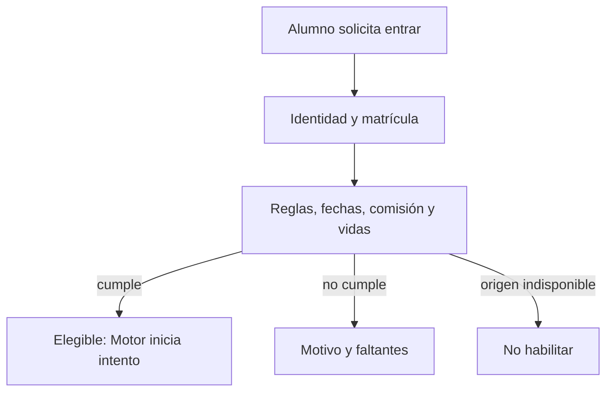

# 4. ¿Puede entrar? ¿Qué le falta?

## Lo que decimos

«Pongámonos en el lugar de un alumno que llega a una actividad. Ve que hay un desafío para resolver y quiere entrar. La pregunta ya no es solamente dónde está ubicado en el mapa, sino si reúne las condiciones necesarias para iniciarlo. Para responderla tenemos el gate, nuestra consulta de elegibilidad.

> [!info]- Detalle técnico: gate
> `GET /api/roadmap/courses/{courseId}/students/{studentId}/nodes/{nodeId}/eligibility` permite consulta técnica. `GateEvaluator` verifica condiciones y `origin_unavailable` bloquea ante una fuente necesaria no disponible. Ver `B/java/com/utn/tpi/roadmap/controllers/GateController.java` y `services/GateService.java`.

La consulta contempla la matrícula, el estado de la cursada, la comisión, las fechas, las reglas del recorrido y las condiciones de vidas que correspondan. El resultado sirve para darle al estudiante una respuesta consistente con la configuración docente. Si todavía le falta algo, podemos explicar ese motivo en vez de dejarlo frente a un candado sin contexto.

Volvamos al ejemplo anterior. Si la práctica requiere Variables y uno de los dos quizzes, podemos identificar cuáles son las partes que todavía faltan y comunicar las alternativas. Si además se necesita experiencia, esa condición también forma parte de la explicación. La misma estructura de reglas que define el avance permite construir una respuesta más útil para orientar al alumno.

> [!info]- Detalle técnico: faltantes
> `gapOf` evalúa la regla y devuelve operadores, IDs y XP faltantes, incluidos grupos anidados; omite hojas dadas de baja. Ver `B/java/com/utn/tpi/roadmap/services/PrerequisiteService.java` y `rules/RuleGap.java`.

Cuando el resultado permite continuar, el Motor se ocupa de abrir y gestionar el intento. Nuestra función es aportar la decisión de elegibilidad y el contexto del recorrido. La aplicación puede hacer una consulta previa para mejorar la experiencia, y el contrato entre servicios permite realizar la comprobación en el flujo del intento. Si una fuente necesaria no está disponible, el comportamiento prioriza mantener la condición de acceso.

También contemplamos el examen como tipo específico de nodo. Tiene sus parámetros propios, incluido un tiempo límite, y la respuesta de elegibilidad identifica ese tipo de actividad. Así mantenemos el examen integrado en el mismo recorrido que los contenidos y desafíos, respetando la responsabilidad del Motor sobre el intento.

> [!info]- Detalle técnico: examen y START
> El tipo `EXAM` requiere tiempo límite; el gate devuelve `is_exam` y el contrato indica que no reserva vidas. Un START técnico aprobado registra inicio idempotente y congela IA; PREVIEW no. Ver `B/java/com/utn/tpi/roadmap/services/GraphService.java` y `controllers/GateController.java`.

Esta combinación une dos necesidades: que la regla del docente se cumpla y que el alumno entienda qué debe hacer para avanzar. Ahora vamos a ver cómo esa información cobra una forma mucho más visual.

Este chequeo acompaña al alumno antes del desafío y también ayuda a que los distintos componentes compartan una misma interpretación de las condiciones. Si el estudiante necesita volver a un contenido anterior, el motivo le indica qué parte del recorrido revisar. Así, la restricción se convierte en una guía concreta para continuar aprendiendo.

**Transición:** «Dejemos por un momento el editor y recorramos juntos el mundo que ve el estudiante».»

## Qué se ve en pantalla
Con el alumno preparado, mostrar un desafío disponible y otro con requisito pendiente; abrir el mensaje. No iniciar un examen real sin ensayo.

## Preguntas probables

**¿El gate crea el intento?** No; lo crea el Motor, aunque START técnico aprobado registra inicio del nodo.

**¿Qué pasa si falla una fuente necesaria?** El gate bloquea con `origin_unavailable`.

**¿Se pueden explicar requisitos alternativos?** Sí, los faltantes conservan la estructura de grupos de la regla.

**¿La niebla es una medida de seguridad?** No; la decisión autoritativa está en el servidor.

**¿El examen ya está integrado con la agenda real?** Hay tipo y elegibilidad, pero la agenda integrada no se verificó.
