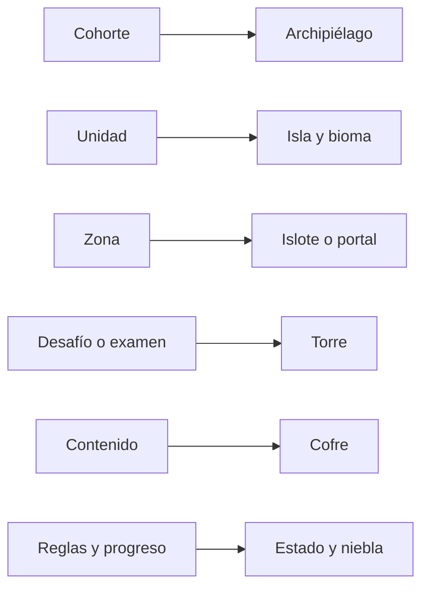

# 5. Nuestro fuerte: el recorrido se vuelve mundo

## Lo que decimos

«Este es el corazón de nuestra propuesta. Todo lo que acabamos de configurar como estructura y reglas aparece ahora como un mundo que el alumno puede explorar. La cursada se transforma en un archipiélago y cada unidad se convierte en una isla. El estudiante no recibe solamente una lista: ve un territorio con lugares para visitar, caminos para recorrer y actividades que descubrir.

La experiencia se dibuja en tiempo real. Podemos movernos, cambiar el punto de vista y elegir hacia dónde ir. Cada isla puede tener su propio bioma, con una identidad visual que ayuda a distinguir las unidades. El mar conecta el conjunto, y el barco es el medio con el que navegamos entre las islas. Esta metáfora sostiene el recorrido de la cursada: hay un mundo común, diferentes unidades y una progresión que el alumno puede reconocer mientras aprende.

> [!info]- Detalle técnico: renderizado 3D y biomas
> Angular coordina páginas y datos; Three.js usa WebGL para escena, cámara, luces y efectos, actualizados con `requestAnimationFrame`. Los biomas participan en terreno y elementos del mundo. Ver `F/app/features/roadmap/engine/archipelago-3d.service.ts`, `world-3d.service.ts` y `domain/world-gen/world-gen.ts`.

La disposición de las islas parte del orden de las unidades. Para que el archipiélago sea navegable, el motor usa plantillas y después ajusta las posiciones para separar las islas y conservar espacio entre ellas. Si hay muchas unidades, se organiza la navegación marítima en páginas de hasta cinco unidades principales, acompañadas por sus zonas. Algunas zonas aparecen como islotes próximos; otras se conectan a través de portales que forman parte de la presentación de ese mundo.

> [!info]- Detalle técnico: layout del archipiélago y portales
> Se seleccionan plantillas según cantidad de islas; 16 pasadas separan pares dentro de límites de coordenadas, y los islotes se colocan cerca de su unidad. Los portales se representan con variantes de estado. Ver `F/app/features/roadmap/engine/archipelago-3d.service.ts` y `domain/archipelago-navigation.ts`.

Fijémonos en el barco. Podemos conducirlo con las flechas o con las teclas de movimiento y también indicar un destino con el mouse. Al seleccionar una isla, el sistema puede guiar la navegación hacia un punto de costa. La cámara sigue suavemente al barco, y la proximidad ayuda a reconocer qué isla tenemos seleccionada. Cuando llegamos, entramos a la unidad para pasar de la vista general del curso al recorrido de sus actividades.

El atraque nos da continuidad: al volver al archipiélago se recuerda la última isla en la que estuvimos durante la sesión. Eso evita que cada ida y vuelta se sienta como empezar desde el principio. Es un detalle pequeño, pero importante para que la navegación acompañe al aprendizaje en vez de interrumpirlo.

> [!info]- Detalle técnico: navegación y atraque
> El motor calcula navegación automática y selección por proximidad. El último atraque se guarda por curso en memoria y `sessionStorage`; al volver usa esa isla si existe. Ver `F/app/features/roadmap/engine/archipelago-3d.service.ts` y `data-access/session/archipelago-dock.service.ts`.

La apariencia también comunica estado. Una unidad disponible se presenta para que podamos visitarla; una bloqueada se atenúa y muestra un candado. La niebla destaca zonas o actividades que todavía están condicionadas por el avance. Los portales también tienen variantes abierta, bloqueada y completada. Cuando se produce un desbloqueo, la experiencia puede celebrarlo con un cartel, un aro y movimiento de cámara. Y si el usuario tiene configurado movimiento reducido, se evita el viaje de cámara.

> [!info]- Detalle técnico: estados, niebla y celebración
> La página entrega al motor los estados derivados de progreso. `fog-spots.ts` determina focos por contenido o torre bloqueada; el motor aplica señales visuales y respeta movimiento reducido. El backend conserva autoridad de acceso. Ver `F/app/features/roadmap/domain/world-gen/fog-spots.ts` y `engine/archipelago-3d.service.ts`.

Entremos ahora a una isla. Los desafíos teóricos, prácticos y los exámenes se representan como torres. Los contenidos aparecen como cofres o anexos. El alumno camina con su personaje y encuentra esas actividades integradas en el terreno. La intención es que cada objeto tenga una lectura inmediata: una torre invita a afrontar un desafío; un cofre acerca un recurso para estudiar. Los estados de bloqueo y progreso se reflejan en la escena para que el estudiante pueda orientarse.

> [!info]- Detalle técnico: dominio a objetos del mundo
> `from-nodes.ts` transforma desafíos y examen en torres y contenidos en anexos; excluye límites técnicos de inicio y fin. Agrupa cada cofre con la torre alcanzable más próxima, o usa el orden como alternativa. Cada cofre conserva su propia regla. Ver `F/app/features/roadmap/domain/world-gen/from-nodes.ts`.

El terreno interior se construye sobre una grilla de hexágonos. A partir de las actividades, su orden y sus conexiones se generan caminos y se distribuyen elementos del bioma. Para mantener una secuencia coherente, se consideran los prerrequisitos internos al ordenar las actividades. Una semilla basada en el curso y la unidad permite reproducir la generación para el mismo contexto. El resultado es un paisaje que surge de la estructura del recorrido y le da una forma explorable.

> [!info]- Detalle técnico: terreno y orden topológico
> El generador usa grilla hexagonal, piezas de camino y semilla derivada de curso/unidad. El orden topológico estable respeta dependencias internas; sin aristas o ante ciclo conserva el orden de la sección. Ver `F/app/features/roadmap/domain/world-gen/world-gen.ts`, `from-nodes.ts` y `auto-tiler.ts`.

Podemos recorrerlo con distintos puntos de vista. La cámara libre permite orbitar y acercarnos o alejarnos para entender la isla; también tenemos tercera y primera persona para vivir el recorrido desde el personaje. Esa flexibilidad nos deja pasar de una mirada general del camino a la interacción con una torre o un cofre.

Cuando entramos a un desafío, el alumno continúa en el flujo del Motor. Al regresar, recuperamos su posición, orientación y la orientación horizontal de la cámara para que siga desde el lugar donde estaba. Y cuando abrimos un material desde un cofre, la interfaz se superpone al mundo: podemos leer y después cerrar el recurso para continuar explorando.

> [!info]- Detalle técnico: cámaras y retorno
> `camera-controller.ts` implementa modos libre, tercera y primera persona. `return-position.ts` guarda posición, orientación y giro horizontal por curso/unidad en `sessionStorage`; al regresar los consume una vez. Ver `F/app/features/roadmap/engine/camera-controller.ts` y `data-access/roadmap/return-position.ts`.

Para construir esta experiencia usamos assets 3D: modelos y texturas que representan objetos del mundo, como caminos o el barco. Estos archivos viven con el front y se cargan cuando se necesitan. El sistema reutiliza modelos ya cargados y solicitudes en curso, agrupa geometría estática y limita la resolución de renderizado, entre otras medidas orientadas a administrar recursos. Si el modelo del barco falla, hay una alternativa generada por el motor para mantener su representación.

> [!info]- Detalle técnico: assets y optimizaciones
> GLB y glTF se sirven desde `F/assets/roadmap/`; `AssetCacheService` usa `GLTFLoader`, comparte cargas y clona escenas. Hay batching de geometría estática, pixel ratio máximo 2 y liberación de recursos al destruir. El barco tiene fallback procedural. Ver `F/app/features/roadmap/engine/asset-cache.service.ts`, `static-mesh-batching.ts` y `archipelago-3d.service.ts`.

Finalmente, esta experiencia también ayuda al docente. Puede abrir una previsualización para recorrer las unidades, inspeccionar el aspecto de las actividades y revisar materiales o desafíos desde la perspectiva del mundo. Así conecta lo que configuró en el editor con la forma en que el estudiante lo encontrará.

> [!info]- Detalle técnico: vista docente
> El modo de previsualización de `HexWorldPageComponent` muestra nodos disponibles y permite inspeccionar detalles sin aplicar el bloqueo de la experiencia de alumno. Ver `F/app/features/roadmap/pages/hex-world-page/hex-world-page.component.ts`.

En la vista de conjunto podemos reconocer qué unidad conviene visitar y después entrar para concentrarnos en sus actividades. Ese cambio de escala es deliberado: el archipiélago orienta sobre la cursada completa y la isla invita a trabajar sobre una unidad concreta. Las torres, cofres, caminos y portales mantienen una identidad común, mientras que los biomas dan variedad a los distintos espacios. Al regresar de una actividad, el alumno retoma su lugar y puede seguir explorando sin perder el hilo del recorrido que había comenzado.

**Transición:** «Ya vimos cómo el mundo vuelve visible el recorrido; abramos ahora uno de esos cofres para mirar el contenido académico».»

## Qué se ve en pantalla
1. Mostrar archipiélago abierto y bloqueado; navegar con barco y seleccionar isla.
2. Entrar, mostrar torre y cofre, girar cámara y explicar niebla.
3. Abrir un intento preparado, regresar y señalar ubicación restaurada. Si falla la integración, recorrer sin afirmar que el intento se completó.
4. Si hay datos, mostrar portal de zona y contrastar con la previsualización docente.

## Preguntas probables

**¿El mapa visual muestra cada dependencia exactamente?** No necesariamente; el camino organiza la experiencia y las reglas autoritativas están en el servidor.

**¿La niebla impide acceder por sí sola?** No; es una señal visual y el gate controla elegibilidad.

**¿La posición se mantiene entre dispositivos?** El retorno y atraque descritos usan almacenamiento de sesión local.

**¿Cómo se representa una actividad terminada?** El progreso alimenta estados de la escena; portales contemplan variante completada y el detalle depende del objeto.

**¿Qué ocurre sin WebGL?** El archipiélago informa la limitación; no se acredita compatibilidad universal.

**¿Hay cifras de rendimiento?** Hay optimizaciones en código, pero no se midieron FPS en esta revisión.

**¿El docente queda bloqueado como alumno?** Su previsualización permite inspeccionar el mundo sin aplicar ese bloqueo de juego.

**¿Un portal habilita acceso por sí mismo?** No; las reglas de negocio se evalúan separadamente.
