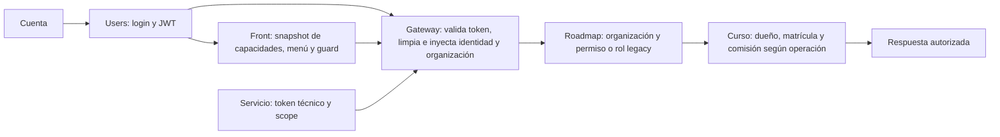

# Roles y permisos: quién hace qué

## Lo que decimos

«Antes de entrar al editor, veamos quién usa el recorrido. El docente responsable organiza mapas, configura el camino y consulta el seguimiento de su cohorte. El alumno encuentra los mapas habilitados para su cursada, recorre actividades y consulta su progreso y ranking. Gestión y administración tienen herramientas de alcance institucional, siempre dentro de la organización y de los permisos asignados. Administración también dispone de operaciones de mantenimiento; no por eso presentamos cada pantalla docente como su pantalla de inicio.

La clave es que **el nombre del rol no alcanza por sí solo**. La cuenta recibe permisos efectivos desde los packs y asignaciones; además, la operación se valida contra la organización y, cuando corresponde, contra el curso, la matrícula y la comisión. En modo de transición pueden seguir decidiendo los roles anteriores. Así, un docente con permiso de edición no edita automáticamente cualquier curso, y un alumno no accede a una cursada ajena por conocer una dirección.

> [!info]- Detalle técnico: permiso y pertenencia
> `@RequirePermission` protege la escritura del grafo y luego se verifica dueño; la lista de mapas exige matrícula y filtra por comisión para alumno. Ver `_presentacion-src/tpi-roadmap/src/main/java/com/utn/tpi/roadmap/controllers/GraphController.java:174-178` y `RoadmapManagementController.java:121-135`.

En el ingreso, Users autentica y emite la credencial; Gateway la valida y transmite identidad y organización confiables a Roadmap. Roadmap comprueba el permiso y las reglas del recurso. En el navegador, un snapshot de capacidades adapta menús y protege rutas, pero la decisión de seguridad se vuelve a tomar en el servidor. Cuando se comunican servicios, usan identidad técnica y scopes específicos, no una cuenta de alumno o docente.

> [!info]- Detalle técnico: identidad y modos
> Gateway limpia headers reservados y agrega identidad validada: `_presentacion-src/tpi-api-gateway/src/main/java/ar/edu/utn/frc/tup/p4/apigateway/filters/IdentityPropagationFilter.java:60-99`. Roadmap usa `AUTHZ_MODE`, `off` por defecto: `_presentacion-src/tpi-roadmap/src/main/resources/application.properties:16`; modos y despliegue: `_presentacion-src/tpi-roadmap/docs/identity-permissions-rollout.md:26`. `editRoadmap` usa el permiso de escritura: `_presentacion-src/fe/src/app/core/services/permissions.service.ts:142-144`, `:626`.

Para la demo usamos cuatro cuentas preparadas: docente dueño, alumno inscripto, gestor y administrador. Mostramos lo que cada una tiene habilitado, no prometemos que todas tengan los mismos permisos en cualquier instalación. El cierre académico sigue siendo responsabilidad de Courses; Roadmap aporta información de seguimiento. Más detalle y límites en [[A4-Limites-conocidos]] y [[A6-Preguntas-dificiles]].»

### Mapa de capacidades

Lectura orientativa de roles legacy y packs de fábrica; **✓ condicionado** a permisos efectivos, organización y controles de dominio, no es garantía de acceso en toda configuración. `P` = PROFESSOR/docente, `S` = STUDENT/alumno, `G` = GESTOR, `A` = ADMIN. Guion operativo en [[A1-Guion-de-demo]].

| Capacidad | Permiso de persona | P | S | G | A |
|---|---|:---:|:---:|:---:|:---:|
| Listar mapas y ver grafo | `roadmap.course-roadmaps.read`, `roadmap.graph.read` | ✓ dueño | ✓ matrícula/comisión | ✓ | ✓ |
| Crear, configurar y mostrar/ocultar mapas | `roadmap.course-roadmaps.write` | ✓ dueño | — | ✓ | ✓ |
| Editar grafo y reglas | `roadmap.graph.write` | ✓ dueño | — | ✓ | ✓ |
| Ranking de curso o mapa | `roadmap.ranking.read` | ✓ dueño, vista staff | ✓ propia/configurada | ✓ staff | ✓ staff |
| Dashboard de cohorte | `roadmap.dashboard.read` | ✓ dueño | — | ✓ | ✓ |
| Progreso propio | `roadmap.student-progress.read` | — | ✓ | — | — |
| Progreso de otros | `roadmap.students-progress.read` | ✓ dueño | — | no en pack citado | ✓ |
| Mantenimiento técnico | `roadmap.maintenance.write` | — | — | — | ✓ |
| Cierre académico | No se confirma permiso de cierre en Roadmap | — | — | — | — |

> [!info]- Detalle técnico: alcance de la tabla
> Matriz legacy y packs: `_presentacion-src/tpi-roadmap/docs/T-22-1-MATRIZ-PERMISOS.md:10-40` y `_presentacion-src/tpi-users/src/main/java/ar/edu/utn/frc/tup/p4/usersservice/users/permissions/FactoryPack.java:176-182`, `:351-361`, `:494-505`, `:704-719`. Hay controles adicionales y excepciones por endpoint: [[07-roles-y-permisos]]. La publicación de desafíos corresponde al Motor, no equivale a mostrar un mapa.

## Qué se ve en pantalla

Mostrar el ingreso y la organización de cada cuenta preparada. Docente: lista y editor de su cohorte; alumno: mapas de su comisión, progreso y ranking; gestor: lista/dashboard que su cuenta efectivamente permita; admin: acceso institucional o mantenimiento solo si está ensayado. No efectuar cambios destructivos ni cierre real.

## Preguntas probables

**¿El docente puede editar cualquier curso?** No: además del permiso, las escrituras comprobadas exigen dueño salvo el bypass de staff aplicable.

**¿Se puede ocultar un botón y considerar protegido el dato?** No: el front facilita navegación; el backend valida por separado.

**¿Un servicio tiene los permisos del alumno?** No: se identifica como servicio y usa scopes explícitos en rutas que lo admiten.

**¿Ya probamos las cuatro cuentas integradas?** No en este trabajo; hay que verificar organización, packs, modo y datos antes de la demo.
