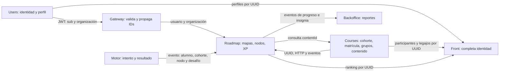

# 11. Identificadores y datos entre micros

## Lo que decimos

«Cuando un alumno abre su recorrido, no lo buscamos por el nombre que vemos en pantalla. El ingreso establece una identidad: Users emite el token y el Gateway lo valida y entrega a Roadmap el identificador de usuario y la organización. Trabajamos con esos identificadores y comprobamos el contexto; el nombre, el legajo y la foto sirven para presentar información, no para decidir a qué alumno corresponde el progreso.

Courses es dueño de la cursada, la inscripción y las comisiones. Nuestro `courseId` identifica la cohorte concreta, no el curso genérico. Roadmap guarda la referencia a esa cohorte y su propia estructura: puede haber un mapa principal y variantes. La matrícula se refleja localmente a partir de eventos y, si no está disponible localmente, se consulta a Courses. La autorización de un docente combina sus permisos con el contexto y, según la operación, su relación con la cohorte; no alcanza con que alguien se llame “profesor”.

Para una unidad también hay dos identificadores: el de nuestra sección y el de la sección original de Courses. Cuando sincronizamos, usamos el vínculo para reflejar cambios de nombre, orden y estado. Hay una excepción importante: al adoptar estructuras anteriores o zonas creadas a mano, puede usarse una coincidencia controlada de nombre y posición o padre para establecer el vínculo inicial. Después se guarda el identificador externo. Por eso no conviene afirmar que nunca se usa el nombre para emparejar.

Un nodo tiene su propio ID. Si representa un desafío, referencia el ID del desafío; si representa un material, referencia el ID del contenido en Courses. Cuando el alumno abre el material, consultamos sus datos y dirección de acceso a Courses. La URL puede vencer y no reemplaza al identificador estable. Si Courses no responde para ese detalle, el nodo puede seguir mostrándose, pero el material figura no disponible.

El Motor resuelve los intentos y nos comunica el resultado por eventos. El mensaje identifica al alumno, la cohorte y el desafío, y puede traer el nodo y el intento. Roadmap ubica la actividad, registra XP y progreso y evita aplicar dos veces un mismo evento en ese camino. También contempla rectificaciones. A partir de los cambios publica eventos como nodo completado o insignia otorgada; Backoffice tiene un consumidor de estos eventos, sujeto a su configuración. No presentamos esto como garantía de entrega perfecta ni como integración ya probada en cada ambiente.

Para mostrar el ranking, el identificador del alumno une progreso e identidad. El front de la vista docente complementa nombres y legajos desde Courses y perfiles de Users, y la foto desde Users. Si faltan esos datos puede quedar una identidad incompleta, sin convertir el nombre en clave. En resumen: cada equipo conserva la responsabilidad de sus datos, los IDs permiten relacionarlos y las consultas o eventos transportan lo necesario entre servicios.

**Transición:** «Con esto claro, podemos distinguir qué sabemos por nuestro propio registro y qué depende de que otro servicio responda».»

> [!info]- Detalle técnico: identidad y fallas
> El Gateway elimina headers reservados y deriva `X-User-Id` del subject y `X-Organization-Id` del claim firmado. La inscripción usa copia local y fallback HTTP a participantes validados de Courses; una consulta parcial se trata como indisponible. Los perfiles Users pueden cachearse, y la tabla docente puede indicar identidad incompleta. Ver [[08-identificadores-y-referencias]].

> [!info]- Detalle técnico: nombres y reconciliación
> Una unidad legacy sin vínculo puede adoptarse por nombre y orden; una zona manual por nombre y mismo padre, solo ante coincidencia única. Es un puente inicial con riesgo de coincidencia accidental, no una clave universal. Nodos y secciones también validan nombres únicos en su ámbito.

> [!info]- Detalle técnico: resultado
> El cierre incluye `id_user`, `id_course`, `challenge_id` y, cuando vienen, `id_node` e `id_attempt`; se prioriza nodo y existe fallback legacy por desafío. `event_id` evita duplicaciones en el ledger; rectificaciones usan revisión y movimiento compensatorio. No equivale a exactly-once global.

| Dato | Dueño | Clave | Cómo lo obtenemos | Qué guardamos |
|---|---|---|---|---|
| Identidad y perfil | Users | UUID usuario; organización UUID | JWT vía Gateway; perfiles HTTP | UUID en progreso; perfil puede estar en caché; front completa presentación |
| Cohorte y matrícula | Courses | UUID cohorte + UUID usuario | Eventos y fallback HTTP | Referencia de cohorte y estado local de matrícula |
| Docencia | Courses / permisos de identidad | UUID usuario y cohorte | Contexto, permisos y control de propiedad | No identificar por nombre del rol |
| Comisión | Courses | UUID grupo y usuario | HTTP grupos y participantes | IDs de audiencia en roadmap; front arma grupos |
| Mapa y sección | Roadmap; unidad origen Courses | UUID roadmap/sección y `courseSectionId` | Propio; sync HTTP Courses | Estructura, nombre y referencia externa |
| Nodo y desafío | Roadmap / Motor | UUID nodo y `challengeId` | Vínculo propio; resultado por evento | Nodo, referencia y progreso |
| Material | Courses | `contentId` UUID | HTTP por cohorte/sección; URL de acceso | Referencia, no asumir copia del archivo |
| XP e insignia | Roadmap | UUID alumno, cohorte, nodo e insignia | Resultado del Motor y evaluación propia | Movimientos, progreso y premios |

## Qué se ve en pantalla

Mostrar un mapa y una unidad sincronizada, un nodo vinculado a contenido o desafío y el ranking docente con nombres y legajo. Los UUID son claves internas: no hace falta que el alumno los vea. No simular fallas sin haberlas ensayado.

## Preguntas probables

**¿Buscamos al alumno por nombre o legajo?** No: el progreso se relaciona por UUID; nombre y legajo enriquecen la pantalla.

**¿Un cambio de nombre rompe la unidad?** Una vez vinculada, se reconcilia por UUID de Courses; la adopción inicial legacy sí puede comparar nombre.

**¿Qué es `courseId`?** El UUID de la cohorte o cursada concreta en Courses.

**¿Guardan una copia del archivo?** En el camino inspeccionado se guarda la referencia y se consulta a Courses, que entrega metadatos y URL de acceso.

**¿Qué pasa si falla otro micro?** Depende de la operación: el material puede figurar no disponible; una matrícula no verificable no se debe confundir con ausencia; el ranking puede quedar con identidad incompleta.

**¿Puede repetirse un evento?** Sí; el procesamiento del resultado controla duplicados por `event_id`, sin garantizar entrega exactamente una vez en toda la plataforma.

**¿La comisión se identifica por nombre?** El vínculo y filtro usan UUID de grupo; el nombre es para mostrar.

**¿Una rectificación borra todo el historial?** No: se registra una corrección compensatoria y puede reabrirse el nodo; no afirmamos reversión integral.
