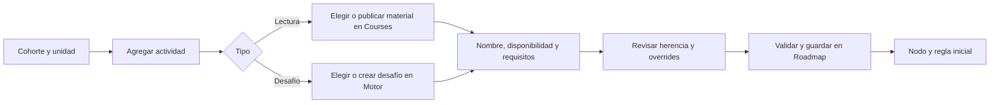

# 12. Crear y editar actividades

## Lo que decimos

«Entremos al editor desde la cohorte. Dentro de una unidad, el docente agrega una actividad. Puede preparar una lectura con material de Courses o ubicar un desafío. En el caso del desafío, el nodo es el lugar que ocupa en el recorrido; el desafío en sí vive en el Motor. Se puede elegir uno existente del catálogo y, cuando la pantalla lo ofrece, iniciar su creación y volver al editor. Una cosa no reemplaza a la otra.

Primero elegimos el tipo y escribimos el nombre. Después vinculamos un material o desafío según corresponda. Para una lectura, podemos seleccionar un material de la unidad o publicar uno desde el editor. En un desafío aparecen sus parámetros y podemos conservar los heredados o definir algunos particulares para este nodo. Marcamos si es obligatorio, definimos cuándo estará disponible y elegimos si queremos condiciones de acceso. Al guardar, Roadmap valida el pedido, registra la actividad y sus reglas iniciales.

La disponibilidad tiene dos dimensiones: lo que habilita el docente y el estado de publicación del desafío. Un desafío todavía no publicado puede estar asociado al nodo, pero no corresponde prometer que el alumno podrá iniciarlo. También distinguimos los perfiles de vidas: una actividad estándar, otra de recuperación y otra que no consume vidas como la estándar. El examen tiene una configuración inicial preparada por la interfaz, que se puede revisar antes de guardar.

> [!info]- Detalle técnico: heredar no es cero
> Un override ausente de reintentos deja la decisión al desafío del Motor; cero es una elección explícita. En IA y efectos también importa distinguir heredar de desactivar. El perfil de examen propone 90 minutos, ventana de tres horas y cero reintentos, con IA e ítems desactivados; es un preset editable del front.

Si queremos cambiar una actividad existente, la abrimos y revisamos la información actual antes de guardar. Podemos modificar datos y configuraciones permitidas, o ajustar sus requisitos. El sistema registra qué campos cambiaron y quién los editó cuando dispone de ese dato. Hay protecciones: por ejemplo, la configuración de IA queda congelada cuando ya hay un intento iniciado o cerrado. Una baja tampoco es simplemente sacar un dibujo: debe respetar las reglas del camino y las protecciones de recuperación. El progreso ya existente merece una revisión especial; no prometemos que toda edición recalcule o borre automáticamente resultados anteriores.

Las unidades y zonas también se pueden organizar, pero conviene distinguir su procedencia. Las unidades sincronizadas reflejan la estructura de Courses; una sección manual nace en Roadmap. La sincronización puede volver a reflejar nombre, orden o estado de origen, de modo que no presentamos ambas como si tuvieran el mismo dueño. El bioma es una elección visual del editor y no cambia por sí solo el contenido académico.

Por último, los valores no vienen todos del mismo lugar. Backoffice mantiene parámetros globales; Courses puede resolver valores efectivos para la cohorte; el Motor conserva configuraciones del desafío; y Roadmap tiene sus propios valores y validaciones. Por ejemplo, la dificultad se valida contra el catálogo efectivo y el máximo de reintentos puede limitar lo que cargamos. Esos parámetros son configurables: no vamos a presentar una semilla como si fuera el valor vigente en todas las instituciones.

**Transición:** «Ahora sí, veamos cómo las reglas del recorrido se convierten en una respuesta cuando el alumno quiere entrar».»

## Crear un nodo: paso a paso

1. Abrir la cohorte, el roadmap y su unidad desde el editor o el contenido de la sección; elegir agregar actividad.
2. Elegir lectura o desafío y completar nombre y descripción; elegir la sección de destino en el contexto ofrecido.
3. Para lectura, vincular material de Courses o publicarlo allí; para desafío, seleccionar uno compatible del Motor o iniciar su creación si está habilitada en ese flujo y volver con el vínculo.
4. Revisar obligatoriedad, disponibilidad, perfil de vidas y ajustes aplicables; conservar herencia del desafío o indicar overrides. El perfil examen propone valores, no los impone para siempre.
5. Elegir requisitos válidos y modo todos/alguno si corresponde; revisar ventana y guardar. El servidor valida, crea el nodo y aplica la regla inicial.

## Editar un nodo: paso a paso

1. Abrir el nodo existente y revisar identidad, contenido o desafío vinculado, disponibilidad y reglas.
2. Cambiar los campos que la pantalla habilite. La IA queda bloqueada si hay intentos iniciados o cerrados; no inferir de eso que todo el nodo queda congelado.
3. Guardar: Roadmap valida otra vez y registra los campos cambiados. La edición no debe presentarse como borrado del historial ni como recálculo retroactivo garantizado.
4. Para dar de baja, confirmar y respetar validaciones de dependencias y recuperación. La baja es lógica; no equivale a eliminar automáticamente todos los nodos dependientes.

> [!info]- Detalle técnico: tipo y progreso
> Los límites START/END están protegidos por el servidor. No se verificó una prohibición general de cambiar tipo o desafío con intentos: consultar las restricciones concretas del flujo y Motor antes de afirmarla. Hay herencia de aprobaciones en el servicio; no se comprobó una migración integral de progreso o XP.

## Unidades, subsecciones y zonas

1. En el editor, crear una sección manual con nombre, orden y bioma; para subsección elegir una unidad padre compatible. El servidor valida nombre, posición y estructura.
2. Para editar, abrirla y cambiar los campos habilitados; al borrar se aplican las protecciones de estructura. La sección sincronizada de Courses conserva un vínculo con su origen: nombre, orden y estado pueden reconciliarse desde Courses. No confundir edición local con cambiar la unidad original.

## Campos y procedencia

| Campo | Tipos de nodo | Default | Origen del default (Roadmap/Backoffice/Courses/Motor) | Validación |
|---|---|---|---|---|
| Nombre y sección | Todos los creados | Sin nombre; sección de contexto | Roadmap | Nodo 2–80; único en sección; sección editable |
| Descripción | Todos | Vacía | Roadmap | Máximo 2000 caracteres |
| Obligatorio | Lectura y desafíos | Marcado en diálogo | Roadmap | Booleano; límites del sistema protegidos |
| Vidas `lives_policy` | Desafíos | STANDARD | Roadmap | STANDARD, RECOVERY, LLM; no estándar exige desafío; protege última recuperación |
| Reintentos | Desafío/examen | Hereda, no cero | Motor; límite efectivo Courses/Backoffice o config Roadmap | Entero ≥ 0 y ≤ máximo disponible |
| Ventana | Actividades | En diálogo puede proponerse ahora a una semana; siempre disponible sin ventana | Roadmap | Inicio no posterior al fin; el front restringe nueva fecha pasada |
| Tiempo límite | Desafío/examen | Heredado o sin límite; preset examen 90 min | Motor / Roadmap | Entero ≥ 0; examen > 0 |
| IA, modo y nivel | Desafíos compatibles | Heredada salvo override | Motor y política de cohorte | Solo si permitida; nivel con modo AGENT; bloqueada ante intento |
| Ítems y efectos | Desafíos | Heredar catálogo; examen propone ninguno | Motor / catálogo de ítems, preset Roadmap | Selección de efectos permitidos; vacío no equivale a heredar |
| Dificultad y XP | Desafíos | Heredada; preset examen elige mayor disponible | Motor; catálogo efectivo Courses/Backoffice | Clave válida del catálogo; si no se puede consultar puede fallar |
| Material | CONTENT | Sin selección | Courses | El diálogo exige material; enlace externo http(s) |
| Requisitos AND/OR | Actividades | Sin regla inicial | Roadmap | Nodos elegibles y sin ciclos; grupos admiten alternativas |
| Bioma | Principalmente sección/zona | Pradera | Roadmap | Selector local; servidor limita longitud |
| Recompensas | Desafíos | Según configuración efectiva | Motor / Courses / Backoffice | No se verificó edición directa de XP en este diálogo |

> [!info]- Detalle técnico: Backoffice
> Roadmap consulta por HTTP parámetros globales PAR-01, PAR-09 y PAR-12; también consulta a Courses los valores efectivos de cohorte. PAR-01 interviene en el catálogo de dificultad y PAR-13 efectivo limita reintentos; si Courses falla, el fallback global inspeccionado no aporta PAR-13 y puede usarse configuración local. PAR-09 es curva de niveles y PAR-12 vidas iniciales/máximas: no son la política `lives_policy` del nodo. Los cambios pueden invalidar caché vía eventos. Ver [[09-creacion-edicion-y-config-backoffice]].

## Qué se ve en pantalla

Abrir el editor de una unidad preparada; mostrar lectura y selector de material, luego desafío con valores heredados, perfil y requisitos. Abrir un nodo existente sin guardar y señalar el bloqueo de IA si hay uno preparado con intentos. Evitar publicar recursos o borrar datos en la cohorte principal.

## Preguntas probables

**¿El nodo es el desafío?** No: Roadmap conserva el nodo y referencia al desafío del Motor.

**¿Siempre debemos crear un desafío nuevo?** No; se puede elegir uno existente compatible y, en los flujos habilitados, crear uno.

**¿Cero reintentos es lo mismo que heredar?** No. Cero es explícito; sin override decide el desafío.

**¿La política de vidas viene de Backoffice?** La política del nodo tiene default STANDARD en Roadmap; PAR-12 trata vidas iniciales y máximas, no es el mismo campo.

**¿El examen siempre dura 90 minutos?** No; es el preset editable del diálogo, con tiempo positivo obligatorio.

**¿Se puede cambiar la IA después de un intento?** La configuración IA del nodo se bloquea ante intentos iniciados o cerrados.

**¿Editar borra el progreso?** No se verificó un borrado ni un recálculo integral como efecto general. Evaluar el cambio concreto antes de prometerlo.

**¿De dónde sale la dificultad?** Del catálogo efectivo de la cohorte resuelto por Courses, con fallback global de Backoffice cuando corresponde; el nodo puede heredar la dificultad del desafío.
