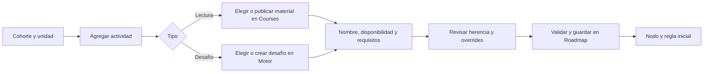

# 12. Crear y editar actividades

## Lo que decimos

«Entremos al editor desde la cohorte. Dentro de una unidad, el docente agrega una actividad. Puede preparar una lectura con material de Courses o ubicar un desafío. En el caso del desafío, el nodo es el lugar que ocupa en el recorrido; el desafío en sí vive en el Motor. Se puede elegir uno existente del catálogo y, cuando la pantalla lo ofrece, iniciar su creación y volver al editor. Una cosa no reemplaza a la otra.

Primero elegimos el tipo y escribimos el nombre. Después vinculamos un material o desafío según corresponda. Para una lectura, podemos seleccionar un material de la unidad o publicar uno desde el editor. En un desafío aparecen sus parámetros y podemos conservar los heredados o definir algunos particulares para este nodo. Marcamos si es obligatorio, definimos cuándo estará disponible y elegimos si queremos condiciones de acceso. Al guardar, Roadmap valida el pedido, registra la actividad y sus reglas iniciales.

La disponibilidad tiene dos dimensiones: lo que habilita el docente y el estado de publicación del desafío. Un desafío todavía no publicado puede estar asociado al nodo, pero no corresponde prometer que el alumno podrá iniciarlo. También distinguimos los perfiles de vidas: una actividad estándar, otra de recuperación y otra que no consume vidas como la estándar. El examen tiene una configuración inicial preparada por la interfaz, que se puede revisar antes de guardar.

> [!info]- Detalle técnico: heredar no es cero
> Un override ausente de reintentos deja la decisión al desafío del Motor; cero es una elección explícita. En IA y efectos también importa distinguir heredar de desactivar. El perfil de examen propone 90 minutos, ventana de tres horas y cero reintentos, con IA e ítems desactivados; es un preset editable del front. En otra ruta, al activar examen sin tiempo cargado, el front puede inicializarlo desde PAR-20 de la cohorte, convertido de horas a minutos.

Si queremos cambiar una actividad existente, la abrimos y revisamos la información actual antes de guardar. Podemos modificar datos y configuraciones permitidas, o ajustar sus requisitos. El servidor registra qué campos cambiaron y quién los editó cuando dispone de ese dato, aunque la pestaña de historial del diálogo está oculta en esta versión. Hay protecciones: por ejemplo, la configuración de IA queda congelada cuando ya hay un intento iniciado o cerrado. Una baja tampoco es simplemente sacar un dibujo: debe respetar las reglas del camino y las protecciones de recuperación. Al reemplazar un desafío, la edición inspeccionada conserva las marcas de completado existentes y puede heredar aprobaciones del nuevo desafío hechas en otro nodo del mismo mapa, sin volver a pagar XP. Es una consecuencia importante para revisar antes de cambiarlo.

Las unidades y zonas también se pueden organizar, pero conviene distinguir su procedencia. Las unidades sincronizadas reflejan la estructura de Courses; una sección manual nace en Roadmap. La sincronización puede volver a reflejar nombre, orden o estado de origen, de modo que no presentamos ambas como si tuvieran el mismo dueño. El bioma es una elección visual del editor y no cambia por sí solo el contenido académico.

Por último, los valores no vienen todos del mismo lugar. Backoffice mantiene parámetros globales; Courses puede resolver valores efectivos para la cohorte; el Motor conserva configuraciones del desafío; y Roadmap tiene sus propios valores y validaciones. Por ejemplo, la dificultad se valida contra el catálogo efectivo y el máximo de reintentos puede limitar lo que cargamos. Esos parámetros son configurables: no vamos a presentar una semilla como si fuera el valor vigente en todas las instituciones.

**Transición:** «Ahora sí, veamos cómo las reglas del recorrido se convierten en una respuesta cuando el alumno quiere entrar».»

## Crear un nodo: paso a paso

1. Abrir la cohorte, el roadmap y su unidad desde el editor o el contenido de la sección; elegir agregar actividad.
2. Elegir lectura o desafío y completar nombre y descripción; elegir la sección de destino en el contexto ofrecido.
3. Para lectura, vincular material de Courses o publicarlo allí; para desafío, seleccionar uno compatible del Motor o iniciar su creación si está habilitada en ese flujo y volver con el vínculo.
4. Revisar obligatoriedad, disponibilidad, perfil de vidas y ajustes aplicables; conservar herencia del desafío o indicar overrides. El perfil examen propone valores, no los impone para siempre.
5. Elegir requisitos válidos y modo todos/alguno si corresponde; revisar ventana y guardar. El servidor valida, crea el nodo y aplica la regla inicial.

## Editar un nodo: paso a paso

1. Abrir el nodo existente y revisar identidad, contenido o desafío vinculado, disponibilidad y reglas.
2. Cambiar los campos que la pantalla habilite. La IA queda bloqueada si hay intentos iniciados o cerrados; no inferir de eso que todo el nodo queda congelado.
3. Guardar: Roadmap valida otra vez y registra los campos cambiados. Al reemplazar el desafío, conserva los completados ya existentes y puede sumar aprobaciones del nuevo desafío realizadas en otro nodo del mismo roadmap, sin XP extra; esto no es un recálculo general.
4. Para dar de baja, confirmar y respetar validaciones de dependencias y recuperación. La baja es lógica; no equivale a eliminar automáticamente todos los nodos dependientes.

> [!info]- Detalle técnico: tipo y progreso
> Los límites START/END están protegidos por el servidor. En los PUT/PATCH de Roadmap no se encontró un bloqueo general de cambio de tipo o desafío por intentos existentes: se admiten cambios compatibles sujetos a las demás validaciones. La configuración de IA sí tiene un bloqueo propio. Esta conclusión no anticipa restricciones al editar el desafío original en el Motor.

## Unidades, subsecciones y zonas

1. En el editor, crear una sección manual con nombre, orden y bioma; para subsección elegir una unidad padre compatible. El servidor valida nombre, posición y estructura.
2. Para editar, abrirla y cambiar los campos habilitados; al borrar se aplican las protecciones de estructura. La sección sincronizada de Courses conserva un vínculo con su origen: nombre, orden y estado pueden reconciliarse desde Courses. No confundir edición local con cambiar la unidad original.

## Campos y procedencia

| Campo | Tipos de nodo | Default | Origen del default (Roadmap/Backoffice/Courses/Motor) | Validación |
|---|---|---|---|---|
| Nombre y sección | Todos los creados | Sin nombre; sección de contexto | Roadmap | Nodo 2–80; único en sección; sección editable |
| Descripción | Todos | Vacía | Roadmap | Máximo 2000 caracteres |
| Obligatorio | Lectura y desafíos | Marcado en diálogo | Roadmap | Booleano; límites del sistema protegidos |
| Vidas `lives_policy` | Desafíos | STANDARD | Roadmap | STANDARD, RECOVERY, LLM; no estándar exige desafío; protege última recuperación |
| Reintentos | Desafío/examen | Hereda, no cero | Motor; límite efectivo Courses/Backoffice o config Roadmap | Entero ≥ 0 y ≤ máximo disponible |
| Ventana | Actividades | En diálogo puede proponerse ahora a una semana; siempre disponible sin ventana | Roadmap | Inicio no posterior al fin; el front restringe nueva fecha pasada |
| Tiempo límite | Desafío/examen | Heredado o sin límite; preset 90 min; otra ruta usa PAR-20 efectivo si está vacío | Motor / Roadmap / Courses / Backoffice | Entero ≥ 0; examen > 0 |
| IA, modo y nivel | Desafíos compatibles | Heredada salvo override | Motor y política de cohorte | Solo si permitida; nivel con modo AGENT; bloqueada ante intento |
| Ítems y efectos | Desafíos | Heredar configuración del desafío; examen propone ninguno | Motor / ofertas de Market / códigos y preset Roadmap | El nodo acota efectos del desafío; vacío no equivale a heredar |
| Dificultad y XP | Desafíos | Heredada; preset examen elige mayor disponible | Motor; catálogo efectivo Courses/Backoffice | Claves base pasan directo; custom requiere catálogo efectivo |
| Material | CONTENT | Sin selección | Courses | El diálogo exige material; enlace externo http(s) |
| Requisitos AND/OR | Actividades | Sin regla inicial | Roadmap | Nodos elegibles y sin ciclos; grupos admiten alternativas |
| Bioma | Principalmente sección/zona | Pradera | Roadmap | Selector local; servidor limita longitud |
| Recompensas | Desafíos | XP calculado por Motor según resultado y PAR-01 | Motor / PAR efectivo; efectos de ítems | El nodo guarda dificultad, no un monto editable de XP |

> [!info]- Detalle técnico: Backoffice
> Roadmap consulta a Courses PAR-01, PAR-09, PAR-13 y PAR-20 efectivos. Su cliente de Backoffice implementa PAR-01, PAR-09 y PAR-12; no se encontró uso productivo de la lectura PAR-12 ni de PAR-08 en el alta de nodo. Si Courses falla, el fallback global inspeccionado aporta dificultad y curva, no PAR-13 ni PAR-20. PAR-12 no es `lives_policy`. Evento de Backoffice invalida caché global; la caché por cohorte tiene su propio vencimiento. Ver [[09-creacion-edicion-y-config-backoffice]].

## Parámetros de plataforma y cohorte

Las cifras son semillas del catálogo de Backoffice, **no una garantía del valor vigente**. Courses admite overrides por cohorte para estos parámetros de curso; eso no significa que Roadmap lea todos esos overrides.

| Parámetro | Semilla Backoffice | Cómo lo usa Roadmap al editar |
|---|---|---|
| PAR-01: XP base por dificultad | 100 / 250 / 500 | Courses entrega catálogo efectivo; muestra XP orientativo y valida dificultades custom. Motor calcula el XP. |
| PAR-08: XP para desbloqueo | 500 | No se encontró consumo de esta clave en Roadmap; no afirmar que prellena reglas. |
| PAR-09: curva de niveles | 0, 250, 600, 1100, 1800, 2800, 4200, 6000, 8500, 12000 | Courses o fallback Backoffice; niveles, ranking e insignias, no default de campo de nodo. |
| PAR-12: vidas iniciales/máximas | 3 / 3 | Cliente de Backoffice disponible, sin invocación productiva encontrada; no define la política de vidas del nodo. |
| PAR-13: máximo de reintentos | 3 | Courses entrega el techo efectivo; se valida el override, no se prellena con 3. |
| PAR-20: gracia de entrega tardía | 48 horas | Courses puede aportar un tiempo inicial de examen en una ruta del editor; no equivale al preset de 90 minutos. |

> [!info]- Detalle técnico: fallas y origen de IA/ítems
> Si no responde Backoffice, puede servir el valor efectivo de Courses o una caché vigente; sin ellos el cliente PAR falla, y el editor usa opciones base locales solo como respaldo visual. El límite de reintentos puede recurrir a un límite local opcional. Courses administra `ai_enabled` de la cohorte, Motor aporta la configuración heredada, y Roadmap define roles y overrides. Las ofertas se consultan a Market; los tres códigos de efecto están definidos en Roadmap según contrato Motor, no llegan como catálogo de Backoffice.

## Qué se ve en pantalla

Abrir el editor de una unidad preparada; mostrar lectura y selector de material, luego desafío con valores heredados, perfil y requisitos. Abrir un nodo existente sin guardar y señalar el bloqueo de IA si hay uno preparado con intentos. Evitar publicar recursos o borrar datos en la cohorte principal.

## Preguntas probables

**¿El nodo es el desafío?** No: Roadmap conserva el nodo y referencia al desafío del Motor.

**¿Siempre debemos crear un desafío nuevo?** No; se puede elegir uno existente compatible y, en los flujos habilitados, crear uno.

**¿Cero reintentos es lo mismo que heredar?** No. Cero es explícito; sin override decide el desafío.

**¿La política de vidas viene de Backoffice?** La política del nodo tiene default STANDARD en Roadmap; PAR-12 trata vidas iniciales y máximas, no es el mismo campo.

**¿El examen siempre dura 90 minutos?** No; es el preset editable del diálogo, con tiempo positivo obligatorio.

**¿Se puede cambiar la IA después de un intento?** La configuración IA del nodo se bloquea ante intentos iniciados o cerrados.

**¿Editar borra el progreso?** La ruta inspeccionada conserva el completado existente al cambiar desafío; además puede heredar aprobaciones del nuevo desafío en otro nodo del mismo roadmap, sin XP extra. Dar de baja es distinto: retira el completado del nodo y conserva XP e insignias ya ganadas.

**¿De dónde sale la dificultad?** El nodo puede heredarla del desafío; las opciones vienen de parámetros efectivos de Courses, con fallback global de Backoffice. El Motor calcula el XP final a partir de PAR-01 y el resultado; la cifra mostrada por el editor es una referencia.
