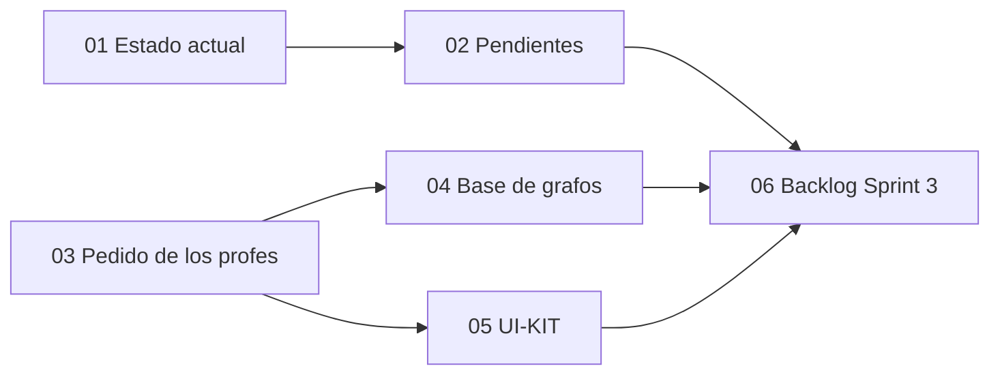

# Propuesta Sprint 3 — G10 (Roadmap)

> [!info] Fuentes
> Armada el 2026-10-14 a partir de:
> - El Taiga del proyecto (id 1804026).
> - El código de `develop` de `tpi-roadmap` (back), `2026-PIV-TPI-FE` (front) y `2026-PIV-TPI-UI-KIT`.
> - El nuevo pedido de los profesores.

> [!warning] Borrador
> Es un borrador para discutir en equipo: todavía no se cargó nada en Taiga ni se empezó a implementar.

## Documentos

| # | Documento | Contenido |
|---|---|---|
| 01 | [Estado actual](01-estado-actual.md) | Taiga vs código, HU por HU (back y front), ramas sin mergear, flags apagados, mocks que quedan |
| 02 | [Pendientes](02-pendientes.md) | Lo que figura Done pero no lo está, y lo que debería cerrarse primero (P0 a P3) |
| 03 | [Pedido de los profes](03-requerimientos-profes.md) | Varios roadmaps por curso, relaciones configurables entre secciones y nodos, las dos vistas. Qué existe, qué cambia y las preguntas abiertas |
| 04 | [Base de grafos](04-base-de-grafos.md) | Neo4j vs Postgres extendido vs Apache AGE: ventajas, desventajas, riesgos, recomendación y diseño si se elige Neo4j |
| 05 | [UI-KIT](05-ui-kit.md) | Adopción de la librería de componentes en el front: qué falta, qué reemplazar en el roadmap y huecos del kit |
| 06 | [Backlog Sprint 3](06-backlog-sprint-3.md) | Épicas, HU e HT propuestas, con esfuerzo, dependencias, orden y riesgos |
| 07 | [Correcciones de los profes](07-correcciones-profes.md) | Lo que pidieron corregir, cruzado con lo ya planteado (✅/⚠️/🆕), qué no es nuestro y preguntas nuevas |

## Mapa de la propuesta

## TL;DR

1. **Taiga no refleja el código.**
   - HU-44 y HU-48 figuran Done y les falta una capa entera.
   - HU-20/21, HU-01/41, HU-15/16 y HU-43 están parciales.
   - HU-45 y HU-49 siguen en New.
   - Dos flags apagados por defecto (`SECTIONS_SYNC_ENABLED`, `ROADMAP_BY_GROUP_ENABLED`) dejan sin funcionar en la demo cosas que ya están hechas.
2. **Del pedido de los profes, la mitad ya existe en el back.** Ya hay dependencias AND/OR entre secciones (V25) y entre nodos (V5/V7). Lo nuevo:
   - Un curso con **N roadmaps** (hoy hay un UNIQUE que lo impide).
   - Volver a tener **XP mínimo** por sección (se borró en V8).
   - **Reglas combinadas** y **propiedades libres**.
   - Las dos vistas del profesor.
3. **BD de grafos**:
   - Neo4j encaja bien con "todo personalizable" y es defendible ante los profes.
   - En contra: suma infra, obliga a escribir en dos bases a la vez y a portar los tests.
   - La vista visual la hace el front igual, con cualquier BD.
   - Si se elige, va como **módulo dentro de roadmap-service**, y el estado del alumno se queda en Postgres.
   - Alternativas de menor riesgo: Postgres + `jsonb`, o Apache AGE.
4. **Correcciones de los profes** ([07](07-correcciones-profes.md)): piden **Neo4j** (queda decidido), nodos de **inicio y fin obligatorios**, **relaciones con tipo** (4 niveles), examen por hora, ranking por curso por defecto, mejoras en Archibaldo, seed de demo y **permisos en vez de roles**. De 17 puntos, 1 ya estaba planteado, 7 en parte y 9 son nuevos.
5. **UI-KIT**:
   - El front ya la usa en gran parte, pero está en 0.7.1 (la última es 0.8.0, que destraba 9 TODOs).
   - El roadmap tiene adopción baja de tokens: 316 colores hardcodeados y un puente de tokens propio.
   - Al kit le falta un **componente de grafo**, que es la base de la nueva vista de nodos.

## Decisiones pendientes

> [!question] A responder por los profes o el PO
>
> Ver las preguntas de [[03-requerimientos-profes#Preguntas abiertas para los profesores o el PO (cambian el diseño)|03]]. Las críticas son:
> - **XP por curso o por roadmap.**
> - **Cómo se mapean las secciones de Courses con N roadmaps.**
> - **Si Neo4j es requisito de la materia.**
