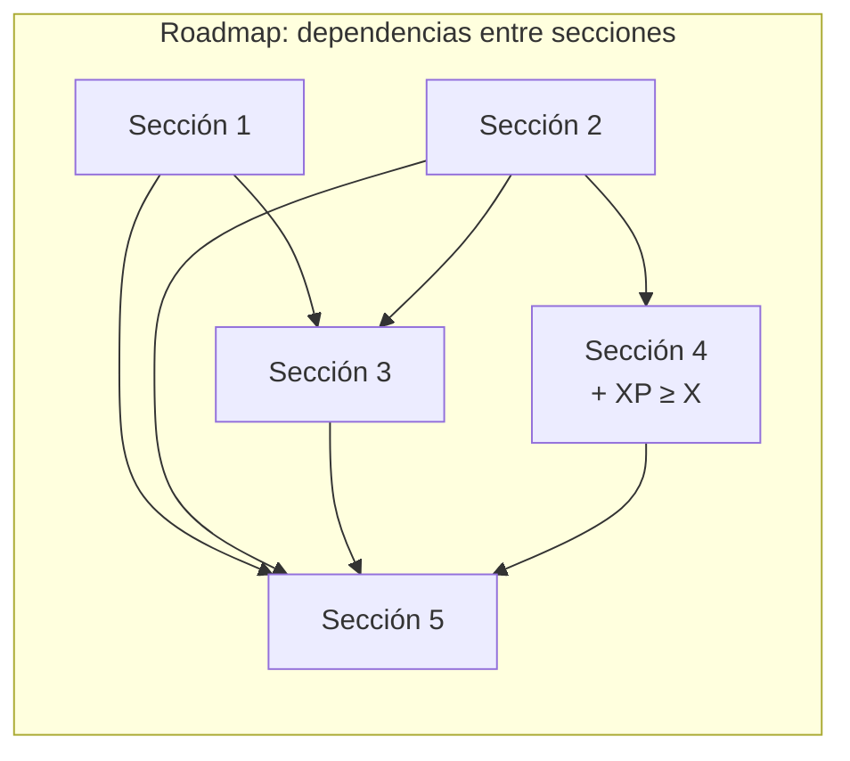
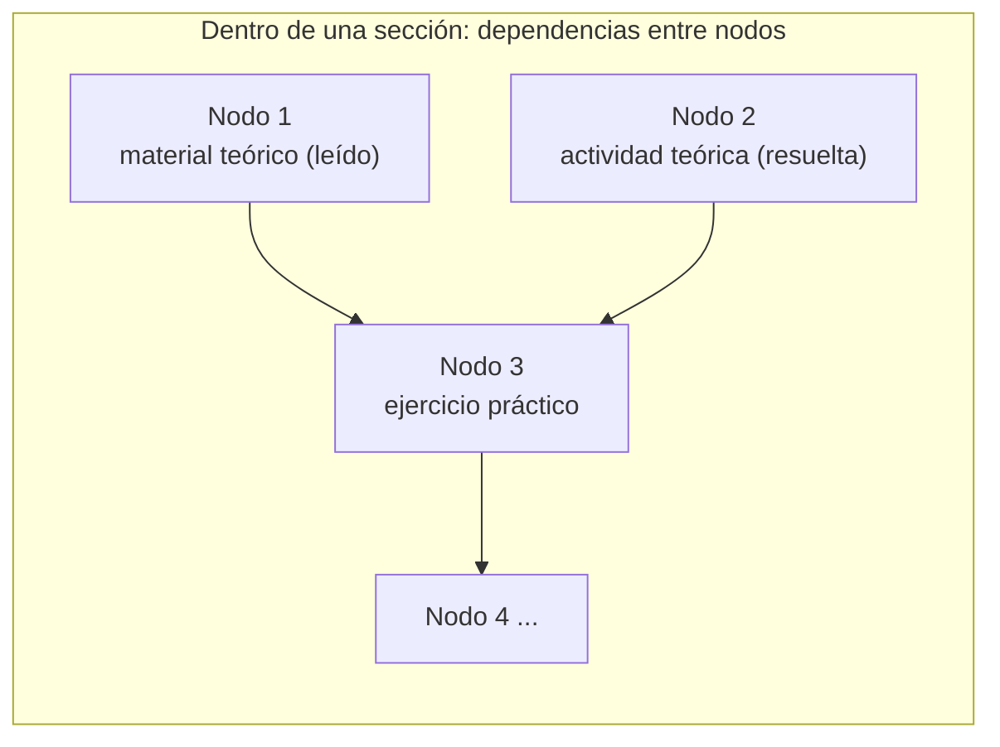

# 03 — Nuevo pedido de los profesores: cambio de paradigma del roadmap

## Pedido (en nuestras palabras)

1. Un **curso** (con sus alumnos y profesores) puede tener **1 o más roadmaps**. Hoy es 1 a 1.
2. El **gestor o el profesor** decide si un curso puede tener más de un roadmap.
3. Cada roadmap se ve **completamente como nodos conectados entre sí**.
4. Dentro del roadmap se crean **secciones**, conectadas entre sí. El profesor define sus relaciones. Ejemplo:
   - La sección 3 depende de la 1 **y** de la 2.
   - La sección 4 depende solo de la 2, **más** un mínimo de X de experiencia.
   - La sección 5 requiere **todo lo anterior** desbloqueado.
5. Dentro de cada sección vale la misma lógica, a nivel de nodos. Ejemplo: para el nodo 3 (ejercicio práctico) hay que tener leído el nodo 1 (material teórico) y resuelto el nodo 2 (actividad teórica). Esto escala a muchos ejercicios, con relaciones **incluyentes (AND)** o **excluyentes (OR)**.
6. Todo tiene que ser **completamente personalizable**: los nodos, su información y sus relaciones.
7. Hay dos vistas para el gestor y el profesor en el front:
   - **Vista tipo Moodle** (lista o árbol). Ya existe (`course-editor-page`), pero hay que hacerla más cómoda, refactorizarla y **usar sí o sí la UI-KIT** (ver [05](05-ui-kit.md)).
   - **Vista de nodos** (grafo). Existe, pero no es cómoda ni representa bien su función final.
8. Idea del equipo: guardar la estructura en una **BD de grafos estilo Neo4j**, con una parte del back especializada en modelar las relaciones y exponerlas para la vista. El análisis está en [04](04-base-de-grafos.md).

### El ejemplo de los profes, como grafo

## Qué existe hoy y qué cambia

| Pedido | Estado en `develop` | Trabajo |
|---|---|---|
| 1 a N roadmaps por curso | `roadmap.course_cohort_id` es **UNIQUE** (V1/V12). Todas las rutas son `/courses/{id}/...` | **Grande.** Quitar el UNIQUE, agregar `roadmap_id` en rutas, DTOs y front. Decidir dónde viven XP, vidas, nivel y ranking: hoy dependen de `student_course` por curso |
| Habilitar varios roadmaps | No existe | Flag por curso (`multiple_roadmaps_allowed`) con permiso GESTOR/PROFESSOR |
| Dependencias entre secciones AND/OR | **Ya existe**: `section_prerequisite` + `section.prerequisite_mode` (V25) | Nada en el modelo |
| XP mínimo para una sección | Existió (`umbral_xp` en V1) y **se borró en V8** | Volver a agregarlo como `min_xp` opcional y sumarlo al evaluador del gate |
| "Todo lo anterior" | Se expresa como AND con todas las secciones previas | Atajo en la UI ("seleccionar todas las anteriores") |
| Dependencias entre nodos AND/OR | **Ya existe**: `node_prerequisite` + `node.prerequisite_mode` (V5/V7), con lectura obligatoria | Nada en el modelo |
| Reglas combinadas, ej. `A y (B o C) y XP ≥ 500` | Hoy hay un solo modo AND u OR por sección o nodo | **Nuevo**: reglas como árbol de expresiones. Ver [04](04-base-de-grafos.md) |
| Personalización total de nodos | Columnas fijas (tipo, nombre, ícono, vidas, etc.) | Propiedades libres por nodo (map/JSON) además de las fijas que el dominio necesita |
| Vista tipo Moodle | `course-editor-page` | Refactor con la UI-KIT |
| Vista de nodos | Existe. `moveNode` devuelve 501 (las posiciones no se guardan) | Librería de grafos en Angular (`ngx-vflow` o `@foblex/flow`) + acomodo automático (`elkjs`) + guardar las posiciones |

## Preguntas abiertas para los profesores o el PO (cambian el diseño)

> [!question] Estas respuestas cambian el diseño: conseguirlas en la semana 1.
> 1. **XP, vidas, nivel y ranking**: ¿son **por curso** (compartidos entre roadmaps) o **por roadmap**?
> 2. **Secciones de Courses**: hoy cada sección del roadmap se sincroniza con una sección de Courses (HU-36, `course_section_id`). Con varios roadmaps, ¿cada roadmap elige qué secciones de Courses usa? ¿O las secciones pasan a ser propias del roadmap?
> 3. ¿El alumno ve **todos** los roadmaps del curso, o se asignan **por comisión** (HU-44)?
> 4. Cuando dicen secciones "anidadas", ¿hablan de dependencias entre secciones o de **subsecciones** (una sección adentro de otra)?
> 5. ¿Hacen falta reglas combinadas (`A y (B o C)`), o alcanza con AND/OR + XP mínimo por sección y por nodo?
> 6. ¿Qué significa "completamente personalizable"? ¿Campos libres definidos por el profesor, tipos de nodo nuevos, o solo nombre, ícono, descripción y reglas?
> 7. ¿Exigen **Neo4j** (u otra BD de grafos) como requisito de la materia, o es una decisión nuestra?

## Impacto en otros grupos

- **Courses (G01)**: si un curso tiene N roadmaps, se acuerda de nuevo el contrato de secciones (HT-07, HU-36) y el de restricciones (HU-49).
- **Motor de desafíos (G09)**: el evento de cierre trae `id_course` + `id_node`. Si el `node_id` es único globalmente no cambia nada, pero hay que confirmarlo.
- **Accounting / Inventario**: no cambia nada si XP y vidas siguen siendo por curso (pregunta 1).
- **Plataforma (compose/mesh)**: si se suma Neo4j hay un servicio de infra nuevo, y hay que coordinarlo con quien mantiene la plataforma y el estable del roadmap.
