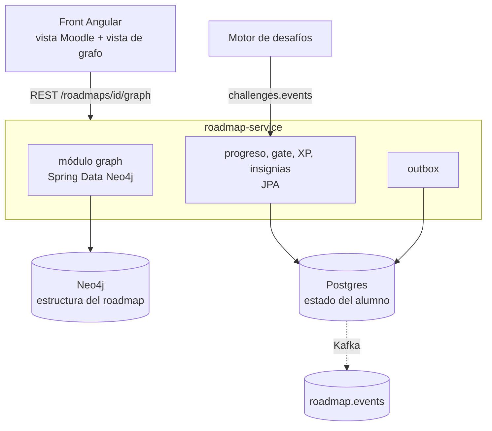
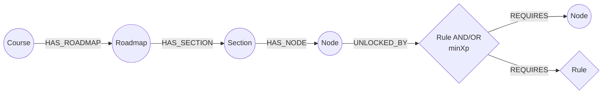

# 04 — Base de datos de grafos: Neo4j y alternativas

## Contexto

El equipo propone guardar la estructura del roadmap en una BD de grafos y tener un componente del back dedicado a modelar las relaciones y exponerlas para la vista visual.

Lo que hay hoy en Postgres:
- Tablas: `roadmap`, `section`, `node`, `section_prerequisite`, `node_prerequisite`.
- Modo AND/OR por sección y por nodo.
- Detección de ciclos en Java (`PrerequisiteGraphService`).
- Estado del alumno: `completed_node`, `content_reading`, `xp_movement`, `student_course`, `badge_award`, `outbox_event`.

## Distinción clave

| Qué | Naturaleza | Dónde conviene |
|---|---|---|
| **Estructura**: roadmaps, secciones, nodos, relaciones, reglas, propiedades libres | Grafo. Lo edita el profesor, cambia poco y se lee mucho | Candidata a BD de grafos |
| **Estado del alumno**: progreso, XP, vidas, lecturas, insignias, outbox | Transaccional e idempotente, con eventos de Kafka | **Postgres, sin cambios.** Ya está hecho y probado |

> [!important] Lo visual no depende de la BD
> **La vista visual la hace el front igual, cualquiera sea la BD.** Neo4j Browser y Bloom sirven para que los desarrolladores inspeccionen el grafo; el profesor no los usa. Lo que la BD de grafos aporta es que el back entregue el grafo listo para dibujar y que las consultas de recorrido sean simples.

## Alternativas

### A. Postgres actual, extendido (sin BD nueva)
- Las reglas combinadas van como árbol JSON (`jsonb`) en `section` y `node`, o como una tabla `rule` / `rule_operand`.
- Las propiedades libres van en una columna `props jsonb`.
- Los recorridos se hacen con `WITH RECURSIVE`, o en memoria (un roadmap tiene decenas o pocos cientos de nodos).

| Ventajas | Desventajas |
|---|---|
| Cero infraestructura nueva. Nada que coordinar con la plataforma ni con la mesh | Las consultas de recorrido complejas son más verbosas (CTE recursivos) |
| Una sola transacción para estructura y estado (borrar un nodo con progreso es consistente) | Modelar reglas anidadas en tablas o JSON es menos natural que en un grafo |
| Se reusan los tests, Flyway, el outbox y el JPA existentes | No cumple la idea de "usar una BD de grafos", si los profes la piden |
| El menor riesgo para el sprint | |

### B. Apache AGE (extensión de grafos para Postgres)
- Cypher dentro de Postgres: `SELECT * FROM cypher('roadmap', $$ MATCH ... $$)`.

| Ventajas | Desventajas |
|---|---|
| Es una BD de grafos con Cypher **y** comparte transacción con el estado del alumno | Necesita una imagen de Postgres con la extensión (`apache/age`), un cambio en la infra de la plataforma |
| No hay escritura en dos bases a la vez | No tiene soporte de Spring Data: Cypher a mano vía JDBC |
| Sigue siendo un solo servicio de BD | Comunidad y tooling más chicos que Neo4j. Hay que confirmar que Neon/Railway la soporten si se usan |

### C. Neo4j (propuesta del equipo)
- Servicio Neo4j Community aparte.
- Spring Data Neo4j en el back.
- Postgres queda solo para el estado del alumno.

| Ventajas | Desventajas / riesgos |
|---|---|
| Es el estándar de BD de grafos: Cypher, Browser, mucha documentación. Buen aprendizaje y defendible frente a los profes | **Escritura en dos bases a la vez**: no hay transacción entre Neo4j y Postgres. Ej.: se borra un nodo en Neo4j que tiene progreso en Postgres |
| Propiedades libres en nodos y relaciones sin migraciones de esquema: encaja con "todo personalizable" | **Infra nueva** en `tpi-system-compose`, la mesh, los entornos y el CI, con memoria y volumen propios |
| Las reglas combinadas se modelan natural como subgrafo (`(:Rule {op})-[:REQUIRES]->(...)`) | **Hay que portar los tests** de reglas, ciclos y retroactividad, hoy contra JPA y Testcontainers de Postgres |
| Consultas como "qué desbloquea X", "qué le falta al alumno" o "detectar ciclos" son cortas | **Migración de datos**: pasar secciones, nodos y prerrequisitos de Postgres a Neo4j |
| Spring Data Neo4j está maduro | Curva de aprendizaje del equipo (Cypher, modelado) |
| | Si se arma como **micro aparte**, el gate (P95 < 200 ms) suma un salto de red, y hay que integrarlo de nuevo con el gateway, Eureka y la autenticación |

### D. Otras (para mencionar)
- **Memgraph**: compatible con Cypher y Bolt, corre en memoria y es rápido. Mismos riesgos que Neo4j, con menos comunidad.
- **ArangoDB**: multimodelo (documentos + grafo). Tiene otro lenguaje (AQL) y no aporta frente a Neo4j para este caso.

## Comparación rápida

| Criterio | A. Postgres | B. AGE | C. Neo4j |
|---|---|---|---|
| Riesgo para el sprint | Bajo | Medio | **Alto** |
| Infra nueva | No | Imagen de Postgres distinta | Servicio nuevo |
| Consistencia con el estado del alumno | Transaccional | Transaccional | Eventual (dos bases) |
| Personalización (props libres) | `jsonb` | Nativa | Nativa |
| Reglas combinadas | JSON o tablas | Subgrafo | Subgrafo |
| Consultas de grafo | CTE | Cypher | Cypher |
| Valor "académico" o de demo | Bajo | Medio | **Alto** |
| Soporte de Spring | JPA (existente) | JDBC manual | Spring Data Neo4j |

## Recomendación

> [!success] Actualización 2026-10-14
> Los profes pidieron **explícitamente** una BD de grafos (ver [[07-correcciones-profes]]). La decisión queda en **C. Neo4j**. A, B y D quedan como registro de las alternativas evaluadas.

> [!tip] Recomendación (antes de las correcciones)
> - **Si los profes exigen o valoran explícitamente una BD de grafos → C. Neo4j**, con el diseño de abajo.
> - **Si es decisión nuestra → A**, más reglas en JSON y la vista nueva en el front. Da el mismo resultado visible para el usuario con mucho menos riesgo.
> - **B (AGE)** es un punto medio a considerar si la plataforma acepta cambiar la imagen de Postgres.

## Diseño propuesto si se elige Neo4j

> [!info] Agregados por las correcciones de los profes
> - **Nodos `START` y `END`** obligatorios por roadmap **y por cada unidad/sección** (P8): exactamente uno de cada uno, todos los nodos alcanzables desde `START` y `END` alcanzable. Se valida al guardar.
> - **Relaciones con tipo** (P4, [[decisiones/DEC-018-catalogo-de-relaciones-y-tipos-de-nodo|DEC-018]]): `REQUIRES`, `RECOMMENDS`, `BELONGS_TO`, `RELATED_TO` y `PART_OF`, cada uno con `label` visible y `visible` configurable. Solo `REQUIRES` (y las `Rule`, que admiten reglas combinadas) afectan el desbloqueo; el profesor elige si la condición es AND/OR, XP mínimo o las dos.
> - **Tipos de nodo fijos** (P8): desafíos teóricos, prácticos, de IA y de recuperación de vida, examen, contenido teórico, inicio y fin. Sin propiedades libres: se personalizan nombre, ícono, descripción y reglas.
> - **Subsecciones** con dependencias entre ellas (P6).
> - **Alcance de Neo4j** (G1): solo para roadmap-service y solo los grafos (curso, sección, unidad); el estado del alumno sigue en Postgres.
> - **Ventana horaria** de los nodos `EXAM`: la publica Courses (P9), no se guarda en el nodo. El gate la evalúa como `DATE_RESTRICTED`.






```
Neo4j (estructura, editable por el profesor)
(:Course {id})-[:HAS_ROADMAP]->(:Roadmap {id, name, archived})
(:Roadmap)-[:HAS_SECTION]->(:Section {id, name, biome, props})
(:Section)-[:HAS_NODE]->(:Node {id, type, name, iconKey, livesPolicy, retries, props})
(:Section|Node)-[:UNLOCKED_BY]->(:Rule {op: AND|OR, minXp?})
(:Rule)-[:REQUIRES]->(:Section|Node|Rule)        // reglas anidadas: A y (B o C)
(:Section|Node)-[:LAID_OUT {x, y}]->(:Roadmap)   // posiciones para la vista (o como props)

Postgres (estado del alumno, sin cambios)
completed_node, content_reading, xp_movement, student_course, badge_award, outbox_event
→ referencian los mismos UUID de Section/Node
```

**Decisiones:**
1. **Módulo `graph` dentro de `roadmap-service`**, no un micro nuevo. Así el gate no suma salto de red y no hay que integrar otro servicio. Si después hace falta, se separa.
2. **La app genera los UUID**, y Neo4j y Postgres comparten ids sin sincronizar.
3. **Solo baja lógica** (`deletedAt`) en Neo4j. Nunca borrado físico, para no romper el progreso histórico.
4. **Gate y progreso**: leen las reglas en Neo4j (con caché corta por roadmap) y el estado en Postgres. Evalúan en Java como hoy (`GateEvaluator`).
5. **Las ediciones del grafo** siguen publicando por el outbox de Postgres. Patrón: escribir en Neo4j, luego registrar en Postgres el `node_edit_log` y el evento. Si falla lo segundo, se reintenta (es idempotente por id).
6. **Esquema versionado** con `neo4j-migrations` (constraints de unicidad por `id`, índices).
7. **Migración inicial**: un job único que lee `section`, `node`, `section_prerequisite` y `node_prerequisite` y crea el grafo. Queda un período de convivencia con la lectura todavía en Postgres, detrás de un flag.
8. **Endpoint para la vista**: `GET /roadmaps/{id}/graph` devuelve `{nodes:[...], edges:[...], layout}` listo para la librería del front.

> [!warning] Riesgos y mitigación
> | Riesgo | Mitigación |
> |---|---|
> | Datos inconsistentes entre las dos bases | Solo baja lógica. Ids compartidos. Un job de reconciliación que detecte ids huérfanos |
> | Latencia del gate | Caché de reglas por roadmap, que se invalida con cada edición |
> | La infra de la plataforma no está lista | Hablar en la primera semana con quien mantiene `tpi-system-compose` y la mesh. Neo4j Community en Docker |
> | Tests | Testcontainers de Neo4j. Portar primero los tests de reglas y ciclos |
> | Tamaño del cambio | Una persona dueña de la migración. Hacerlo por fases detrás de un flag |
> | Licencia | Neo4j Community es GPLv3: sin problema para uso académico |
