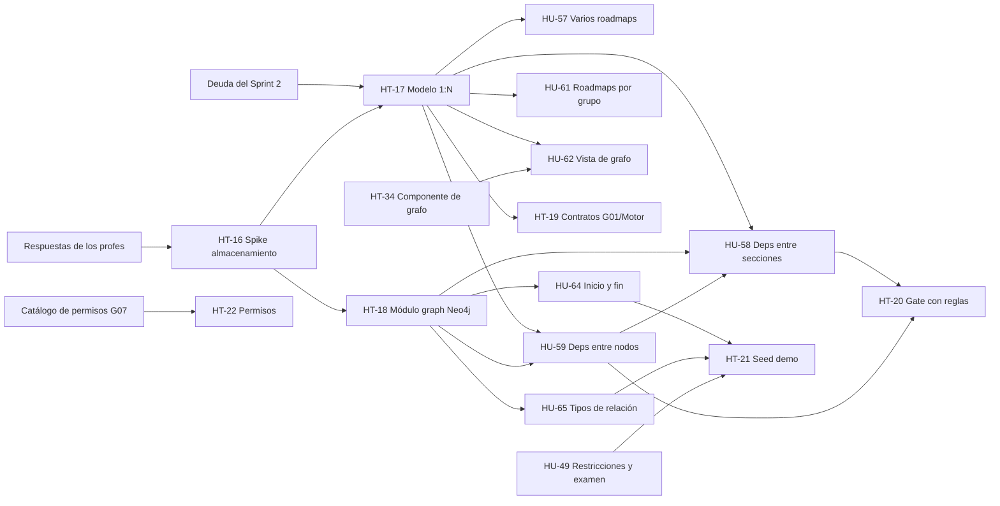

# 06 — Backlog propuesto para el Sprint 3

> [!warning] Borrador
> Borrador para discutir en equipo. Todavía no está cargado en Taiga. Los códigos HU-57+ y HT-12+ son los que se proponen para cargarlas.
>
> Esfuerzo: S (≤1 día) · M (2-3 días) · L (≥4 días).

> [!tip] Cada ítem tiene su nota con historia y criterios de aceptación
> Revisión del 2026-10-15 aplicada: HU-60 eliminada, HU-66 y HU-67 fusionadas, HU-63 descartada (la vista tipo Moodle ya no existe), HT-30 dividida en HT-30 a HT-33 y HT-26 en HT-26 y HT-34 (máximo 8 pts por historia).
> Ver [[sprints/sprint-3/09-epicas-e-historias|09 — Épicas e historias]], con el formato de la wiki de Taiga. Las del Bloque 0 son HU existentes que se reabren (HU-01, 15, 16, 20, 21, 41, 43, 44, 45, 46, 48, 49) más HT-14.

## Bloque 0: deuda del Sprint 2 (primera semana)

Detalle en [02-pendientes.md](02-pendientes.md). La deuda técnica que no es una HU (código muerto, mocks, seguridad, docs) está en [[deuda-tecnica]]: los ítems marcados *Sprint 3* entran en este bloque.

| Ítem | Capa | Esfuerzo |
|---|---|---|
| Cerrar `feature/t-21-7-roadmap-events-topic` (redundante) y revisar `fix/account-not-found-gate` contra #193 | Back | S |
| Encender los flags en los entornos (`SECTIONS_SYNC_ENABLED`, `ROADMAP_BY_GROUP_ENABLED`) | Infra | S |
| Sacar los IDs de mock de las rutas reales | Front | S |
| HU-48: pre-chequeo de elegibilidad para el alumno | Back | M |
| HU-20/21: los 3 criterios de insignia (implementarlos o quitarlos) + edición y baja en el front | Back + Front | M |
| HU-15/16: motivo `origen_no_disponible` + stale de 24 h | Back | M |
| HU-43: validar el ícono según el tipo de nodo | Back | S |
| HU-46: redefinir el CA sin el Templo (P13: el Templo no existe más) | Taiga | S |
| HU-45 / HU-49: cerrar o pasar al Sprint 3 con su alcance redefinido | Back + Front | M/L |
| HT-11: actualizar el texto de Taiga | Taiga | S |

## Épica nueva: "Múltiples roadmaps por curso y grafo configurable"

| # | Tipo | Título | Capa | Esfuerzo | Depende de |
|---|---|---|---|---|---|
| [[sprints/sprint-3/historias/HT-16 Validar la infra de Neo4j y modelar las relaciones\|HT-16]] | Spike | ~~Decidir el almacenamiento~~ **Neo4j, decidido por los profes** ([07](07-correcciones-profes.md)). Validar la infra con la plataforma y modelar los tipos de relación | Back + Infra | S | — |
| [[sprints/sprint-3/historias/HT-17 Modelo 1 a N de curso a roadmaps\|HT-17]] | HT | Modelo 1:N curso → roadmaps: quitar el UNIQUE, agregar `roadmap_id` en las rutas, compatibilidad con `/courses/{id}` mientras migra el front | Back | L | HT-16 |
| [[sprints/sprint-3/historias/HT-18 Módulo graph en Neo4j y migración inicial\|HT-18]] | HT | (Si se elige Neo4j) módulo `graph`, esquema, migración inicial de datos y caché de reglas para el gate | Back | L | HT-16 |
| [[sprints/sprint-3/historias/HU-57 Habilitar y gestionar varios roadmaps por curso\|HU-57]] | HU | Como GESTOR o PROFESOR quiero habilitar varios roadmaps en un curso y crearlos, renombrarlos y archivarlos | Back + Front | M | HT-17 |
| [[sprints/sprint-3/historias/HU-58 Dependencias entre secciones\|HU-58]] | HU | Como PROFESOR quiero definir dependencias entre secciones (AND/OR + XP mínimo + "todas las anteriores") | Back + Front | M | HT-17/HT-18, HU-59 |
| [[sprints/sprint-3/historias/HU-59 Dependencias entre nodos con reglas combinadas\|HU-59]] | HU | Como PROFESOR quiero definir dependencias entre nodos dentro de una sección, con reglas combinadas | Back + Front | M | HT-17/HT-18 |
| [[sprints/sprint-3/historias/HU-61 Roadmaps por grupo del curso y restricciones de visualización\|HU-61]] | HU | Como PROFESOR quiero asignar un roadmap a cada grupo o división del curso (lo oculto y bloqueado va en HU-49) | Back + Front | M | HT-17, pregunta 1 |
| [[sprints/sprint-3/historias/HU-62 Vista de grafo cómoda para el profesor\|HU-62]] | HU | Como PROFESOR quiero una vista de grafo cómoda: acomodo automático, aristas editables arrastrando, zoom, minimapa y posiciones guardadas | Front (+ endpoint `/graph`) | L | HT-17, HT-34 |
| [[sprints/sprint-3/historias/HT-19 Contratos con Courses y el Motor para el modelo 1 a N\|HT-19]] | HT | Adaptar los contratos con Courses (secciones y restricciones) y con el Motor al modelo 1:N | Back | M | HT-17, pregunta 2 |
| [[sprints/sprint-3/historias/HT-20 Gate y progreso con reglas combinadas y XP mínimo\|HT-20]] | HT | Gate y progreso evaluando reglas combinadas + XP mínimo (tests BDD) | Back | M | HU-58, HU-59 |

## Épica: correcciones de los profes (2026-10-14)

Detalle y estado de cada punto en [07-correcciones-profes.md](07-correcciones-profes.md).

| # | Tipo | Título | Capa | Esfuerzo | Depende de |
|---|---|---|---|---|---|
| [[sprints/sprint-3/historias/HU-64 Nodos de inicio y fin obligatorios\|HU-64]] | HU | Como PROFESOR quiero que el roadmap tenga siempre un nodo de inicio ("Bienvenidos") y uno final ("Felicitaciones"), y que no se pueda guardar sin ellos | Back + Front | M | HT-18 |
| [[sprints/sprint-3/historias/HU-65 Relaciones con tipo\|HU-65]] | HU | Como PROFESOR quiero relacionar nodos y unidades con tipos de relación (5 tipos, P4), ver su nombre y elegir cuáles se muestran | Back + Front | L | HT-18 |
| [[sprints/sprint-3/historias/HU-68 Obligatoriedad visible en la lista de nodos\|HU-68]] | HU | Como PROFESOR quiero ver en la lista de nodos de cada sección cuáles son obligatorios y de qué dependen. Casi hecho: falta la obligatoriedad en desafíos y exámenes | Front | XS | — |
| [[sprints/sprint-3/historias/HU-45 Ranking de la cohorte y avance por comisión\|HU-45]] | Bug | El ranking por grupo da error: reproducir, default por curso, filtro opcional por comisión | Back + Front | M | Flag `ROADMAP_BY_GROUP_ENABLED`; G09 para ordenar por notas |
| [[sprints/sprint-3/historias/HU-69 Archibaldo - Enter, avatar personalizable y destello\|HU-69]] | HU | Como ALUMNO quiero hablar con Archibaldo con Enter y que un destello me guíe por el camino; el profesor y el gestor personalizan su avatar y su nombre (P11) | Front (3D) + Back | M | — |
| [[sprints/sprint-3/historias/HT-21 Seed de demo curado\|HT-21]] | HT | Seed de la demo con un curso entero, curado y reproducible (usa los usuarios demo de G07) | Back | M | HT-18, HU-57, HU-58, HU-59, HU-64, HU-65, HU-49, HT-30; G07 |
| [[sprints/sprint-3/historias/HT-22 Permisos en vez de roles\|HT-22]] | HT | Migrar 17 `hasRole`/`hasAnyRole` (y el chequeo manual de `RankingController`) a permisos | Back | M | Catálogo de permisos de G07 Users (G2, sin definir) |
| [[sprints/sprint-3/historias/HT-23 Documentación global del micro\|HT-23]] | HT | Documentación global del micro Roadmap | Back / Docs | S | — |

## Temas consultados por el equipo (2026-10-15)

Chequeo de si cada tema está contemplado en este sprint.

| Tema | ¿En el Sprint 3? | Dónde |
|---|---|---|
| Ranking por XP, notas o ambas | ✅ | HU-45. Lo configura el profesor: por XP o por notas (P14). Las notas vienen del Motor; falta acordar con G09 cómo llegan |
| Insignias | ✅ | Bloque 0 (HU-20/21: criterios que no se otorgan, edición y baja en el front) |
| Grupos dentro de la cohorte (2w1, 2w2) | ✅ | Bloque 0 (HU-44/45, flag) y HU-45 (ranking por grupo) |
| Subsecciones / N roadmaps por curso | ✅ | HT-17, HU-57, HU-58 y HU-61 (P1 y P6 respondidas, [[decisiones/DEC-017-n-roadmaps-por-curso-configurables\|DEC-017]]) |
| Archivado del curso | ✅ Ya hecho | Consumimos `COURSE_COHORT_ARCHIVED` |
| Estado académico final | ✅ Sí (P15) | [[sprints/sprint-3/historias/HU-72 Cerrar el curso con el estado académico final\|HU-72]] (retoma HU-27/28 de EP-61) |
| Responsabilidades de cada rol | ⚠️ Parcial | HT-22 (permisos). Falta la matriz escrita: DT-03 en [[deuda-tecnica]] |
| Racha | ✅ Sí (E12) | [[sprints/sprint-3/historias/HU-73 Ver mi racha de días con actividad\|HU-73]]. Hoy el front muestra un valor fijo (DT-13) |
| Multiple choice con boss fight | ❌ No es nuestro | Es de Desafíos teóricos (P16) |
| Garage | ✅ Ya hecho | Courses guarda el material; Roadmap pide la URL (HU-04/42/46) |
| Nodos con restricción de fecha / parciales | ✅ | HU-49, que desde el 2026-10-15 incluye el examen con ventana horaria (ex HU-67). La ventana la publica Courses (P9) |

## Épica transversal: consistencia visual con la UI-KIT

Detalle y plan en [05-ui-kit.md](05-ui-kit.md).

## Orden sugerido

Las correcciones sin dependencias (HU-68 lista de nodos, HU-45 ranking salvo el orden por notas, HU-69 Archibaldo, HT-23 documentación) se pueden tomar desde la semana 1 por quien no esté en el modelo.

1. **Semana 1**:
   - **Prioridad 1:** HT-30 a HT-33 (criterios pendientes de HU cerradas, empezando por las insignias de HT-30), HT-26 (UI-KIT) y HT-34 (componente de grafo).
   - Resto del Bloque 0 (deuda).
   - HT-16 (spike de Neo4j).
   - ~~Respuestas de los profes: las 🔴 de [[08-dudas]] (P1 a P4)~~ Respondidas el 2026-10-15: HT-17 y HT-18 pueden arrancar.
   - Acordar con G01 el contrato de secciones para el modelo 1:N.
   - Correcciones independientes: HU-68, HU-45 (reproducir el error), HU-69 y HT-23.
2. **Semana 2**:
   - HT-17 y HT-18 (modelo y almacenamiento).
   - En paralelo, el front arranca la vista de grafo (HU-62) sobre un mock del endpoint `/graph`.
   - HU-64 y HU-65 sobre el módulo `graph`; HU-49 (restricciones y examen con ventana, P9); HT-22 si G07 ya pasó el catálogo.
3. **Cierre**: HU-57 a HU-59, HU-61 y HT-20 integradas, y HT-21 (seed curado), y demo con un curso completo de inicio a fin, con 2 roadmaps (P1 confirmado).

## Riesgos del sprint

> [!danger] Riesgos
> - **Alcance.** La épica nueva es grande y Neo4j es el cambio más grande del proyecto hasta ahora. Respuesta a P12: el alcance se recorta según la [capacidad del Excel](https://docs.google.com/spreadsheets/d/1v2ofVa0sACpaW6F9Y4JUAtQQvN-g20Op/edit?usp=drive_web&ouid=112280761703985307915&rtpof=true): **445,6 h ajustadas** (532 h efectivas) para 12 personas en 14 días. Algunas historias se van a borrar.
> - **Dependencias externas**: G01 (contrato de secciones, HU-49) y la plataforma (infra de Neo4j).
> - ~~**Contradicción abierta.**~~ Resuelta (P1): cada roadmap es un mapa distinto del mismo curso; HT-17, HU-57, HU-61 y HT-19 se mantienen.
> - **Trabajo nuevo**: HU-71 (clonar roadmaps, G4), HU-72 (estado académico final, P15; depende de G01 por G14) y HU-73 (racha, E12).
> - **Correcciones.** Suman 7 historias (HU-64, HU-65, HU-68, HU-69 y HT-21 a HT-23; el ranking va en HU-45 y el examen en HU-49) a una épica que ya era grande. HT-22 depende de G07 (catálogo de permisos) y HT-21 depende de casi todo: van al final.
> - **Regresiones.** Cambiar `/courses/{id}` por `/roadmaps/{id}` toca casi todo el front y el back. Mantener compatibilidad mientras se migra.
