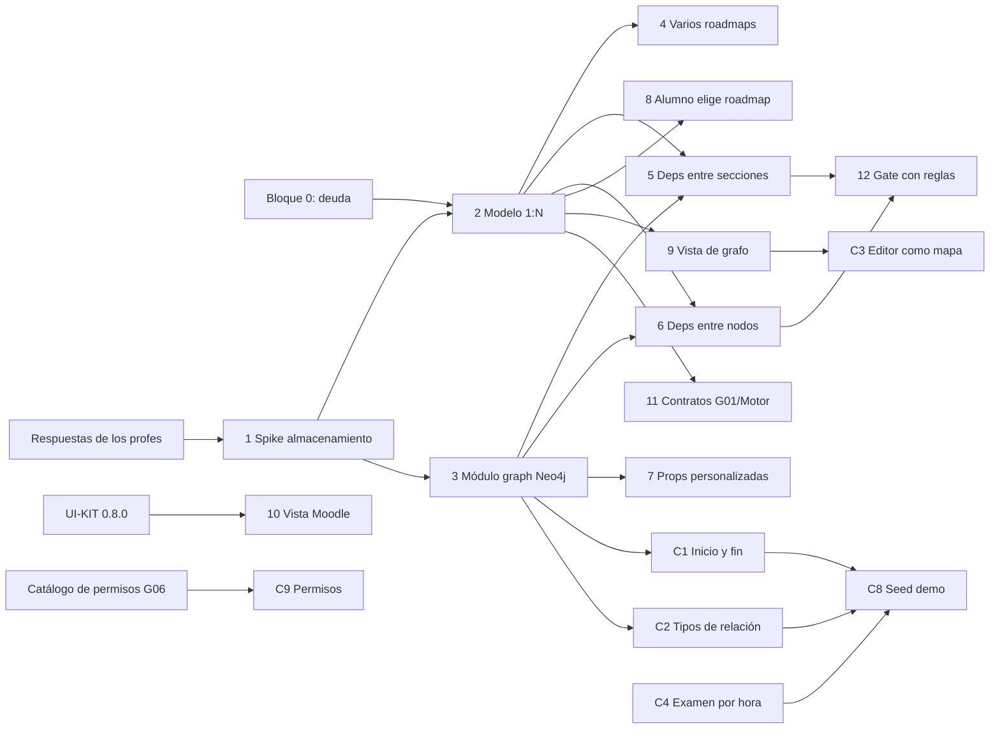

# 06 — Backlog propuesto para el Sprint 3

> [!warning] Borrador
> Borrador para discutir en equipo. Todavía no está cargado en Taiga. Los números de HU son provisorios.
>
> Esfuerzo: S (≤1 día) · M (2-3 días) · L (≥4 días).

## Bloque 0: deuda del Sprint 2 (primera semana)

Detalle en [02-pendientes.md](02-pendientes.md). La deuda técnica que no es una HU (código muerto, mocks, seguridad, docs) está en [[deuda-tecnica]]: los ítems marcados *Sprint 3* entran en este bloque.

| Ítem | Capa | Esfuerzo |
|---|---|---|
| Cerrar `feature/t-21-7-roadmap-events-topic` (redundante) y revisar `fix/account-not-found-gate` contra #193 | Back | S |
| Encender los flags en los entornos (`SECTIONS_SYNC_ENABLED`, `ROADMAP_BY_GROUP_ENABLED`) | Infra | S |
| Sacar los IDs de mock de las rutas reales | Front | S |
| HU-48: pre-chequeo de elegibilidad para el alumno | Back | M |
| HU-20/21: los 3 criterios de insignia (implementarlos o quitarlos) + edición y baja en el front | Back + Front | M |
| HU-15/16: motivo `origen_no_disponible` + stale de 24 h | Back | M |
| HU-43: validar el ícono según el tipo de nodo | Back | S |
| HU-46: Templo (o redefinir el CA con el PO) | Front | M |
| HU-45 / HU-49: cerrar o pasar al Sprint 3 con su alcance redefinido | Back + Front | M/L |
| HT-11: actualizar el texto de Taiga | Taiga | S |

## Épica nueva: "Múltiples roadmaps por curso y grafo configurable"

| # | Tipo | Título | Capa | Esfuerzo | Depende de |
|---|---|---|---|---|---|
| 1 | Spike | ~~Decidir el almacenamiento~~ **Neo4j, decidido por los profes** ([07](07-correcciones-profes.md)). Validar la infra con la plataforma y modelar los tipos de relación | Back + Infra | S | — |
| 2 | HT | Modelo 1:N curso → roadmaps: quitar el UNIQUE, agregar `roadmap_id` en las rutas, compatibilidad con `/courses/{id}` mientras migra el front | Back | L | 1 |
| 3 | HT | (Si se elige Neo4j) módulo `graph`, esquema, migración inicial de datos y caché de reglas para el gate | Back | L | 1 |
| 4 | HU | Como GESTOR o PROFESOR quiero habilitar varios roadmaps en un curso y crearlos, renombrarlos y archivarlos | Back + Front | M | 2 |
| 5 | HU | Como PROFESOR quiero definir dependencias entre secciones (AND/OR + XP mínimo + "todas las anteriores") | Back + Front | M | 2/3 |
| 6 | HU | Como PROFESOR quiero definir dependencias entre nodos dentro de una sección, con reglas combinadas | Back + Front | M | 2/3 |
| 7 | HU | Como PROFESOR quiero agregar propiedades personalizadas a nodos y secciones | Back + Front | M | 3 |
| 8 | HU | Como ALUMNO quiero elegir qué roadmap del curso recorrer y ver mi progreso en cada uno | Back + Front | M | 2, pregunta 1 |
| 9 | HU | Como PROFESOR quiero una vista de grafo cómoda: acomodo automático, aristas editables arrastrando, zoom, minimapa y posiciones guardadas | Front (+ endpoint `/graph`) | L | 2 |
| 10 | HU | Como PROFESOR quiero la vista tipo Moodle refactorizada con la UI-KIT, sincronizada con la vista de grafo | Front | L | [05](05-ui-kit.md) |
| 11 | HT | Adaptar los contratos con Courses (secciones y restricciones) y con el Motor al modelo 1:N | Back | M | 2, pregunta 2 |
| 12 | HT | Gate y progreso evaluando reglas combinadas + XP mínimo (tests BDD) | Back | M | 5, 6 |

## Épica: correcciones de los profes (2026-10-14)

Detalle y estado de cada punto en [07-correcciones-profes.md](07-correcciones-profes.md).

| # | Tipo | Título | Capa | Esfuerzo | Depende de |
|---|---|---|---|---|---|
| C1 | HU | Como PROFESOR quiero que el roadmap tenga siempre un nodo de inicio ("Bienvenidos") y uno final ("Felicitaciones"), y que no se pueda guardar sin ellos | Back + Front | M | 3 |
| C2 | HU | Como PROFESOR quiero relacionar nodos y unidades con tipos de relación (4 niveles), ver su nombre y elegir cuáles se muestran | Back + Front | L | 3, pregunta 2 de [07] |
| C3 | HU | Como PROFESOR quiero arrastrar nodos y crear relaciones arrastrando en el editor, y que el curso se vea como un mapa | Front | L | 9, pregunta 1 de [07] |
| C4 | HU | Como PROFESOR quiero habilitar un nodo examen en una ventana horaria | Back + Front | M | pregunta 3 de [07] |
| C5 | HU | Como PROFESOR quiero ver en la lista de nodos cuáles son obligatorios y de qué dependen | Front | S | — |
| C6 | Bug | El ranking por grupo da error: reproducir, default por curso, filtro opcional por comisión | Back + Front | M | Flag `ROADMAP_BY_GROUP_ENABLED` |
| C7 | HU | Como ALUMNO quiero hablar con Archibaldo con Enter, que tenga el aspecto de Hernán y que un destello me guíe por el camino | Front (3D) | M | — |
| C8 | HT | Seed de la demo con un curso entero, curado y reproducible (usa los usuarios demo de G07) | Back | M | C1, C2, C4 |
| C9 | HT | Migrar 17 `hasRole`/`hasAnyRole` (y el chequeo manual de `RankingController`) a permisos | Back | M | Catálogo de permisos de G06 |
| C10 | HT | Documentación global del micro Roadmap | Back / Docs | S | — |
| C11 | HT | Acordar con G06 los datos que aportamos al dashboard (progreso, ranking, XP) | Back + acuerdo | S | — |

## Temas consultados por el equipo (2026-10-15)

Chequeo de si cada tema está contemplado en este sprint.

| Tema | ¿En el Sprint 3? | Dónde |
|---|---|---|
| Ranking por XP, notas o ambas | ❓ Falta definir | Hoy solo XP. P14 en [[08-dudas]] |
| Insignias | ✅ | Bloque 0 (HU-20/21: criterios que no se otorgan, edición y baja en el front) |
| Grupos dentro de la cohorte (2w1, 2w2) | ✅ | Bloque 0 (HU-44/45, flag) y C6 (ranking por grupo) |
| Subsecciones / N roadmaps por curso | ✅ con dudas | Ítems 2, 4 y 8. Dependen de P1 y P6 |
| Archivado del curso | ✅ Ya hecho | Consumimos `COURSE_COHORT_ARCHIVED` |
| Estado académico final | ❌ No | Diferido en EP-61. P15 en [[08-dudas]] |
| Responsabilidades de cada rol | ⚠️ Parcial | C9 (permisos). Falta la matriz escrita: DT-03 en [[deuda-tecnica]] |
| Racha | ❌ No | EP-592 sin HU. E12 en [[08-dudas]]; el front muestra un valor fijo (DT-13) |
| Multiple choice con boss fight | ❌ No | P16 en [[08-dudas]] |
| Garage | ✅ Ya hecho | Courses guarda el material; Roadmap pide la URL (HU-04/42/46) |
| Nodos con restricción de fecha / parciales | ✅ | Bloque 0 (HU-49) y C4. Depende de P9 |

## Épica transversal: consistencia visual con la UI-KIT

Detalle y plan en [05-ui-kit.md](05-ui-kit.md).

## Orden sugerido

Las correcciones sin dependencias (C5 lista de nodos, C6 ranking, C7 Archibaldo, C10 documentación, C11 acuerdo con G06) se pueden tomar desde la semana 1 por quien no esté en el modelo.

1. **Semana 1**:
   - Bloque 0 (deuda).
   - Spike 1.
   - Respuestas de los profes: las 🔴 de [[08-dudas]] (P1 a P4) antes de arrancar los ítems 2 y 3.
   - Acordar con G01 el contrato de secciones para el modelo 1:N.
   - Correcciones independientes: C5, C6 (reproducir el error), C7, C10 y C11 (acuerdo con G06).
2. **Semana 2**:
   - HT 2 y 3 (modelo y almacenamiento).
   - En paralelo, el front arranca la UI-KIT (10) y la vista de grafo (9) sobre un mock del endpoint `/graph`.
   - C1 y C2 sobre el módulo `graph`; C4 si P9 ya está respondida; C9 si G06 ya pasó el catálogo.
3. **Cierre**: HU 4 a 8 y 12 integradas, C3 y C8 (seed curado), y demo con un curso completo de inicio a fin (con 2 roadmaps si P1 lo confirma).

## Riesgos del sprint

> [!danger] Riesgos
> - **Alcance.** La épica nueva es grande. Si además se elige Neo4j, es el cambio más grande del proyecto hasta ahora. Conviene acordar con los profes un mínimo para la demo.
> - **Dependencias externas**: G01 (contrato de secciones, HU-49) y la plataforma (infra de Neo4j).
> - **Contradicción abierta.** "El mapa es el curso" puede descartar los N roadmaps (P1 en [[08-dudas]]). Si se descarta, los ítems 2, 4, 8 y 11 se caen o se achican.
> - **Correcciones.** Suman 11 ítems (C1–C11) a una épica que ya era grande. C9 depende de G06 y C8 depende de casi todo: van al final.
> - **Regresiones.** Cambiar `/courses/{id}` por `/roadmaps/{id}` toca casi todo el front y el back. Mantener compatibilidad mientras se migra.
