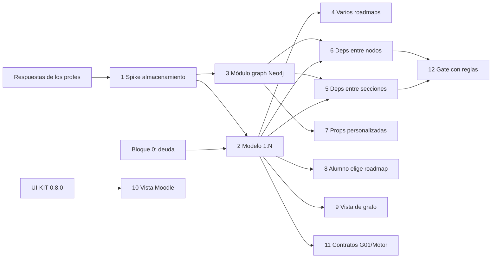

# 06 — Backlog propuesto para el Sprint 3

> [!warning] Borrador
> Borrador para discutir en equipo. Todavía no está cargado en Taiga. Los números de HU son provisorios.
>
> Esfuerzo: S (≤1 día) · M (2-3 días) · L (≥4 días).

## Bloque 0: deuda del Sprint 2 (primera semana)

Detalle en [02-pendientes.md](02-pendientes.md).

| Ítem | Capa | Esfuerzo |
|---|---|---|
| Cerrar `feature/t-21-7-roadmap-events-topic` (redundante) y revisar `fix/account-not-found-gate` contra #193 | Back | S |
| Encender los flags en los entornos (`SECTIONS_SYNC_ENABLED`, `ROADMAP_BY_GROUP_ENABLED`) | Infra | S |
| Sacar los IDs de mock de las rutas reales | Front | S |
| HU-48: pre-chequeo de elegibilidad para el alumno | Back | M |
| HU-20/21: los 3 criterios de insignia (implementarlos o quitarlos) + edición y baja en el front | Back + Front | M |
| HU-15/16: motivo `origen_no_disponible` + stale de 24 h | Back | M |
| HU-43: validar el ícono según el tipo de nodo | Back | S |
| HU-46: Templo (o redefinir el CA con el PO) | Front | M |
| HU-45 / HU-49: cerrar o pasar al Sprint 3 con su alcance redefinido | Back + Front | M/L |
| HT-11: actualizar el texto de Taiga | Taiga | S |

## Épica nueva: "Múltiples roadmaps por curso y grafo configurable"

| # | Tipo | Título | Capa | Esfuerzo | Depende de |
|---|---|---|---|---|---|
| 1 | Spike | Decidir el almacenamiento del grafo: Postgres, AGE o Neo4j (ver [04](04-base-de-grafos.md)) y validar la infra con la plataforma | Back + Infra | S | Respuesta de los profes (pregunta 7) |
| 2 | HT | Modelo 1:N curso → roadmaps: quitar el UNIQUE, agregar `roadmap_id` en las rutas, compatibilidad con `/courses/{id}` mientras migra el front | Back | L | 1 |
| 3 | HT | (Si se elige Neo4j) módulo `graph`, esquema, migración inicial de datos y caché de reglas para el gate | Back | L | 1 |
| 4 | HU | Como GESTOR o PROFESOR quiero habilitar varios roadmaps en un curso y crearlos, renombrarlos y archivarlos | Back + Front | M | 2 |
| 5 | HU | Como PROFESOR quiero definir dependencias entre secciones (AND/OR + XP mínimo + "todas las anteriores") | Back + Front | M | 2/3 |
| 6 | HU | Como PROFESOR quiero definir dependencias entre nodos dentro de una sección, con reglas combinadas | Back + Front | M | 2/3 |
| 7 | HU | Como PROFESOR quiero agregar propiedades personalizadas a nodos y secciones | Back + Front | M | 3 |
| 8 | HU | Como ALUMNO quiero elegir qué roadmap del curso recorrer y ver mi progreso en cada uno | Back + Front | M | 2, pregunta 1 |
| 9 | HU | Como PROFESOR quiero una vista de grafo cómoda: acomodo automático, aristas editables arrastrando, zoom, minimapa y posiciones guardadas | Front (+ endpoint `/graph`) | L | 2 |
| 10 | HU | Como PROFESOR quiero la vista tipo Moodle refactorizada con la UI-KIT, sincronizada con la vista de grafo | Front | L | [05](05-ui-kit.md) |
| 11 | HT | Adaptar los contratos con Courses (secciones y restricciones) y con el Motor al modelo 1:N | Back | M | 2, pregunta 2 |
| 12 | HT | Gate y progreso evaluando reglas combinadas + XP mínimo (tests BDD) | Back | M | 5, 6 |

## Épica transversal: consistencia visual con la UI-KIT

Detalle y plan en [05-ui-kit.md](05-ui-kit.md).

## Orden sugerido

1. **Semana 1**:
   - Bloque 0 (deuda).
   - Spike 1.
   - Respuestas de los profes a las preguntas de [03](03-requerimientos-profes.md).
   - Acordar con G01 el contrato de secciones para el modelo 1:N.
2. **Semana 2**:
   - HT 2 y 3 (modelo y almacenamiento).
   - En paralelo, el front arranca la UI-KIT (10) y la vista de grafo (9) sobre un mock del endpoint `/graph`.
3. **Cierre**: HU 4 a 8 y 12 integradas, y demo con 2 roadmaps en un curso.

## Riesgos del sprint

> [!danger] Riesgos
> - **Alcance.** La épica nueva es grande. Si además se elige Neo4j, es el cambio más grande del proyecto hasta ahora. Conviene acordar con los profes un mínimo para la demo.
> - **Dependencias externas**: G01 (contrato de secciones, HU-49) y la plataforma (infra de Neo4j).
> - **Regresiones.** Cambiar `/courses/{id}` por `/roadmaps/{id}` toca casi todo el front y el back. Mantener compatibilidad mientras se migra.
