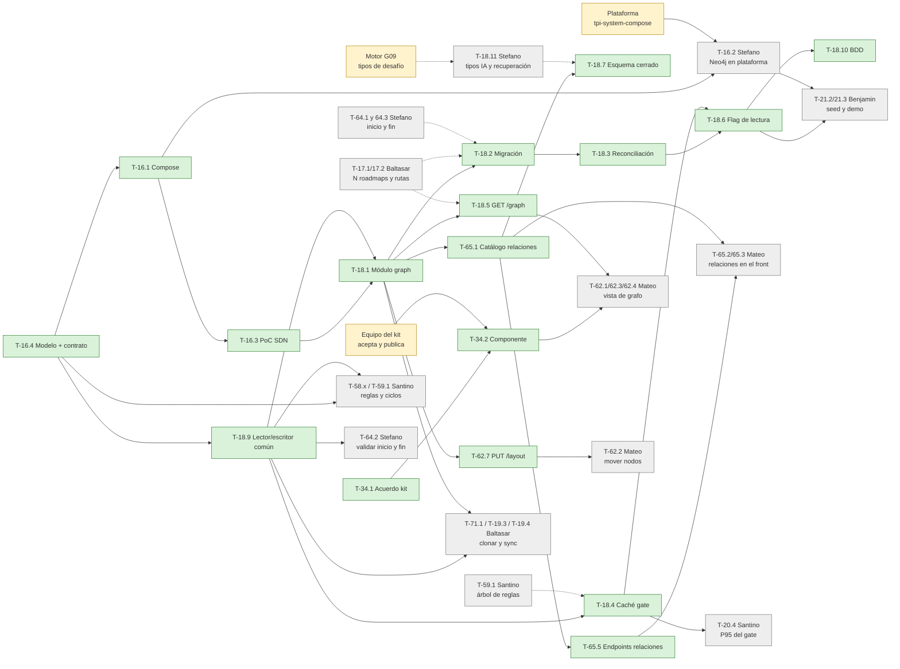

# 11 — Plan de ejecución del grafo (Neo4j, endpoint y componente)

> [!info] Alcance
> Orden de trabajo de las tareas de Iker Alonso en el Sprint 3: [[sprints/sprint-3/historias/HT-16 Validar la infra de Neo4j y modelar las relaciones|HT-16]], [[sprints/sprint-3/historias/HT-18 Módulo graph en Neo4j y migración inicial|HT-18]], [[sprints/sprint-3/historias/HT-34 Componente de grafo en la UI-KIT|HT-34]] y su parte de [[sprints/sprint-3/historias/HU-65 Relaciones con tipo|HU-65]] y [[sprints/sprint-3/historias/HU-62 Vista de grafo cómoda para el profesor|HU-62]]. Supone aceptados los cambios de [[sprints/sprint-3/10-propuesta-tareas-grafo|10-propuesta-tareas-grafo]]. Si alguno no se acepta, ver [[#Si cambia el reparto]].
>
> **Día 1** = primer día hábil después del planning. Son 14 días a unas 5 h por día.

## La idea en una frase

Primero se publican **los contratos** (modelo del grafo, JSON de `/graph`, API del componente y lector/escritor común) para que nadie espere código. Después se construye la base en Neo4j. Recién al final se mueve la lectura de Postgres a Neo4j, cuando todo lo demás ya funciona contra el modelo común.

## Mis tareas (17 tareas, 67 h)

| # | Tarea | Historia | Hs | Repo |
|---|---|---|---|---|
| 1 | T-16.4 Modelo del grafo + contrato de `/graph` | HT-16 | 2 | `tpi-roadmap` (`docs/`) |
| 2 | T-34.1 Acordar el componente con el equipo del kit | HT-34 | 2 | coordinación |
| 3 | T-16.1 Neo4j en el compose local | HT-16 | 2 | `tpi-roadmap` |
| 4 | T-16.3 Spring Data Neo4j + Testcontainers | HT-16 | 4 | `tpi-roadmap` |
| 5 | T-18.9 Modelo común y lector/escritor por base | HT-18 | 4 | `tpi-roadmap` |
| 6 | T-18.1 Módulo `graph` y esquema en Neo4j | HT-18 | 6 | `tpi-roadmap` |
| 7 | T-65.1 Catálogo de los 5 tipos de relación | HU-65 | 5 | `tpi-roadmap` |
| 8 | T-18.7 Rechazar campos libres y tipos fuera del catálogo | HT-18 | 2 | `tpi-roadmap` |
| 9 | T-18.5 `GET /roadmaps/{id}/graph` | HT-18 | 4 | `tpi-roadmap` |
| 10 | T-18.4 Caché de reglas por roadmap para el gate | HT-18 | 4 | `tpi-roadmap` |
| 11 | T-34.2 Construir y publicar `generic-node-graph` | HT-34 | 10 | `2026-PIV-TPI-UI-KIT` |
| 12 | T-65.5 Endpoints de relaciones con tipo | HU-65 | 4 | `tpi-roadmap` |
| 13 | T-62.7 Guardar posiciones (`PUT /layout`) | HU-62 | 2 | `tpi-roadmap` |
| 14 | T-18.2 Job de migración Postgres → Neo4j | HT-18 | 6 | `tpi-roadmap` |
| 15 | T-18.3 Log, outbox y reconciliación entre bases | HT-18 | 5 | `tpi-roadmap` |
| 16 | T-18.6 Flag de lectura en Neo4j | HT-18 | 2 | `tpi-roadmap` |
| 17 | T-18.10 Escenarios BDD de la estructura | HT-18 | 3 | `tpi-roadmap` |

## Mapa de dependencias

Flechas = "tiene que estar antes". En verde, las tareas de Iker; en gris, las de otras personas o grupos.

## Cronograma día por día

Cada bloque termina en algo **mergeable a `develop`** (un PR por día, salvo los días de solo coordinación).

### Semana 1 — Contratos y base

| Día | Qué hago | Hs | Entrega (PR) | Qué destraba |
|---|---|---|---|---|
| **1** | **T-16.4** Modelo del grafo: etiquetas, 5 relaciones con `label` y `visible`, árbol de reglas, subsecciones (P6), START/END por roadmap y por sección, posiciones, qué queda en Postgres. Incluye el **contrato de `GET /roadmaps/{id}/graph`** (JSON de ejemplo) en `docs/contracts/`. **T-34.1** propuesta de API de `generic-node-graph` al equipo del kit, alineada con ese JSON | 4 | PR 1: `docs/T-16-4-MODELO-GRAFO.md` + contrato de `/graph` | Santino, Stefano y Baltasar ya saben cómo se guarda lo suyo. Mateo puede mockear `/graph` y arrancar la vista |
| **2** | **T-16.1** Neo4j en `docker/docker-compose.yml` (volumen, credenciales por variables y healthcheck). Arranco **T-16.3**: dependencias y versión compatible con Spring Boot 4 | 5 | PR 2: Neo4j en el compose | Stefano puede arrancar T-16.2 con el bloque del compose |
| **3** | Termino **T-16.3** (test con Testcontainers: sección con 2 nodos y `REQUIRES`). **T-18.9**: `RoadmapStructure`, `StructureReader`/`StructureWriter` y la implementación sobre Postgres | 5 | PR 3: PoC de Neo4j · PR 4: modelo común (impl. Postgres) | **Clave:** Santino (T-58.x, T-59.1), Stefano (T-64.2) y Baltasar (T-71.1, T-19.3, T-19.4) programan sobre el modelo común y no sobre JPA |
| **4** | **T-18.1** Paquete `graph`: entidades de Spring Data Neo4j, repositorios y esquema con `neo4j-migrations` | 5 | — | — |
| **5** | Termino **T-18.1**. **T-34.2** (parte 1): pruebo la librería (`ngx-vflow` o `@foblex/flow` + `elkjs`) con **Angular 22** y armo el esqueleto del componente | 5 | PR 5: módulo `graph` | Baltasar puede copiar subgrafos en Neo4j. Se confirma la librería antes de invertir más |

> [!check] Chequeo del día 5
> - ¿El equipo del kit respondió T-34.1? Si no, insistir y avisar en la daily. Mateo arranca T-62.1 con la librería directa, como ya prevé HU-62.
> - ¿Funcionaron las versiones de Spring Data Neo4j y `neo4j-migrations` con Boot 4? Si no, decidirlo en el día: migraciones con Cypher propio.

### Semana 2 — Funcionalidad, migración y corte de lectura

| Día | Qué hago | Hs | Entrega (PR) | Qué destraba |
|---|---|---|---|---|
| **6** | **T-65.1** Catálogo de relaciones: enum con `label`, `visible` y `affectsUnlock` (solo `REQUIRES`) | 5 | PR 6: catálogo de relaciones | Mateo (T-65.2 y T-65.3) tiene los tipos y sus nombres |
| **7** | **T-18.7** Esquema cerrado: 400 ante campos libres o tipos fuera del catálogo. Arranco **T-18.5** | 5 | PR 7: validación del esquema | — |
| **8** | Termino **T-18.5** `GET /roadmaps/{id}/graph` con OpenAPI y test del contrato. **T-18.4** caché de reglas sobre `StructureReader`, invalidada en cada edición | 5 | PR 8: endpoint `/graph` · PR 9: caché del gate | Mateo pasa del mock al endpoint real. Santino mide el P95 (T-20.4) desde el día 9 |
| **9** | **T-34.2** (parte 2): pan, zoom, minimapa, aristas con etiqueta y forma de línea, teclado, tokens del kit | 5 | — | — |
| **10** | Termino **T-34.2**: specs, historia de Storybook con 150 nodos y PR al kit con el pedido de release. **T-65.5** `POST/DELETE /relations` | 5 | PR al kit (`2026-PIV-TPI-UI-KIT`) · PR 10: relaciones | Con la release, Mateo cambia la librería directa por el componente del kit |
| **11** | **T-62.7** `PUT /layout`. Arranco **T-18.2** | 5 | PR 11: posiciones | Mateo: crear relaciones arrastrando (T-62.3) y mover nodos (T-62.2) |
| **12** | **T-18.2** Job de migración idempotente con reporte de cantidades. Arranco **T-18.3** | 5 | PR 12: migración | — |
| **13** | Termino **T-18.3** (`node_edit_log`, outbox y reconciliación). **T-18.6** Flag de lectura (completa la implementación Neo4j de `StructureReader`/`Writer`) | 5 | PR 13: reconciliación + flag | Benjamin puede correr la demo con Neo4j (T-21.2, T-21.3) |
| **14** | **T-18.10** Escenarios BDD. Mergear lo pendiente y acompañar la Wiki (T-16.5, T-18.8, T-34.3, T-65.4) | 3 | PR 14: BDD | Tomás cierra la Wiki con todo implementado |

> [!warning] No hay margen
> Con 67 h el cronograma ocupa los 14 días y no queda colchón para integrar al final. Si el **día 7** voy atrasado, paso **T-18.3** a Stefano y, si hace falta, **T-18.4** a Santino (ver [[sprints/sprint-3/10-propuesta-tareas-grafo#4. Cómo queda la carga|la válvula de la propuesta]]). Así se liberan los dos últimos días para integrar.

## De quién dependo yo

| Necesito | De quién | Para qué tarea mía | Para cuándo | Si no llega |
|---|---|---|---|---|
| Que acepten la API de `generic-node-graph` y publiquen una release | **Equipo de la UI-KIT** (otros grupos, organización `2026-P4-FE`) | T-34.1, T-34.2 | Respuesta: día 4. Release: día 11 | Mateo sigue con la librería directa y se cambia por el componente en cuanto salga la release |
| Modelo de N roadmaps por curso (`is_primary`) y rutas `/roadmaps/{roadmapId}/...` | **Baltasar** (T-17.1, T-17.2) | T-18.5 (ruta), T-18.2 (migrar todos los roadmaps de un curso) | Día 8 | Expongo `/roadmaps/{id}/graph` con el id del roadmap principal y la migración toma todos los roadmaps que haya |
| Formato del árbol de reglas AND/OR anidadas | **Santino** (T-59.1) | T-16.4 (cómo se guarda), T-18.4 (qué se cachea) | Acordarlo el día 1 | Guardo el árbol como lo define T-16.4 y Santino lo usa tal cual |
| `START` y `END` en los tipos de nodo y en los roadmaps existentes | **Stefano** (T-64.1, T-64.3) | T-18.7 (catálogo), T-18.2 (la migración tiene que llevarlos) | Día 11 | La corrida final de la migración espera a T-64.3 |
| Tipos de desafío de IA y de recuperación de vida | **Stefano** (T-18.11) y **Motor G09** | T-18.7 (catálogo cerrado) | Día 7 | El catálogo sale con los tipos de hoy más START/END, y se suman después |
| Neo4j en `tpi-system-compose`, mesh y demo | **Stefano** (T-16.2) y quien mantiene la plataforma | T-18.6 en el entorno integrado | Día 11 | Todo se prueba local. La demo integrada sigue con Postgres (flag apagado) |
| Si un roadmap usa secciones de Courses o propias | **Mateo** (T-19.1, con Courses G01) | T-16.4 (propiedad del roadmap) | Día 3 | El modelo deja la propiedad prevista con "secciones de Courses" como valor por defecto |

## Quién depende de mí

| Persona | Su tarea | Espera de mí | Lo tiene el día | Mientras tanto puede |
|---|---|---|---|---|
| **Mateo Delgado Costa** | T-62.1 Vista de grafo | Contrato de `/graph` (T-16.4) → endpoint real (T-18.5) → componente del kit (T-34.2) | Contrato: 1 · Endpoint: 8 · Kit: 11 | Arrancar con un mock del contrato y la librería directa |
| | T-62.3 Crear y borrar relaciones arrastrando | T-65.5 y T-34.2 | 11 | Armar la interacción contra el mock |
| | T-62.4 Usar el grafo con teclado | Teclado del componente (T-34.2) | 11 | Hacer el enlace alternativo a la lista de nodos |
| | T-62.2 Mover nodos (front) | `PUT /layout` (T-62.7) | 11 | Guardar en el store local |
| | T-65.2 y T-65.3 Relaciones en el front | Catálogo (T-65.1) y endpoints (T-65.5) | 6 y 11 | Usar los 5 tipos del contrato del día 1 |
| | T-65.6 Ocultar tipos para el alumno | `GET /graph` (T-18.5) | 8 | — |
| **Fenoglio Santino** | T-58.1, T-58.2, T-59.1 Reglas y ciclos | Modelo (T-16.4) y lector/escritor común (T-18.9) | 1 y 3 | Diseñar el evaluador con el modelo del día 1 |
| | T-20.1 Un solo evaluador | `StructureReader` (T-18.9) | 3 | — |
| | T-20.4 P95 del gate | Caché (T-18.4) | 9 | Preparar el roadmap de 150 nodos y el script de carga |
| **Stefano Zoffoli** | T-64.1 a T-64.3 Inicio y fin | Modelo (T-16.4) y `RoadmapStructure` (T-18.9) | 1 y 3 | — |
| | T-16.2 Neo4j en la plataforma | Bloque del compose (T-16.1) | 2 | Hablar con quien mantiene la plataforma |
| | T-18.11 Tipos nuevos | Catálogo cerrado (T-18.7) para integrarlos | 7 | Acordar con G09 los tipos |
| **Baltasar Rodriguez Teruel** | T-71.1 Clonar un roadmap | `StructureWriter` (T-18.9) y módulo `graph` (T-18.1) | 3 y 5 | Clonar sobre la implementación Postgres del día 3 |
| | T-19.3 y T-19.4 Sync y eventos del Motor | `StructureReader`/`Writer` (T-18.9) | 3 | — |
| **Benjamin Polzoni** | T-21.2 y T-21.3 Seed y demo | Migración y flag (T-18.2, T-18.6) y Neo4j en la demo (T-16.2) | 13 | Armar el seed sobre Postgres: la migración lo pasa a Neo4j |
| **Ludmila Cejas** | T-64.4 Cómo se ven inicio y fin | Que el componente acepte un aspecto propio por tipo de nodo (T-34.2) | 11 | Definir el diseño |
| **Quinteros Tomás** | T-16.5, T-18.8, T-34.3, T-65.4 Wiki | Cada tarea terminada | 5 a 14 | Ir documentando a medida que se mergea |

## Riesgos

| Riesgo | Probabilidad | Mitigación |
|---|---|---|
| Spring Data Neo4j, `neo4j-migrations` o Testcontainers no andan con Spring Boot 4 | Media | Lo valida T-16.3 el día 2-3. Plan B: migraciones con scripts Cypher propios |
| La librería del grafo no anda con Angular 22 | Media | Se prueba el día 5, antes de construir el componente |
| El kit tarda en publicar la release | Media | La propuesta sale el día 1. Mateo arranca con la librería directa |
| Otras historias programan contra JPA y hay que reescribirlas al pasar a Neo4j | Alta si no hay T-18.9 | T-18.9 mergeada el día 3 y los ajustes de criterio de la propuesta |
| Inconsistencia entre Postgres y Neo4j | Media | Ids compartidos, solo baja lógica, reconciliación (T-18.3) en cero antes de encender el flag |
| Sobrecarga de Iker (152 %) | Alta | Chequeo del día 7 y válvula: T-18.3 a Stefano, T-18.4 a Santino |
| Sin CI remoto: los tests con Testcontainers solo corren local | Segura | Cada PR lleva la salida de `./mvnw verify` local. Hace falta Docker en la máquina |

## Si cambia el reparto

- **Si Stefano no toma T-16.2:** vuelve a Iker (+4 h) y se hace el día 2, junto con T-16.1. Ahí sí o sí se activa la válvula del día 7.
- **Si Mateo no acepta separar T-62.2:** se borra T-62.7 (−2 h) y Mateo guarda las posiciones con `StructureWriter`.
- **Si Mateo no toma T-65.6:** la hace Iker el día 8, junto con T-18.5 (+3 h).
- **Si el equipo no acepta T-18.9:** T-18.6 vuelve a 4 h, y hay que avisar a Santino, Stefano y Baltasar que su código sobre JPA se va a adaptar al final del sprint.
