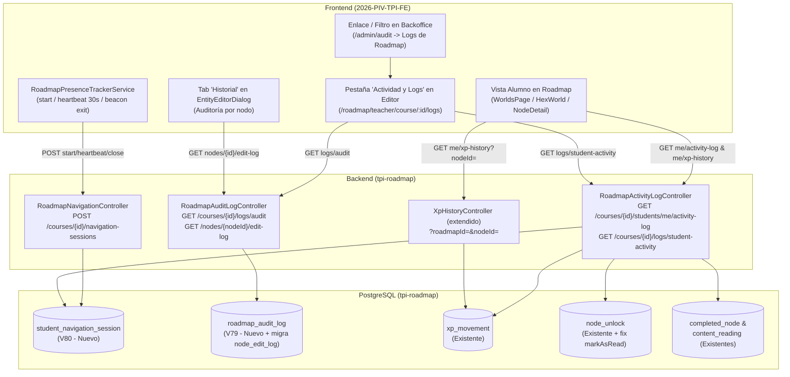

# Sistema de Logs, Telemetría de Alumnos y Auditoría del Roadmap (Back + Front)

> [!NOTE] Pedido
> Implementar un sistema integral de **logs y auditoría enfocado en el apartado de Roadmaps**, con vistas diferenciadas según el rol del usuario:
> 1. **Vista Alumno (en Roadmaps y apartado de Nodos)**:
>    - Ver sus propios movimientos dentro del roadmap (lecturas, completitudes, avances).
>    - Ver **qué nodos desbloqueó**, cuándo y por qué motivo.
>    - Ver el **movimiento e historial de su XP** tanto en el roadmap general como dentro del apartado de cada nodo.
> 2. **Vista Admin / Gestor / Profesor (en Roadmaps y pestaña de Logs del sistema)**:
>    - **Actividad de cada alumno en el roadmap**: a dónde entró y **por cuánto tiempo** (tracking de permanencia/sesión), qué nodo hizo/completó, qué ejercicio resolvió, cuánta XP ganó y qué nodos se le desbloquearon.
>    - **Auditoría de acciones administrativas y docentes sobre los nodos y el roadmap**: qué nodo se creó, se editó (y por qué profesor/admin), se eliminó, se movió (orden o sección), se ocultó, se mostró, se asignó (desafío/contenido/grupos), se cambió el nombre o las reglas de desbloqueo.

---

## 1. Diagnóstico del estado actual en el Backend (`tpi-roadmap`)

Se auditó el microservicio `Backend/tpi-roadmap-develop` (migraciones Flyway `V1` a `V78`, entidades JPA, repositorios, servicios, controladores y listeners Kafka). A continuación se detalla qué existe hoy y qué brechas impiden cumplir el 100% del requerimiento:

### 1.1. Lo que YA existe hoy en `tpi-roadmap`

| Dominio | Tabla / Entidad | Servicio / Endpoint actual | Qué guarda hoy |
|---|---|---|---|
| **Movimientos de XP** | `xp_movement` (`V16`, `V61`, `V66`, `V70`, `V73`, `V76`, `V78`) · `XpMovementEntity` | `XpHistoryController`:<br>• `GET /api/roadmap/courses/{courseId}/students/me/xp-history`<br>• `GET /api/roadmap/courses/{courseId}/students/{studentId}/xp-history` | Append-only ledger por intento (`id_attempt`, `challenge_id`, `node_id`, `section_id`, `roadmap_id`, `xp` con signo para rectificaciones, `counted_in_course`, `score`, `max_score`, `required_minimums_met`, `attempt_number`, `status`, `result_revision`, `previous_result_revision`, `post_pass_repeat`, `recorded_at`). |
| **Desbloqueo de nodos** | `node_unlock` (`V23`) · `NodeUnlockEntity` (`UnlockOrigin`: `PROGRESS`, `RULE_CHANGE`, `XP`) | `PrerequisiteService.recordUnlocksAfter` / `recordXpUnlocks` / `freezeUnlockedStudentsBeforeRuleChange`.<br>**Sin endpoint HTTP propio.** | Guarda `student_id`, `node_id`, `origin`, `unlocked_by_node_id`, `unlocked_by_event_id`, `unlocked_at`. También emite `NODE_UNLOCKED` en `outbox_event`. |
| **Nodos completados y leídos** | `completed_node` (`V4`) · `CompletedNodeEntity`<br>`content_reading` (`V19`) · `ContentReadingEntity`<br>`daily_activity` (`V29`) | `ProgressService.completeNode` / `markAsRead`.<br>`GET /api/roadmap/courses/{courseId}/students/{studentId}/progress` | `completed_node` guarda `(student_id, node_id, completed_at)`. `content_reading` guarda `(student_id, node_id, read_at)`. El endpoint `/progress` devuelve solo el estado actual (`LOCKED`, `ENABLED`, `COMPLETED`), **sin timestamps**. |
| **Edición docente de nodos** | `node_edit_log` (`V18`) · `NodeEditLogEntity` | `NodeEditLogService` / `GraphController`:<br>• `GET /api/roadmap/nodes/{nodeId}/edit-log` *(huérfano B4-119 en Front)* | Guarda `node_id`, `edited_by` (UUID), `changed_fields` (JSON array de nombres de campos, ej. `["name","sortOrder"]`) y `edited_at`. Calcula `affected_students` cruzando con `completed_node`. |

### 1.2. Análisis de brechas (Gaps detectados)

> [!WARNING] Brechas críticas entre lo existente y lo requerido
> 1. **Gap 1 — Tracking de permanencia ("a dónde entró y por cuánto tiempo") inexistente (0%)**:
>    - Hoy `GET /courses/{courseId}`, `GET /roadmaps/{roadmapId}` y `GET /courses/{courseId}/nodes/{nodeId}` son lecturas `@Transactional(readOnly = true)` sin rastro en base de datos. En el Frontend, `VisitService` solo escribe en `localStorage` (`educa.visited.{courseId}`). No existe tabla ni endpoint de sesiones de navegación/permanencia por alumno en el roadmap, sección o nodo.
> 2. **Gap 2 — Desbloqueos (`node_unlock`) sin endpoint y sin registro al leer nodos `CONTENT`**:
>    - No existe ningún endpoint REST que devuelva la tabla `node_unlock` (ni para el alumno ni para el profesor/admin).
>    - Además, en `ProgressService.markAsRead(studentId, courseCohortId, nodeId)` no se invoca `prerequisites.recordUnlocksAfter(nodeId, studentId, null)` (solo se llama en `completeNode` cuando aprueba un desafío). Por lo tanto, cuando un nodo `CONTENT` destraba el siguiente nodo, no queda fila en `node_unlock`.
> 3. **Gap 3 — Historial de XP sin filtro por nodo/roadmap ni vista global de curso para docentes**:
>    - `XpHistoryController` solo permite consultar por `(studentId, courseId)` paginado. No permite filtrar por `nodeId` (para el apartado del nodo del alumno) ni por `roadmapId`, ni consultar todos los movimientos de XP del curso/roadmap sin iterar alumno por alumno. Tampoco incluye el nombre del nodo (`node_name`) cuando un nodo fue eliminado.
> 4. **Gap 4 — Completitudes (`completed_node`) y lecturas (`content_reading`) no exponen sus fechas en un feed de actividad**:
>    - Aunque `completed_at` y `read_at` se persisten en DB, ningún DTO de respuesta los expone en una línea de tiempo para saber exactamente cuándo el alumno leyó un material o completó un nodo.
> 5. **Gap 5 — Operaciones sobre nodos que NO se registran en `node_edit_log`**:
>    - **Creación de nodo (`createNode`)**: no genera entrada en `node_edit_log`.
>    - **Eliminación de nodo (`deleteNode`)**: `GraphController.deleteNode` no pasa el `professorId` y `GraphService.deleteNode` solo hace `node.softDelete()`. Peor aún: como `NodeEntity` tiene `@SQLRestriction("deleted_at IS NULL")`, pedir `GET /nodes/{nodeId}/edit-log` de un nodo eliminado devuelve `404 node.not-found`.
>    - **Asignación de contenido (`PATCH /nodes/{nodeId}/content` · `updateContent`)**: no recibe `professorId` ni registra el cambio de `contentId`.
>    - **Alta/baja individual de correlativas (`POST /nodes/{nodeId}/prerequisites`, `DELETE /prerequisites/{id}`)**: no registra entrada en `node_edit_log`.
> 6. **Gap 6 — `node_edit_log` solo guarda nombres de campos (`changed_fields`), sin valores previos/nuevos ni tipo de acción semántica**:
>    - Hoy guarda `["name", "available"]`, pero no guarda qué acción fue (`HIDE`, `SHOW`, `RENAME`, `MOVE_ORDER`, `MOVE_SECTION`, `DELETE`, `ASSIGN_CHALLENGE`, etc.), ni el valor anterior vs. nuevo (`old_values` / `new_values`), ni el `node_name_snapshot` (indispensable si el nodo luego se elimina).
> 7. **Gap 7 — Mutaciones de Secciones (Unidades) y de Roadmaps no tienen auditoría**:
>    - Crear, renombrar, mover, ocultar/mostrar (`isVisible`), cambiar reglas o eliminar una **Sección**, así como crear, renombrar, clonar, archivar, cambiar modo de XP (`rankingOrder`) o asignar grupos (`assignGroups`) a un **Roadmap**, no deja registro de auditoría en `tpi-roadmap`.
> 8. **Gap 8 — Falta endpoint de auditoría a nivel Curso / Roadmap**:
>    - `GET /nodes/{nodeId}/edit-log` obliga a consultar nodo por nodo. Para la pestaña de Logs del sistema / Roadmaps se necesita un endpoint paginado y filtrable por curso y roadmap (`GET /api/roadmap/courses/{courseId}/audit-log`).

---

## 2. Arquitectura de la solución propuesta



---

## 3. Diseño detallado de Backend (`Backend/tpi-roadmap-develop`)

### 3.1. Migraciones de Base de Datos (Flyway `V79` y `V80`)

#### `V79__roadmap_audit_log.sql` — Auditoría completa de Nodos, Secciones y Roadmaps
En lugar de limitarnos a `node_edit_log` (que tiene `node_id NOT NULL` con FK a `node(id)` y solo guarda un array de strings), creamos `roadmap_audit_log` para cubrir mutaciones de **Nodos, Secciones, Roadmaps y Relaciones**, guardando tipo de acción, snapshot del nombre y valores anteriores/nuevos, y migramos las filas históricas de `node_edit_log`:

```sql
CREATE TABLE roadmap_audit_log (
    id                      UUID PRIMARY KEY,
    organization_id         UUID NOT NULL,
    course_cohort_id        UUID NOT NULL,
    roadmap_id              UUID NOT NULL,
    section_id              UUID,
    node_id                 UUID,
    target_type             VARCHAR(24) NOT NULL, -- 'ROADMAP' | 'SECTION' | 'NODE' | 'PREREQUISITE' | 'TYPED_RELATION'
    target_id               UUID NOT NULL,
    target_name_snapshot    VARCHAR(255) NOT NULL,
    action_type             VARCHAR(40) NOT NULL,
    -- Valores de action_type:
    -- 'CREATED' | 'UPDATED' | 'DELETED' | 'RENAMED'
    -- 'MOVED_ORDER' | 'MOVED_SECTION' | 'MOVED_POSITION'
    -- 'HIDDEN' | 'SHOWN'
    -- 'ASSIGNED_CHALLENGE' | 'UNASSIGNED_CHALLENGE'
    -- 'ASSIGNED_CONTENT' | 'UNASSIGNED_CONTENT'
    -- 'ASSIGNED_GROUPS' | 'UPDATED_RULES'
    -- 'CLONED' | 'ARCHIVED' | 'SYSTEM_CHALLENGE_ARCHIVED'
    actor_id                UUID NOT NULL,
    actor_role              VARCHAR(32),          -- 'PROFESSOR' | 'ADMIN' | 'GESTOR' | 'SYSTEM'
    changed_fields          TEXT NOT NULL,        -- JSON array ["name", "sortOrder", ...]
    previous_values         TEXT,                 -- JSON object {"name": "Viejo", "available": true}
    new_values              TEXT,                 -- JSON object {"name": "Nuevo", "available": false}
    affected_students_count INTEGER NOT NULL DEFAULT 0,
    occurred_at             TIMESTAMP NOT NULL DEFAULT CURRENT_TIMESTAMP
);

CREATE INDEX idx_roadmap_audit_course_time
    ON roadmap_audit_log (course_cohort_id, occurred_at DESC);

CREATE INDEX idx_roadmap_audit_roadmap_time
    ON roadmap_audit_log (roadmap_id, occurred_at DESC);

CREATE INDEX idx_roadmap_audit_node_time
    ON roadmap_audit_log (node_id, occurred_at DESC)
    WHERE node_id IS NOT NULL;

CREATE INDEX idx_roadmap_audit_actor_time
    ON roadmap_audit_log (actor_id, occurred_at DESC);
```

> [!TIP] Compatibilidad con `GET /api/roadmap/nodes/{nodeId}/edit-log`
> El endpoint existente `GET /api/roadmap/nodes/{nodeId}/edit-log` pasa a leer de `roadmap_audit_log` filtrando por `node_id = :nodeId` **sin exigir que el nodo siga vivo en `node`** (`deleted_at IS NULL`), agregando al DTO `EditLogEntry` los campos `action_type`, `target_name_snapshot`, `previous_values` y `new_values` sin romper los campos existentes (`node_id`, `edited_by`, `edited_at`, `changed_fields`, `affected_students`).

#### `V80__student_navigation_session.sql` — Tracking de permanencia del alumno ("a dónde entró y por cuánto tiempo")
Registra cada ingreso de un alumno al mapa del roadmap, a una isla/sección o a un nodo (detalle, lector de contenido o lanzamiento de desafío) y su duración en segundos:

```sql
CREATE TABLE student_navigation_session (
    id                  UUID PRIMARY KEY,
    organization_id     UUID NOT NULL,
    course_cohort_id    UUID NOT NULL,
    roadmap_id          UUID NOT NULL,
    section_id          UUID,
    node_id             UUID,
    student_id          UUID NOT NULL,
    scope               VARCHAR(32) NOT NULL,
    -- Valores de scope:
    -- 'ROADMAP_MAP'      (Vista de islas / mundos del curso)
    -- 'SECTION_WORLD'    (Mapa hexagonal 3D de una unidad/sección)
    -- 'NODE_DETAIL'      (Apertura de panel/detalle de un nodo)
    -- 'CONTENT_READER'   (Lectura de material teórico de un nodo CONTENT)
    -- 'CHALLENGE_LAUNCH' (Ingreso a resolver el ejercicio desde el nodo)
    entered_at          TIMESTAMP NOT NULL,
    last_heartbeat_at   TIMESTAMP NOT NULL,
    exited_at           TIMESTAMP,
    duration_seconds    INTEGER NOT NULL DEFAULT 0,
    closed              BOOLEAN NOT NULL DEFAULT FALSE
);

CREATE INDEX idx_student_nav_course_student_time
    ON student_navigation_session (course_cohort_id, student_id, entered_at DESC);

CREATE INDEX idx_student_nav_roadmap_time
    ON student_navigation_session (roadmap_id, entered_at DESC);

CREATE INDEX idx_student_nav_node_time
    ON student_navigation_session (node_id, entered_at DESC)
    WHERE node_id IS NOT NULL;
```

---

### 3.2. Ajustes en servicios existentes del Backend

1. **Fix de desbloqueos por lectura de contenido en `ProgressService.markAsRead`**:
   - En [`ProgressService.java`](file:///Users/benjaminpolzoni/dev/TPI_2026/Backend/tpi-roadmap-develop/src/main/java/utn/tpi/roadmap/service/ProgressService.java), al registrar por primera vez la lectura de un nodo `CONTENT` (`readings.save(new ContentReadingEntity(studentId, nodeId))`), invocar:
     ```java
     prerequisites.recordUnlocksAfter(nodeId, studentId, null);
     ```
   - De este modo, si el nodo `CONTENT` era correlativa de otros nodos, el desbloqueo queda persistido en `node_unlock` con `origin = UnlockOrigin.PROGRESS`, `unlocked_by_node_id = nodeId` y `unlocked_at = Instant.now()`, igual que sucede al aprobar un nodo de desafío.
2. **Registro exhaustivo de acciones docentes/admin en `RoadmapAuditService` (reemplazando `NodeEditLogSupport`)**:
   - **En [`GraphService.java`](file:///Users/benjaminpolzoni/dev/TPI_2026/Backend/tpi-roadmap-develop/src/main/java/utn/tpi/roadmap/service/GraphService.java) y [`GraphController.java`](file:///Users/benjaminpolzoni/dev/TPI_2026/Backend/tpi-roadmap-develop/src/main/java/utn/tpi/roadmap/controller/GraphController.java)**:
     - Pasar `UUID actorId = CurrentUser.id()` y el rol actual en **todos** los endpoints de mutación (incluyendo `createNode`, `deleteNode`, `updateContent`, `addPrerequisite`, `deletePrerequisite`, `createSection`, `updateSection`, `patchSection`, `deleteSection`, `updateSectionRules`).
     - Clasificar automáticamente el `action_type` principal según el cambio:
       - Si se crea el nodo → `CREATED`.
       - Si se elimina (`softDelete`) → `DELETED` (guardando `target_name_snapshot` y estado previo antes de marcar `deleted_at`).
       - Si cambia `available` de `true → false` → `HIDDEN`; de `false → true` → `SHOWN`.
       - Si cambia `sectionId` → `MOVED_SECTION`; si solo cambia `sortOrder` → `MOVED_ORDER`; si solo cambia `positionX`/`positionY` → `MOVED_POSITION`.
       - Si cambia `challengeId` → `ASSIGNED_CHALLENGE` / `UNASSIGNED_CHALLENGE`.
       - Si cambia `contentId` → `ASSIGNED_CONTENT` / `UNASSIGNED_CONTENT`.
       - Si solo cambia `name` → `RENAMED`.
       - Si cambian reglas (`prerequisiteMode`, `prerequisiteNodeIds`, `unlockRule`) → `UPDATED_RULES`.
       - En una edición múltiple (`PUT`/`PATCH /nodes/{id}`) se guarda el `action_type` más específico (o `UPDATED` si toca múltiples categorías) junto con `changed_fields`, `previous_values` y `new_values` completos en JSON.
   - **En [`RoadmapManagementService.java`](file:///Users/benjaminpolzoni/dev/TPI_2026/Backend/tpi-roadmap-develop/src/main/java/utn/tpi/roadmap/service/RoadmapManagementService.java)**:
     - Auditar `create` (`CREATED`), `update` (`UPDATED` / `RENAMED`), `assignGroups` (`ASSIGNED_GROUPS` con lista de `groupIds` antes/después), `cloneRoadmap` (`CLONED`), y `archive` (`ARCHIVED`).
3. **Resolución de nombres de nodos eliminados (`NodeRepository`)**:
   - Agregar queries nativas o con proyección que lean `id, name, type, section_id, challenge_id, content_id, deleted_at` sin la restricción `@SQLRestriction("deleted_at IS NULL")` para enriquecer los logs de XP, desbloqueos y auditoría incluso cuando el nodo fue borrado con posterioridad.

---

### 3.3. Nuevos Endpoints y Contratos REST en `tpi-roadmap`

#### A. Endpoints para el Alumno (`STUDENT`)

##### 1. `GET /api/roadmap/courses/{courseId}/students/me/activity-log`
Devuelve la bitácora unificada de movimientos del propio alumno en el roadmap (desbloqueos de nodos, movimientos de XP, nodos completados y lecturas de material), ordenada por fecha descendente (`occurred_at DESC`).

- **Query params**:
  - `roadmapId` *(UUID, opcional)*: filtra por un roadmap específico del curso.
  - `sectionId` *(UUID, opcional)*: filtra por unidad/sección.
  - `nodeId` *(UUID, opcional)*: filtra por un nodo puntual (usado en el apartado del nodo).
  - `category` *(opcional)*: `ALL` (default) | `UNLOCK` | `XP` | `COMPLETION` | `READING`.
  - `page` *(default `0`)*, `size` *(default `20`, máx `100`)*.
- **Response (`200 OK` · `StudentActivityLogPageDto`)**:
  ```json
  {
    "summary": {
      "unlocked_nodes_count": 12,
      "completed_nodes_count": 8,
      "read_contents_count": 5,
      "total_course_xp": 450,
      "xp_movements_count": 14
    },
    "items": [
      {
        "id": "e8c1...",
        "category": "UNLOCK",
        "occurred_at": "2026-10-28T19:15:02Z",
        "roadmap_id": "a1b2...",
        "section_id": "c3d4...",
        "section_name": "Unidad 2 · Estructuras",
        "node_id": "f5e6...",
        "node_name": "Desafío de Árboles",
        "node_type": "PRACTICAL",
        "unlock_detail": {
          "origin": "PROGRESS",
          "unlocked_by_node_id": "1122...",
          "unlocked_by_node_name": "Introducción a Recursión"
        },
        "xp_detail": null
      },
      {
        "id": "9a7b...",
        "category": "XP",
        "occurred_at": "2026-10-28T19:15:00Z",
        "roadmap_id": "a1b2...",
        "section_id": "c3d4...",
        "section_name": "Unidad 2 · Estructuras",
        "node_id": "1122...",
        "node_name": "Introducción a Recursión",
        "node_type": "PRACTICAL",
        "unlock_detail": null,
        "xp_detail": {
          "attempt_id": "7788...",
          "challenge_id": "3344...",
          "xp": 50,
          "counted_in_course": true,
          "status": "PASSED",
          "attempt_number": 2,
          "score": 90.0,
          "max_score": 100.0,
          "post_pass_repeat": false,
          "is_rectification": false
        }
      }
    ],
    "page": 0,
    "size": 20,
    "total_elements": 31,
    "total_pages": 2
  }
  ```

##### 2. Extensión de `GET /api/roadmap/courses/{courseId}/students/me/xp-history` (y `.../students/{studentId}/xp-history`)
- Agregar query params opcionales `?roadmapId={uuid}&nodeId={uuid}` en [`XpHistoryController.java`](file:///Users/benjaminpolzoni/dev/TPI_2026/Backend/tpi-roadmap-develop/src/main/java/utn/tpi/roadmap/controller/XpHistoryController.java).
- Enriquecer `XpMovementView` con `node_name` y `section_name` (sin romper los campos actuales consumidos por Accounting en el Issue #349).

##### 3. `POST /api/roadmap/courses/{courseId}/navigation-sessions`
Registra y actualiza el tiempo de permanencia del alumno en cada pantalla del roadmap.
- **Request body (`NavigationSessionEventRequest`)**:
  ```json
  {
    "session_id": "b7f4...",
    "event": "START",
    "scope": "SECTION_WORLD",
    "roadmap_id": "a1b2...",
    "section_id": "c3d4...",
    "node_id": null
  }
  ```
  - `event`: `START` (crea la fila con `entered_at = now`), `HEARTBEAT` (actualiza `last_heartbeat_at = now` y recalcula `duration_seconds = min(duration, cap)` acotando saltos mayores a 90s por inactividad), o `END` (marca `exited_at = now`, `closed = true` y consolida `duration_seconds`).

---

#### B. Endpoints para Admin / Gestor / Profesor (`ADMIN`, `GESTOR`, `PROFESSOR` owner)

##### 1. `GET /api/roadmap/courses/{courseId}/logs/student-activity`
Permite al docente/gestor/admin ver **absolutamente todo lo que hizo cada alumno en el roadmap**: a dónde entró y por cuánto tiempo, qué nodo completó o leyó, qué ejercicio resolvió, cuánta XP ganó y qué se le desbloqueó.

- **Autorización**: `ADMIN`, `GESTOR`, o `PROFESSOR` dueño del curso (`CourseOwnershipGuard.requireCourseOwner`).
- **Query params**:
  - `studentId` *(UUID, opcional)*: filtra por un alumno específico (o todos los alumnos del curso si se omite).
  - `roadmapId` *(UUID, opcional)*, `sectionId` *(UUID, opcional)*, `nodeId` *(UUID, opcional)*.
  - `category` *(opcional)*: `ALL` | `NAVIGATION` (ingresos y tiempo de permanencia) | `UNLOCK` | `COMPLETION` | `READING` | `XP`.
  - `from` *(ISO-8601 Instant, opcional)*, `to` *(ISO-8601 Instant, opcional)*.
  - `page` *(default `0`)*, `size` *(default `25`, máx `100`)*.
- **Response (`200 OK` · `StaffStudentActivityPageDto`)**:
  - Lista paginada de eventos enriquecida con:
    - Datos del alumno (`student_id`, `student_full_name`, `student_email`, `student_file_number` resueltos en batch vía `UserProfilesClient`).
    - Datos del destino (`roadmap_id`, `roadmap_name`, `section_id`, `section_name`, `node_id`, `node_name`, `node_type`, `node_deleted`).
    - Detalle según categoría:
      - `NAVIGATION`: `scope`, `entered_at`, `exited_at`, `duration_seconds`.
      - `XP`: `challenge_id`, `attempt_id`, `attempt_number`, `status`, `score`, `max_score`, `xp`, `counted_in_course`, `post_pass_repeat`, `result_revision`.
      - `UNLOCK`: `origin` (`PROGRESS`, `XP`, `RULE_CHANGE`), `unlocked_by_node_id`, `unlocked_by_node_name`, `unlocked_at`.
      - `COMPLETION` / `READING`: `completed_at` / `read_at`.

##### 2. `GET /api/roadmap/courses/{courseId}/students/{studentId}/roadmap-analytics` (Resumen consolidado de un alumno)
Devuelve las métricas consolidadas de un alumno en el roadmap para la cabecera de inspección docente:
- `total_dwell_time_seconds` (tiempo total en el roadmap), desglosado por `sections[]` y `nodes[]` (`node_id`, `node_name`, `visit_count`, `total_seconds`, `last_visited_at`).
- `nodes_unlocked[]` (todos los nodos desbloqueados con fecha y origen).
- `nodes_completed[]` (todos los nodos completados/leídos con fecha).
- `exercises_solved_summary` (intentos totales, aprobados, XP ganada en curso, XP en repeticiones).

##### 3. `GET /api/roadmap/courses/{courseId}/logs/audit`
Devuelve el historial completo de **acciones docentes y administrativas** sobre los roadmaps, secciones y nodos del curso (incluyendo nodos o secciones eliminados).

- **Autorización**: `ADMIN`, `GESTOR`, o `PROFESSOR` dueño del curso.
- **Query params**:
  - `roadmapId` *(UUID, opcional)*, `sectionId` *(UUID, opcional)*, `nodeId` *(UUID, opcional)*.
  - `actorId` *(UUID, opcional)*: filtra por qué profesor/admin realizó la acción.
  - `targetType` *(opcional)*: `ALL` | `ROADMAP` | `SECTION` | `NODE` | `PREREQUISITE` | `TYPED_RELATION`.
  - `actionType` *(opcional)*: `CREATED`, `UPDATED`, `DELETED`, `RENAMED`, `MOVED_ORDER`, `MOVED_SECTION`, `MOVED_POSITION`, `HIDDEN`, `SHOWN`, `ASSIGNED_CHALLENGE`, `ASSIGNED_CONTENT`, `ASSIGNED_GROUPS`, `UPDATED_RULES`, `CLONED`, `ARCHIVED`.
  - `from`, `to`, `page`, `size`.
- **Response (`200 OK` · `RoadmapAuditLogPageDto`)**:
  ```json
  {
    "items": [
      {
        "id": "550e...",
        "occurred_at": "2026-10-29T01:20:00Z",
        "course_cohort_id": "c100...",
        "roadmap_id": "r200...",
        "roadmap_name": "Roadmap Principal",
        "section_id": "s300...",
        "section_name": "Unidad 1 · Introducción",
        "node_id": "n400...",
        "target_type": "NODE",
        "target_id": "n400...",
        "target_name_snapshot": "TP 1 · Variables",
        "action_type": "MOVED_SECTION",
        "actor_id": "p900...",
        "actor_name": "Ana García",
        "actor_role": "PROFESSOR",
        "changed_fields": ["sectionId", "sortOrder"],
        "previous_values": { "sectionId": "s200...", "sectionName": "Unidad 0", "sortOrder": 3 },
        "new_values": { "sectionId": "s300...", "sectionName": "Unidad 1 · Introducción", "sortOrder": 1 },
        "affected_students_count": 18
      }
    ],
    "page": 0,
    "size": 25,
    "total_elements": 42,
    "total_pages": 2
  }
  ```

---

## 4. Diseño detallado de Frontend (`Frontend/2026-PIV-TPI-FE`)

### 4.1. Servicio de Tracking de Permanencia (`RoadmapPresenceTrackerService`)
- **Ubicación**: `src/app/features/roadmap/data-access/telemetry/roadmap-presence-tracker.service.ts`
- **Comportamiento**:
  - Solo se activa cuando el usuario autenticado tiene rol `STUDENT`.
  - Expone `startSession(context: { courseId: string; roadmapId: string; sectionId?: string; nodeId?: string; scope: NavigationScope })`.
  - Al iniciar una sesión:
    1. Si había una sesión activa previa (por ejemplo, pasa del mapa de la isla `SECTION_WORLD` a abrir el detalle de un nodo `NODE_DETAIL`), cierra la anterior (`event: 'END'`) o mantiene la de nivel sección y abre la de nivel nodo.
    2. Envía `POST /api/roadmap/courses/{courseId}/navigation-sessions` con `event: 'START'`.
    3. Inicia un `interval(30_000)` que envía `event: 'HEARTBEAT'` únicamente si `document.visibilityState === 'visible'`.
    4. Escucha `visibilitychange`, `pagehide` y `DestroyRef.onDestroy` para enviar `event: 'END'` (usando `fetch` con `keepalive: true` en `pagehide` para no perder el cierre al cerrar la pestaña o navegar hacia `/challenges`).
- **Puntos de enganche**:
  - [`WorldsPageComponent`](file:///Users/benjaminpolzoni/dev/TPI_2026/Frontend/2026-PIV-TPI-FE/src/app/features/roadmap/pages/worlds-page/worlds-page.component.ts) → `scope: 'ROADMAP_MAP'`.
  - [`HexWorldPageComponent`](file:///Users/benjaminpolzoni/dev/TPI_2026/Frontend/2026-PIV-TPI-FE/src/app/features/roadmap/pages/hex-world-page/hex-world-page.component.ts) → `scope: 'SECTION_WORLD'` al entrar a la sección, `scope: 'NODE_DETAIL'` al seleccionar un nodo en el mapa hexagonal, `scope: 'CONTENT_READER'` al abrir un anexo/material, y `scope: 'CHALLENGE_LAUNCH'` al iniciar un desafío.

---

### 4.2. Vista Alumno en Roadmaps ("Mis movimientos, desbloqueos y XP")

1. **En el apartado de cada Nodo (`HexWorldPageComponent` / `NodeDetailComponent` / panel lateral de nodo)**:
   - Cuando el alumno abre un nodo en el roadmap (tanto de contenido como de desafío), se agrega un bloque/acordeón o pestaña **"Mi actividad en este nodo"**:
     - **Estado de desbloqueo**: muestra cuándo se le desbloqueó (`unlocked_at`), por qué motivo (`origin`: *"Desbloqueado al completar [Nombre del nodo previo]"*, *"Desbloqueado por alcanzar XP requerida"*, o *"Habilitado desde el inicio"*) y cuándo lo completó/leyó (`completed_at` / `read_at`).
     - **Historial de XP en este nodo**: consume `GET /api/roadmap/courses/{courseId}/students/me/xp-history?nodeId={nodeId}` y lista cada intento del alumno en ese nodo:
       - Fecha y hora (`recorded_at`), N.º de intento (`attempt_number`), estado (`PASSED` / `FAILED`), puntaje (`score / max_score`), XP obtenida (`+50 XP` o rectificación `-10 XP`), y badge claro indicando si **sumó al curso** (`counted_in_course: true`) o fue una **práctica post-aprobación** (`post_pass_repeat: true`).
2. **En el HUD general del Roadmap (`WorldsPageComponent` y `HexWorldPageComponent`)**:
   - Botón en el HUD superior **"Mi bitácora / Historial"** que abre el drawer `StudentRoadmapActivityDrawerComponent`:
     - Permite filtrar con `GenericSegmented` entre:
       - **Todo mi recorrido** (`ALL`)
       - **Nodos desbloqueados** (`UNLOCK`)
       - **Movimientos de XP** (`XP`)
       - **Completados y lecturas** (`COMPLETION` / `READING`)
     - Muestra tarjetas cronológicas con ícono según tipo de evento, nombre de unidad y nodo, badge de XP ganada y nodo disparador del desbloqueo.

---

### 4.3. Vista Admin / Gestor / Profesor en Roadmaps y Pestaña de Logs

#### 1. Nueva pestaña `Logs y Actividad` en el Editor del Curso (`/roadmap/teacher/course/:id/logs`)
En [`CourseEditorPageComponent`](file:///Users/benjaminpolzoni/dev/TPI_2026/Frontend/2026-PIV-TPI-FE/src/app/features/roadmap/pages/course-editor-page/course-editor-page.component.ts) y [`roadmap.routes.ts`](file:///Users/benjaminpolzoni/dev/TPI_2026/Frontend/2026-PIV-TPI-FE/src/app/features/roadmap/roadmap.routes.ts):
- Se amplía `type EditorTab = 'nodes' | 'roadmaps' | 'guide' | 'logs'` y se agrega la ruta hija `path: 'logs'` bajo `teacher/course/:id` que carga `CourseRoadmapLogsPageComponent`.
- La página `CourseRoadmapLogsPageComponent` cuenta con dos sub-vistas principales conmutables:

##### Sub-vista A: **Actividad de Alumnos en el Roadmap** (`StudentRoadmapTelemetryTabComponent`)
Permite a `ADMIN`, `GESTOR` y `PROFESSOR` ver todo lo que ocurre con cada alumno:
- **Barra de filtros**:
  - **Alumno**: selector buscable poblado con el padrón de la cohorte (`cohortRosterNames` / `UserLookupService`) + opción *"Todos los alumnos"*.
  - **Roadmap**: selector entre los roadmaps del curso (principal y secundarios/por grupo).
  - **Unidad / Sección** y **Nodo**: selectores encadenados (incluyendo nodos archivados/eliminados).
  - **Tipo de actividad**: *Todos*, *Ingresos y tiempo de permanencia*, *Nodos completados/leídos*, *Ejercicios resueltos y XP*, *Nodos desbloqueados*.
  - **Rango de fechas** (`desde` / `hasta`) + botón **Exportar CSV / JSON**.
- **Panel de Resumen del Alumno** (visible al filtrar por un alumno o al hacer clic en "Ver detalle del alumno" en una fila):
  - **Tiempo total en el roadmap** (ej. `2h 14m`) y tabla de **permanencia por sección y por nodo** (cuántas veces entró a cada nodo, cuánto tiempo estuvo en total y última visita).
  - **Progreso de nodos**: cuántos y cuáles desbloqueó, cuáles completó y qué lecturas realizó.
  - **Ejercicios y XP**: total de ejercicios resueltos, intentos realizados, XP computable ganada y rectificaciones.
- **Tabla / Línea de tiempo detallada (`GenericTable`)**:
  - Columnas: *Fecha/Hora*, *Alumno*, *Evento* (badge semántico: `Ingreso / Permanencia`, `Desbloqueo`, `Ejercicio / XP`, `Nodo completado`, `Lectura`), *Unidad / Nodo*, *Detalle* (ej. *"Estuvo 6m 40s en el nodo"*, *"Resolvió intento #2 (85/100) · +50 XP"*, *"Se desbloqueó por aprobar 'Nodo X'"*).

##### Sub-vista B: **Auditoría de Cambios del Roadmap y Nodos** (`RoadmapAuditLogTabComponent`)
Muestra todas las acciones administrativas y docentes sobre el roadmap:
- **Barra de filtros**:
  - **Autor (Profesor / Admin / Gestor)**: selector resuelto con `UserLookupService`.
  - **Entidad (`targetType`)**: *Todos*, *Nodos*, *Secciones (Unidades)*, *Roadmaps*, *Correlativas y Relaciones*.
  - **Acción (`actionType`)**: *Creación*, *Edición*, *Eliminación*, *Movimiento (Orden / Sección / Posición)*, *Ocultar / Mostrar*, *Asignación (Desafío / Contenido / Grupos)*, *Cambio de nombre*, *Cambio de reglas*, *Archivado / Clonación*.
  - **Nodo / Sección específico** y **Rango de fechas** + **Exportar CSV / JSON**.
- **Tabla de Auditoría (`GenericTable`)**:
  - Columnas:
    1. **Fecha y hora** (`occurred_at`).
    2. **Autor** (Nombre y apellido + badge de rol `PROFESSOR` / `ADMIN` / `GESTOR`).
    3. **Acción** (Badge con color semántico: `Creado`, `Renombrado`, `Movido de unidad`, `Reordenado`, `Ocultado`, `Mostrado`, `Desafío asignado`, `Contenido asignado`, `Reglas modificadas`, `Eliminado`).
    4. **Elemento afectado** (`target_type` + `target_name_snapshot` + unidad a la que pertenece; si fue eliminado, etiqueta `(eliminado)`).
    5. **Detalle de cambios (`antes → después`)**: visor compacto de diffs que compara `previous_values` y `new_values` (ej. `Nombre: "Nodo 1" → "Recursión"`, `Orden: 2 → 5`, `Disponible: Sí → No`).
    6. **Alumnos afectados** (`affected_students_count`: cuántos alumnos ya habían completado ese nodo al momento de la edición).

#### 2. Historial directo dentro del Diálogo de Edición de Nodo (`EntityEditorDialogComponent`)
- En [`entity-editor-dialog.component.ts`](file:///Users/benjaminpolzoni/dev/TPI_2026/Frontend/2026-PIV-TPI-FE/src/app/features/roadmap/ui/entity-editor-dialog/entity-editor-dialog.component.ts), cuando se edita un nodo existente (`mode === 'edit'`), se agrega una sección/pestaña plegable **"Historial de cambios del nodo"** que consume `GET /api/roadmap/nodes/{nodeId}/edit-log`.
- Esto además **resuelve el endpoint huérfano `B4-119`** documentado en [[sprints/sprint-4/Planes/Benja/Back+Front - endpoints sin uso del roadmap|Auditoría · Endpoints sin uso del roadmap]].

#### 3. Integración con el Panel de Progreso Grupal y el Backoffice (`/admin/audit`)
- En [`GroupProgressPageComponent`](file:///Users/benjaminpolzoni/dev/TPI_2026/Frontend/2026-PIV-TPI-FE/src/app/features/roadmap/pages/group-progress-page/group-progress-page.component.ts) (`/roadmap/teacher/progress/:id`), cada fila de alumno suma una acción rápida **"Ver actividad y logs"** que navega a `/roadmap/teacher/course/:id/logs?view=student-activity&studentId={studentId}`.
- En el Backoffice de Administración ([`AdminAuditPageComponent`](file:///Users/benjaminpolzoni/dev/TPI_2026/Frontend/2026-PIV-TPI-FE/src/app/features/admin/slices/11-admin-audit/pages/admin-audit-page/admin-audit-page.component.ts) en `/admin/audit`), se agrega un acceso directo / banner de navegación hacia el explorador de **Logs de Roadmaps por Curso**, permitiendo al `ADMIN` elegir cualquier curso del catálogo (`CourseLookupService`) y abrir su auditoría completa de roadmap y telemetría de alumnos.

---

## 5. Punto de arranque y Estrategia de Ramas (Branches)

> [!IMPORTANT] Dónde arrancar: **Backend (`Backend/tpi-roadmap-develop`)**
> Conviene arrancar por **Backend (Fases 1 y 2)** porque el Frontend depende directamente de los nuevos contratos REST (`/logs/audit`, `/logs/student-activity`, `/students/me/activity-log`, `/navigation-sessions` y los filtros `?nodeId=&roadmapId=` en `/xp-history`), además de las migraciones `V79` y `V80` y del fix de desbloqueos en `ProgressService.markAsRead`.
>
> - **Repositorio inicial**: `Backend/tpi-roadmap-develop`
> - **Rama creada (activa)**: `BenjaminPolzoni/roadmap-logs-auditoria` (creada desde `origin/develop` en `02e10f8c`)
> - **Orden recomendado de arranque en esta rama**:
>   1. **Paso 1 (Quick win + base de datos)**: Fix de 1 línea en `ProgressService.markAsRead` (`prerequisites.recordUnlocksAfter(nodeId, studentId, null)`) + migraciones Flyway `V79__roadmap_audit_log.sql` y `V80__student_navigation_session.sql`.
>   2. **Paso 2 (Auditoría docente/admin)**: `RoadmapAuditLogEntity` + `RoadmapAuditService` conectado en `GraphService` / `RoadmapManagementService` + `GET /api/roadmap/courses/{courseId}/logs/audit` y actualización de `GET /api/roadmap/nodes/{nodeId}/edit-log` (soportando nodos eliminados).
>   3. **Paso 3 (Telemetría y actividad del alumno)**: `POST /navigation-sessions`, extensión de `XpHistoryController` con `?nodeId=&roadmapId=`, y `GET /students/me/activity-log` + `GET /logs/student-activity`.
> - **Siguiente rama (Frontend)**: una vez listos los endpoints en back, crear `BenjaminPolzoni/roadmap-logs-auditoria-front` desde `origin/develop` en `Frontend/2026-PIV-TPI-FE` para ejecutar las Fases 3 y 4.

---

## 6. Plan de implementación paso a paso (Fases y Tareas)

### Fase 1 — Persistencia y Auditoría Docente en Backend (`tpi-roadmap`)
- [ ] **T-1.1**: Crear migración Flyway `V79__roadmap_audit_log.sql` con la tabla `roadmap_audit_log`, índices y migración de datos existentes desde `node_edit_log`.
- [ ] **T-1.2**: Crear `RoadmapAuditLogEntity`, `RoadmapAuditLogRepository`, `RoadmapAuditActionType` y `RoadmapAuditTargetType`.
- [ ] **T-1.3**: Instrumentar `GraphService`, `GraphController`, `PrerequisiteEditor`, `TypedRelationService` y `RoadmapManagementService` para registrar todas las acciones (`CREATED`, `UPDATED`, `DELETED`, `RENAMED`, `MOVED_ORDER`, `MOVED_SECTION`, `MOVED_POSITION`, `HIDDEN`, `SHOWN`, `ASSIGNED_CHALLENGE`, `ASSIGNED_CONTENT`, `ASSIGNED_GROUPS`, `UPDATED_RULES`, `CLONED`, `ARCHIVED`) con `previous_values` y `new_values`.
- [ ] **T-1.4**: Exponer `GET /api/roadmap/courses/{courseId}/logs/audit` y actualizar `GET /api/roadmap/nodes/{nodeId}/edit-log` para soportar nodos eliminados y devolver `action_type`, `previous_values`, `new_values` y `actor_name` (vía `UserProfilesClient`).

### Fase 2 — Telemetría de Permanencia y Feed de Actividad del Alumno en Backend (`tpi-roadmap`)
- [ ] **T-2.1**: Crear migración Flyway `V80__student_navigation_session.sql` con la tabla `student_navigation_session` e índices.
- [ ] **T-2.2**: En `ProgressService.markAsRead`, invocar `prerequisites.recordUnlocksAfter(nodeId, studentId, null)` para que los desbloqueos originados por lectura de nodos `CONTENT` se persistan en `node_unlock`.
- [ ] **T-2.3**: Implementar `StudentNavigationService` y `POST /api/roadmap/courses/{courseId}/navigation-sessions` (`START`, `HEARTBEAT`, `END` con tope anti-inactividad).
- [ ] **T-2.4**: Extender `XpHistoryController` y `XpMovementRepository` para aceptar filtros opcionales `?roadmapId=&nodeId=` e incluir `node_name` y `section_name` (incluso para nodos soft-deleted).
- [ ] **T-2.5**: Implementar `StudentActivityLogService` y los endpoints:
  - `GET /api/roadmap/courses/{courseId}/students/me/activity-log` (para el alumno).
  - `GET /api/roadmap/courses/{courseId}/logs/student-activity` (para profesor/gestor/admin).
  - `GET /api/roadmap/courses/{courseId}/students/{studentId}/roadmap-analytics` (resumen de permanencia, desbloqueos, completitudes y XP por alumno).
- [ ] **T-2.6**: Tests unitarios y de integración en `tpi-roadmap` (`RoadmapAuditLogControllerTest`, `StudentActivityLogControllerTest`, `StudentNavigationServiceTest`).

### Fase 3 — Vista Alumno y Tracking de Permanencia en Frontend (`2026-PIV-TPI-FE`)
- [ ] **T-3.1**: Extender `RoadmapDataPort`, `HttpRoadmapAdapter` e `InMemoryRoadmapAdapter` con los métodos `recordNavigationSession`, `getMyActivityLog` y filtros `nodeId`/`roadmapId` en `getMyXpHistory`.
- [ ] **T-3.2**: Implementar `RoadmapPresenceTrackerService` y conectarlo en `WorldsPageComponent` y `HexWorldPageComponent` (mapa, sección, detalle de nodo, lector de material y lanzamiento de desafío).
- [ ] **T-3.3**: Agregar el apartado **"Mi actividad y XP en este nodo"** dentro del panel de detalle del nodo en `HexWorldPageComponent` / `NodeDetailComponent` (mostrando fecha y causa de desbloqueo + tabla de movimientos de XP del nodo).
- [ ] **T-3.4**: Crear el drawer **"Mi bitácora del roadmap"** (`StudentRoadmapActivityDrawerComponent`) accesible desde el HUD del alumno en `WorldsPageComponent` y `HexWorldPageComponent`.

### Fase 4 — Pestaña de Logs y Auditoría para Admin / Gestor / Profesor en Frontend (`2026-PIV-TPI-FE`)
- [ ] **T-4.1**: Agregar la pestaña `logs` (**"Actividad y Logs"**) en `CourseEditorPageComponent` (`/roadmap/teacher/course/:id/logs`) y registrarla en `roadmap.routes.ts`.
- [ ] **T-4.2**: Construir `StudentRoadmapTelemetryTabComponent` (filtros por alumno, unidad, nodo, tipo de evento y fechas; tarjetas de tiempo de permanencia por nodo/sección; tabla de eventos y exportación CSV/JSON).
- [ ] **T-4.3**: Construir `RoadmapAuditLogTabComponent` (filtros por profesor/admin, tipo de entidad, tipo de acción y fechas; visor de diffs `antes → después`; contador de alumnos afectados y exportación CSV/JSON).
- [ ] **T-4.4**: Integrar la pestaña **"Historial de cambios"** dentro de `EntityEditorDialogComponent` (conectando `GET /nodes/{nodeId}/edit-log`) y agregar accesos directos desde `GroupProgressPageComponent` y `AdminAuditPageComponent` (`/admin/audit`).
- [ ] **T-4.5**: Agregar claves i18n (`es` / `en`) y tests unitarios de componentes y adaptadores (`.spec.ts`).

---

## 7. Riesgos y consideraciones de diseño

> [!IMPORTANT] Decisiones clave para evitar problemas de rendimiento y consistencia
> 1. **Control de sesiones huérfanas en el tracking de tiempo (`student_navigation_session`)**:
>    - Si un alumno deja una pestaña abierta sin interactuar o pierde conexión, el cálculo de `duration_seconds` nunca debe hacer `now() - entered_at` a ciegas en el servidor. Cada `HEARTBEAT` (cada 30s con pestaña activa) suma como máximo `min(now - last_heartbeat_at, 90 segundos)`. Así, si el navegador se suspende 4 horas y vuelve, solo se contabiliza el tiempo real en pantalla activa.
> 2. **Nodos y secciones eliminados (`softDelete`)**:
>    - En PostgreSQL, `node` y `section` usan borrado lógico (`deleted_at`), pero las entidades JPA tienen `@SQLRestriction("deleted_at IS NULL")`. Todos los queries de logs y auditoría deben guardar `target_name_snapshot` al momento del evento y usar queries sin filtro de `deleted_at` al cruzar nombres históricos, para que un nodo eliminado siga apareciendo con su nombre en el log de auditoría y en el historial de XP del alumno.
> 3. **Privacidad y permisos por rol**:
>    - Un `STUDENT` solo puede consultar `/students/me/activity-log` y `/students/me/xp-history` (y solo ve nodos de roadmaps a los que pertenece su grupo). Nunca ve el `roadmap_audit_log` docente ni la actividad de otros alumnos.
>    - `PROFESSOR` valida propiedad del curso mediante `CourseOwnershipGuard.requireCourseOwner(courseId)`; `GESTOR` y `ADMIN` tienen acceso de lectura a todos los cursos de la organización.
