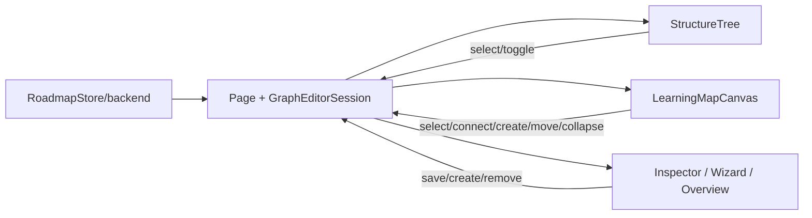

# Diseño: editor unificado del grafo del roadmap

## Enfoque y decisiones

La página coordina `RoadmapStore`; el backend es la única verdad. A→B agrega A al grupo raíz de B con el modo vigente, sin aplanar AND/OR ni `minXp` (REPO-01). Actividad usa `saveRules`; sección, `saveUnitRules` (existe, falta conectarlo). No se muestran ni mutan relaciones informativas.

| Elección | Alternativa / motivo |
|---|---|
| `/map` monta el grafo con `unsavedChangesGuard`; `/graph` redirige; una pestaña de mapa. | Dos editores duplican flujos y estado. |
| Validar con `prerequisitePolicy`, `prerequisiteOptions` y `rule-tree`. | Evita reglas divergentes; reutiliza chequeos de ciclo/contención. |
| Preferencia de forma en `localStorage` dentro de `try/catch`; default tarjeta. | Preferencia personal, no dato del curso. |
| Router jerárquico: rutas entre marcos raíz actuales; enmarcado local simplificado. | `routeEdges` soporta regiones planas/carriles, no obstáculos recursivos. |

## Corte y contratos

Primero dividir `graph-editor-page.component.ts` (~2267 líneas): página coordina; servicio local `GraphEditorSession` maneja borradores/comandos/save signal; `domain/graph-editor-projection.ts` aloja proyecciones puras; extraer `GraphStructureTreeComponent` y `GraphOverviewPanelComponent`. Reusar `NodeInspectorComponent`. Datos por `input()`, acciones por `output()`; cámara/drag/colapso transitorio quedan en canvas.

Canvas inputs: `units` jerárquicas (≤5), requisitos, selección, colapsos, forma, `validateConnection(): {allowed,reason}`, pending/saving. Outputs: `selectNode`, `selectSection`, `connectRequested`, `createRequested({sectionId?,prerequisiteId?})`, `moveRequested`, `collapseRequested`. Puertos en nodos/headers y flecha fantasma. `prerequisitePolicy` valida ciclo/contención; `prerequisiteOptions` da opciones; duplicados no escriben. Soltar en vacío/marco abre wizard precargado. Marco colapsado es destino de sección: solo source sección es válido; source nodo se rechaza, nunca apunta implícitamente a hijo.

## Layout, creación y persistencia

Añadir `parentId`/depth a entrada y rectángulos de `LayoutRegion`; `DagreLayoutEngine`/`packRegions` distribuyen hermanos. Al colapsar, `routeEdges` proyecta extremos ocultos al borde del ancestro; expandir restaura endpoints. Entre raíces se conserva router actual; dentro de marco, carriles ortogonales locales que no cruzan headers. Secciones vacías conservan marco, aviso y acción; volver sube nivel y subsecciones anidan hasta cinco.

`MAP_METRICS` define tamaños (`cardWidth/cardHeight`, `circleDiameter`) y puertos según forma. Datos idénticos en ambas; CSS variante con `--tpi-*`, sin hex/font literals, total <10 kB.

Sin selección, panel muestra overview; con selección, inspector. Wizard reutiliza `initialSectionId`, `initialDraft`, `connections`, `createChallenge`/`NodeWizardDraft` y mapeo `onWizardCreateChallenge` de `section-nodes`; no duplica validación. Reemplazar `wizardSectionId` por contexto; unidad usa `addSection`, subsección `addZone`. Crear nodo: `addActivity`→`saveRules`; si falla regla, conservar nodo, quitar flecha y advertir/reintentar.

Cada comando activa signal `saving`; éxito solo tras callback/recarga. Error revierte al confirmado y conserva contexto reintentable; no hay estado optimista de negocio. Mover valida REPO-04/05 y usa `moveActivityToSection`; ordenar usa `moveActivityTo`, sin tocar reglas. `section-nodes` tiene store separado (`embeds/roadmap-editor.providers.ts`) y estudiante consume las mismas reglas desde backend.

## Tree, overview, acceso y eliminación

Árbol inputs: `sections`, `selectedId`, `collapsedIds`; outputs: `select`, `toggle`, `expandAll`, `collapseAll`. Selección expande ancestros y centra canvas. Overview recibe seleccionado/requisitos/dependientes y emite `removeRule`. La lista de conexiones ofrece alternativa a flechas.

WCAG 2.2 AA: C conecta (destino, Enter/Esc); N abre wizard con enfocado como requisito; selector sustituye drag. `aria-live` anuncia resultados/razones; foco visible y gestionado; flechas distinguen estado por trazo/icono/texto, no solo color.

Eliminar `pages/course-map-page/**` (incluye page/estilos, `map-layout.ts`, `map-drag.ts`, `map-view-mode.ts` y specs) y `ui/map-unit-list/**`; ajustar imports/rutas/specs exclusivos. `roadmap.routes.ts`: map→Graph con guard, graph→map; `course-editor-page` retira pestaña duplicada. Limpieza es/en tras grep: borrar claves huérfanas `courseMap.hiddenUnit`, `list*`, `emptyUnitNotice`, `nodesBadgeLabel` y exclusivas de la página. Conservar/mover `mapView`, `cannotConnect*`, `connected`, `swap*/move*`, `statusCompleted`, `edgeTypes.*`, `hiddenEdge` según usos en spec.

## Archivos y pruebas

| Crear | Modificar | Borrar |
|---|---|---|
| `graph-editor-session.ts`; `domain/graph-editor-projection.ts`; `ui/graph-structure-tree/*`; `ui/graph-overview-panel/*`. | `roadmap.routes.ts`, `course-editor-page/*`, `graph-editor-page/*`, `learning-map-canvas/*`, `domain/map-layout/{map-layout,dagre-layout.engine,region-packing,edge-router}.ts`, wizard, `embeds/section-nodes/*`, `roadmap.store.ts`, i18n es/en. | `pages/course-map-page/**`; `ui/map-unit-list/**`; referencias/specs exclusivos. |

Pruebas al final antes del PR: unitarias de reglas/layout; componentes (contratos, teclado/ARIA); store (ambos saves, rollback, fallo parcial/movimiento); rutas/guard; regresión simple y aceptación alumno/docente; i18n/WCAG. Sin migración. Riesgos: endpoint de reglas para subsecciones y routing/drag profundo.

## Trazabilidad R1–R10

| Requisito | Elemento de diseño |
|---|---|
| R1 | Ruta única, guard, redirect y eliminación legacy. |
| R2 | Puertos/verdict, reglas por owner, sin informativas, creación en vacío. |
| R3 | Marcos, plegado y política explícita de drop colapsado. |
| R4 | Wizard reutilizado, `addActivity`→`saveRules`, `addZone`, fallo parcial. |
| R5 | Saving signal, reload, rollback y contexto reintentable. |
| R6 | Preflight y movimientos sin podar reglas. |
| R7 | Árbol plegable y overview con reglas/dependientes/quitar. |
| R8 | Tarjeta/círculo y preferencia local tolerante a fallo. |
| R9 | Store/backend compartido con vista simple y estudiante. |
| R10 | Atajos, selector/lista alternativos, foco, anuncios y señal no cromática. |

## Pregunta abierta

Confirmar cobertura del endpoint de reglas de unidad para subsecciones en todos los entornos antes de implementar; no se presupone endpoint nuevo.
