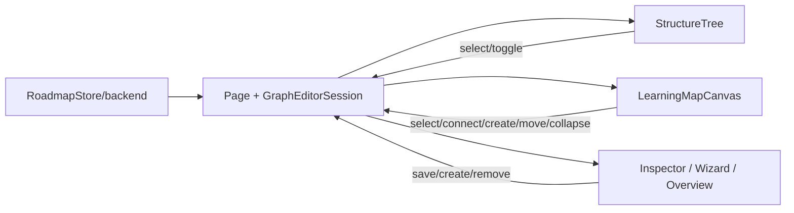

 # Diseño: editor unificado del grafo del roadmap

## Enfoque y decisiones

La página coordina `RoadmapStore`; el backend es la única verdad. A→B agrega A al grupo raíz de B con el modo vigente, sin aplanar AND/OR ni `minXp` (REPO-01). Actividad usa `saveRules`; sección, `saveUnitRules` (existe, falta conectarlo). No se muestran ni mutan relaciones informativas.

| Elección | Alternativa / motivo |
|---|---|
| `/map` monta el grafo con `unsavedChangesGuard`; `/graph` redirige; una pestaña de mapa. | Dos editores duplican flujos y estado. |
| Validar con `prerequisitePolicy`, `prerequisiteOptions` y `rule-tree`. | Evita reglas divergentes; reutiliza chequeos de ciclo/contención. |
| Preferencia de forma en `localStorage` dentro de `try/catch`; default tarjeta. | Preferencia personal, no dato del curso. |
| Router jerárquico y consciente de obstáculos en todos los niveles. | El router actual no evita obstáculos recursivos. |

## Corte y contratos

Primero dividir `graph-editor-page.component.ts` (~2267 líneas): página coordina; servicio local `GraphEditorSession` maneja borradores/comandos/save signal; `domain/graph-editor-projection.ts` aloja proyecciones puras; extraer `GraphStructureTreeComponent` y `GraphOverviewPanelComponent`. Reusar `NodeInspectorComponent`. Datos por `input()`, acciones por `output()`; cámara/drag/colapso transitorio quedan en canvas.

Canvas inputs: `units` jerárquicas (≤5), requisitos, selección, colapsos, forma, `validateConnection(): {allowed,reason}`, pending/saving. Outputs: `selectNode`, `selectSection`, `connectRequested`, `createRequested({sectionId?,prerequisiteId?})`, `moveRequested`, `collapseRequested`. Puertos en nodos/headers y flecha fantasma. `prerequisitePolicy` y `prerequisiteOptions` dan preflight/opciones de UX para ciclo y contención; los duplicados se advierten localmente, pero el backend valida cada intento. Soltar en vacío/marco abre wizard precargado. Un marco colapsado es destino de la regla de esa sección: un source nodo externo elegible también es válido como hoja `NODE`; nunca se redirige implícitamente a un nodo hijo. Se conserva el rechazo por contención.

## Layout, creación y persistencia

Añadir `parentId`/depth a entrada y rectángulos de `LayoutRegion`; `DagreLayoutEngine`/`packRegions` distribuyen hermanos. Al colapsar, el router proyecta extremos ocultos al borde del ancestro; expandir restaura endpoints. `domain/map-layout/edge-router.ts` enruta también dentro de marcos anidados evitando nodos y etiquetas no extremos y sin salir del marco: stubs de 16 px en puertos, ruta ortogonal con esquinas redondeadas, costo de giro, separación de paralelas y punta visible. Hover/selección resalta ambos extremos. Debe recalcularse tras reordenar, cambiar visibilidad o forma y colapsar/expandir. `edge-router.spec.ts` comprueba que ningún segmento intersecte obstáculos no extremos. El HTML de referencia del mockup usa A* ortogonal en grilla de 10 px, penalidad de giro 25, proximidad paralela 7 y stubs de 16 px; es referencia, no implementación de producción. Secciones vacías conservan marco, aviso y acción; volver sube nivel y subsecciones anidan hasta cinco.

`MAP_METRICS` define tamaños (`cardWidth/cardHeight`, `circleDiameter`) y puertos según forma. Datos idénticos en ambas; CSS variante con `--tpi-*`, sin hex/font literals, total <10 kB.

Sin selección, el panel muestra el overview con conteos del roadmap, «Para revisar» (secciones vacías y nodos sin reglas) y atajos de teclado. Con selección, muestra el inspector con requisitos y dependientes; el overview no muestra requisitos del elemento seleccionado. Wizard reutiliza `initialSectionId`, `initialDraft`, `connections`, `createChallenge`/`NodeWizardDraft` y mapeo `onWizardCreateChallenge` de `section-nodes`; no duplica validación. Reemplazar `wizardSectionId` por contexto; unidad usa `addSection`, subsección `addZone`. Crear nodo: `addActivity`→`saveRules`; si falla regla, conservar nodo, quitar flecha y advertir/reintentar.

Cada comando activa signal `saving`; éxito solo tras callback/recarga. Error revierte al confirmado y conserva contexto reintentable; no hay estado optimista de negocio. Mover valida REPO-04/05 y usa `moveActivityToSection`; ordenar usa `moveActivityTo`, sin tocar reglas. `section-nodes` tiene store separado (`embeds/roadmap-editor.providers.ts`) y estudiante consume las mismas reglas desde backend.

## Tree, overview, acceso y eliminación

Árbol inputs: `sections`, `selectedId`, `collapsedIds`; outputs: `select`, `toggle`, `expandAll`, `collapseAll`. Selección expande ancestros y centra canvas. Sin selección se muestra el overview informativo; con selección, el inspector recibe requisitos/dependientes y permite `removeRule`. La lista de conexiones ofrece alternativa a flechas.

WCAG 2.2 AA: C conecta (destino, Enter/Esc); N abre wizard con enfocado como requisito; selector sustituye drag. `aria-live` anuncia resultados/razones; foco visible y gestionado; flechas distinguen estado por trazo/icono/texto, no solo color.

Eliminar `pages/course-map-page/**` (incluye page/estilos, `map-layout.ts`, `map-drag.ts`, `map-view-mode.ts` y specs) y `ui/map-unit-list/**`; ajustar imports/rutas/specs exclusivos. `roadmap.routes.ts`: map→Graph con guard, graph→map; `course-editor-page` retira pestaña duplicada. Limpieza es/en tras grep: borrar claves huérfanas `courseMap.hiddenUnit`, `list*`, `emptyUnitNotice`, `nodesBadgeLabel` y exclusivas de la página. Conservar/mover `mapView`, `cannotConnect*`, `connected`, `swap*/move*`, `statusCompleted`, `edgeTypes.*`, `hiddenEdge` según usos en spec.

## Archivos y pruebas

| Crear | Modificar | Borrar |
|---|---|---|
| `graph-editor-session.ts`; `domain/graph-editor-projection.ts`; `ui/graph-structure-tree/*`; `ui/graph-overview-panel/*`. | `roadmap.routes.ts`, `course-editor-page/*`, `graph-editor-page/*`, `learning-map-canvas/*`, `domain/map-layout/{map-layout,dagre-layout.engine,region-packing,edge-router}.ts`, wizard, `embeds/section-nodes/*`, `roadmap.store.ts`, i18n es/en. | `pages/course-map-page/**`; `ui/map-unit-list/**`; referencias/specs exclusivos. |

Pruebas al final antes del PR: unitarias de reglas/layout; componentes (contratos, teclado/ARIA); store (ambos saves, rollback, fallo parcial/movimiento); rutas/guard; regresión simple y aceptación alumno/docente; i18n/WCAG. Sin migración. Riesgos: endpoint de reglas para subsecciones y routing/drag profundo.

## Trazabilidad R1–R12

| Requisito | Elemento de diseño |
|---|---|
| R1 | Ruta única, guard, redirect y eliminación legacy. |
| R2 | Puertos/verdict, reglas por owner, sin informativas, creación en vacío. |
| R3 | Marcos, plegado y política explícita de drop colapsado. |
| R4 | Wizard reutilizado, `addActivity`→`saveRules`, `addZone`, fallo parcial. |
| R5 | Saving signal, reload, rollback y contexto reintentable. |
| R6 | Preflight y movimientos sin podar reglas. |
| R7 | Árbol plegable, overview vacío informativo y inspector contextual con reglas/dependientes/quitar. |
| R8 | Tarjeta/círculo y preferencia local tolerante a fallo. |
| R9 | Store/backend compartido con vista simple y estudiante. |
| R10 | Atajos, selector/lista alternativos, foco, anuncios y señal no cromática. |
| R11 | Preflight UX; autoridad backend, guardado pesimista, rollback, relectura y error parcial. |
| R12 | `edge-router.ts` obstáculo-aware en marcos anidados; stubs, giros, paralelas, puntas, resaltado y prueba de intersección. |

## Pregunta abierta

Confirmar cobertura del endpoint de reglas de unidad para subsecciones en todos los entornos antes de implementar; no se presupone endpoint nuevo.

## Contrato con el back y validaciones

### Autoridad y endpoints

**El back (`tpi-roadmap`) es la única autoridad para reglas, permisos, validez y mutaciones.** Toda comprobación local (ciclo, contención, tipo permitido, duplicado o profundidad) es únicamente preflight para dar una pista temprana; puede estar desactualizada y nunca autoriza ni reemplaza el request. La UI solo comunica «Guardado» después de un 2xx. Un error o pérdida de red restaura la última lectura confirmada, muestra el mensaje mapeado y deja reintentar. Cada código backend se traduce a texto accionable en español; nunca se enseña `detail` técnico crudo.

Los paths de la tabla son los relativos que construye `HttpRoadmapAdapter` (`ROADMAP_API_PREFIX = /roadmap`); `HttpGenericService` les antepone `environment.apiUrl` (en esta app `/api`, vía el gateway/proxy descrito en `src/app/core/config/api.config.ts`). Las líneas de front y backend citadas son referencias a la implementación investigada, no una promesa de que el futuro editor ya esté cableado. Backend localizado: `~/dev/TPI_2026/Backend/tpi-roadmap`.

| Acción | Método del store | HTTP y path efectivo | Payload | Éxito | Códigos backend conocidos (HTTP, sentido) | Mensaje UI | Reversión |
|---|---|---|---|---|---|---|---|
| Crear flecha/regla a nodo | `saveRules` → `updateRules` o `updateRuleTree` | `PATCH /api/roadmap/nodes/{nodeId}/rules` (front `http-roadmap.adapter.ts:1206-1243`; back `GraphController.java:435`) | Flat `{mode, prerequisiteNodeIds}`; árbol `{rule}` | Flat: `ApiResponse<BackendRulesResponse>`; árbol igual | `400 rule.*` (forma inválida, duplicado del árbol); `400 node.prerequisite-invalid`; `403` permiso; `409 node.prerequisite-cycle`, `node.prerequisite-duplicate`, `node.prerequisite-out-of-scope`, `course.archived` | «No se pudo crear el requisito: [motivo]. No se guardaron los cambios; podés reintentar.» | Recargar nodo/grafo confirmado; descartar flecha borrador. |
| Crear flecha/regla a sección (unidad o subsección) | `saveUnitRules` → `updateSectionRules` o `updateSectionRuleTree` | `PATCH /api/roadmap/sections/{sectionId}/rules` (front `http-roadmap.adapter.ts:1169-1204`; back `GraphController.java:452`) | Flat `{mode, prerequisiteSectionIds}`; árbol `{rule}` | Flat: 2xx sin cuerpo requerido; árbol igual | `400 rule.*`, `400 section.prerequisite-invalid`; `403` permiso; `409 section.prerequisite-cycle`, `section.prerequisite-containment`, `course.archived` | «El requisito de unidad no se guardó: [motivo].» | Releer reglas de la sección; restaurar el último árbol confirmado. |
| Quitar una hoja | `saveRules` / `saveUnitRules` (guardar el árbol/flat actualizado sin esa hoja) | Mismo `PATCH .../nodes/{nodeId}/rules` o `.../sections/{sectionId}/rules` | Flat actualizado o `{rule}` sin la hoja | Respuesta de reglas (nodo), 2xx sin cuerpo (sección) | Los mismos códigos de validación/permiso/archivado que al guardar | «No se pudo quitar el requisito: [motivo].» | Releer dueño de regla; la hoja vuelve si el back no confirmó. |
| Cambiar AND/OR o `minXp` | `saveRules` / `saveUnitRules` | Mismo `PATCH .../rules` según dueño (front `http-roadmap.adapter.ts:1170-1243`; back `GraphController.java:435,452`) | Flat `{mode, prerequisite_*_ids}` para AND/OR plano; `{rule}` para grupos y XP mínimo | Respuesta de reglas (nodo), 2xx sin cuerpo (sección) | `400 rule.min-xp-negative`, `rule.empty-group`, `rule.too-deep`, `rule.malformed`; `403`; `409` ciclo/archivado | «No se pudo guardar la regla: [motivo].» | Descartar borrador y volver a la regla leída del back. |
| Crear nodo de contenido | `addActivity` (y, si se liga contenido, flujo de link del adapter) | `POST /api/roadmap/sections/{sectionId}/nodes` (front `http-roadmap.adapter.ts:546-571`; back `GraphController.java:236`) | Objeto de nodo: `type`, `name`, `sortOrder`, `mandatory`, `challengeId` y campos opcionales; tipo wire de contenido | `ApiResponse<BackendNodeResponse>` | `400 node.*` (body/tipo/recurso inválido), `403`, `404 node/section not found`, `409 node.duplicate-name`, `course.archived` | «No se pudo crear el contenido: [motivo].» | Si create falló, no agregarlo localmente; si el nodo sí quedó creado pero falló el vínculo, conservar y avisar explícitamente del fallo parcial. |
| Crear nodo de desafío teórico | `addActivity` | Mismo `POST .../sections/{sectionId}/nodes` (front `http-roadmap.adapter.ts:546-571`; back `GraphController.java:236`) | Objeto de nodo con tipo wire `THEORETICAL_CHALLENGE` y campos del asistente | `ApiResponse<BackendNodeResponse>` | `400 node.*`, `403`, `404`, `409 node.duplicate-name`, `course.archived` | «No se pudo crear el desafío teórico: [motivo].» | Mantener fuera del grafo hasta confirmar; releer si hay respuesta ambigua. |
| Crear nodo de desafío práctico | `addActivity` | Mismo `POST .../sections/{sectionId}/nodes` (front `http-roadmap.adapter.ts:546-571`; back `GraphController.java:236`) | Objeto de nodo con tipo wire `PRACTICAL_CHALLENGE` y campos del asistente | `ApiResponse<BackendNodeResponse>` | `400 node.*`, `403`, `404`, `409 node.duplicate-name`, `course.archived` | «No se pudo crear el desafío práctico: [motivo].» | Mantener fuera del grafo hasta confirmar; releer si hay respuesta ambigua. |
| Crear subsección | `addZone` → `addSection` | `POST /api/roadmap/courses/{courseId}/sections` (o roadmap elegido) (front `roadmap.store.ts:779-786`, adapter `http-roadmap.adapter.ts:377-403`; back `GraphController.java:155-162,173-182`) | `{name, sortOrder, biome, parentSectionId}` | `ApiResponse<BackendSectionResponse>` | `400 section.parent-invalid`, `400 section.too-deep` (MAX_DEPTH=5); `403`; `404`; `409 section.duplicate-name`, `course.archived` | «No se pudo crear la subsección: [motivo].» | No mostrar marco hasta 2xx; si falla, releer la estructura confirmada. |
| Crear unidad | `addSection` | `POST /api/roadmap/courses/{courseId}/sections` (o roadmap elegido) (front `http-roadmap.adapter.ts:377-403`; back `GraphController.java:155-162,173-182`) | `{name, sortOrder, biome}` sin `parentSectionId` | `ApiResponse<BackendSectionResponse>` | `400 section.*`; `403`; `409 section.duplicate-name`, `course.archived` | «No se pudo crear la unidad: [motivo].» | No mostrar marco hasta 2xx; releer estructura. |
| Mover nodo a otra sección | `moveActivityToSection` | `PATCH /api/roadmap/nodes/{nodeId}/section` (front `http-roadmap.adapter.ts:823-837`; back `GraphController.java:286`) | `{sectionId}` | `ApiResponse<BackendNodeResponse>` | `400 node.section-invalid`; `403`; `404`; `409 node.order-conflict`, `course.archived` | «No se pudo mover el nodo: [motivo].» | Releer ambas secciones y el nodo; restaurar ubicación confirmada. |
| Reordenar | `moveActivityTo` → `reorderActivity` | `PATCH /api/roadmap/nodes/{nodeId}` con cambio `sortOrder` (front `http-roadmap.adapter.ts:729-768`; back `GraphController.java:269-276`) | `{sortOrder}` | `ApiResponse<BackendNodeResponse>` por movimiento | `400` orden inválido; `403`; `404`; `409 node.order-conflict`, `course.archived` | «No se pudo guardar el orden: [motivo].» | Cancelar cola pendiente, releer orden confirmado (store `roadmap.store.ts:1258-1283`). |
| Eliminar nodo | `removeActivity` | `DELETE /api/roadmap/nodes/{nodeId}` (front `http-roadmap.adapter.ts:671-681`; back `GraphController.java:300-305`) | Sin cuerpo | `204`/2xx sin cuerpo (`void`) | `403`; `404 node.not-found`; `409 course.archived` u otra restricción de dependencias, si aplica | «No se pudo eliminar el nodo: [motivo].» | No quitarlo localmente antes de 2xx; ante rechazo releerlo desde el back. |

Los códigos enumerados son los del catálogo/servicios inspeccionados (`RoadmapErrorCode`, `GraphService`, `GraphValidator`); `403`, `404`, y `5xx` conservan tratamiento genérico del contrato HTTP cuando no hay código de dominio. Texto UI significa texto traducido por código y status, jamás `detail` directo. Las llamadas parciales (`crear nodo` y después guardar regla/vínculo) se reportan como parciales, nunca como transacción atómica inexistente.

### Matriz de validaciones (el back decide siempre)

| Regla | Preflight en front (solo UX) | Autoridad en back: endpoint y código | Estado |
|---|---|---|---|
| Ciclo | `prerequisitePolicy` avisa temprano; puede estar viejo | `PATCH .../nodes/{id}/rules`: `409 node.prerequisite-cycle`; sección: `409 section.prerequisite-cycle` (`GraphService`, `DependencyGraphService`) | implementado en back |
| Contención (requisito y contenido/ancestro) | `prerequisitePolicy` rechaza con motivo | `PATCH .../sections/{id}/rules`: `409 section.prerequisite-containment`; reglas de nodo chequean el grafo combinado y `rule.self-reference` (`DependencyGraphService`) | implementado en back |
| Regla de sección con hojas de nodo | Ofrecer nodos externos elegibles; preflight de contención como pista, sin reemplazar el request | `PATCH .../sections/{id}/rules`: `RuleLeafEligibility.requireEligibleForSection` acepta hojas `NODE` externas y rechaza nodos dentro de la sección o cualquiera de sus subsecciones (`RuleLeafEligibility.java:73-85`); `requireEligibleForNode` rechaza las secciones que contienen al nodo (`RuleLeafEligibility.java:51-58`). La contención entre secciones/ancestros y descendientes se valida en `SubsectionGuard.requireNoContainment` (`SubsectionGuard.java:81-100`) | implementado en back |
| Hoja duplicada | Ocultar/bloquear duplicado y anunciarlo | `PATCH .../nodes/{id}/rules`: flat `409 node.prerequisite-duplicate`; árbol `400 rule.duplicate-operand`; secciones validan duplicados de árbol (`RuleTreeValidator`) | implementado en back |
| Profundidad máxima 5 | No ofrecer crear hija por encima de nivel 5 | `POST .../courses/{id}/sections` con `parentSectionId`: `400 section.too-deep` (`SubsectionGuard.MAX_DEPTH=5`). Profundidad de árbol de reglas usa `400 rule.too-deep` con máximo configurable; confirmar que el entorno dé 5 | implementado en back |
| `minXp` negativo / fracción | Validar formato y mostrar rango como ayuda | `PATCH .../rules`: `400 rule.min-xp-negative`; rechazo de fracciones inválidas pendiente de confirmar en el DTO | verificar (negativo implementado) |
| Grupo vacío | No permitir guardar grupo vacío en UI | `PATCH .../rules`: `400 rule.empty-group` salvo grupo con `minXp` que sí expresa condición (`RuleTreeValidator`) | implementado en back |
| Referencia a elemento eliminado u oculto/fuera de alcance | Deshabilitar candidatos no disponibles; no inferir acceso por visibilidad cargada | `PATCH .../rules`: not-found/`400 node.prerequisite-invalid` o `409 node.prerequisite-out-of-scope`; verificar equivalentes de secciones y que oculto se rechace según política | verificar |
| Permiso insuficiente | Ocultar/inhabilitar comandos solo como UX | Cada mutación: `403` (autorización backend; validar path y código/`type` del gateway) | implementado en back |
| Curso archivado | Deshabilitar controles al leer `archived`, solo como pista | Mutaciones Graph: `409 course.archived` (`GraphService`) | implementado en back |
| Concurrencia / dos editores | Guardar una acción a la vez localmente; refrescar al recuperar foco | Mutaciones con versión/lock o conflicto inequívoco: confirmar contrato; el front relee tras 2xx y en foco, pero no resuelve conflictos por sí solo | verificar |

No hay gaps confirmados entre las validaciones revisadas. Nueve controles tienen evidencia de backend: ciclo, contención (incluidas hojas `NODE` en reglas de sección), hoja duplicada, profundidad de subsección, grupo vacío, XP negativo, permisos y curso archivado, además de elegibilidad de nodos externos para reglas de sección. Quedan tres puntos por verificar con pruebas/código: fracción/no entero en `minXp`; referencias eliminadas u ocultas (incluida sección); y control/serialización de ediciones concurrentes. Si alguno no tiene control backend, abrir una tarea análoga con status/código estable y pruebas; hasta entonces no se registra como garantizado. Ninguna fila puede quedar protegida solo por el front.

### Flujo de guardado y sincronización

- Guardado pesimista: `saving` permanece activo desde antes de enviar hasta completar la respuesta; bloquear doble submit por comando/dueño.
- Solo 2xx significa éxito. Después del éxito, `RoadmapStore` vuelve a leer la entidad tocada; la vista no inventa respuesta optimista ni muestra «Guardado» por haber iniciado una llamada.
- Ante error HTTP o de red, mapear código/status a mensaje con acción de reintento; descartar borrador visual y restaurar la última instantánea confirmada mediante reload. En fallo parcial de dos requests (crear nodo y luego regla), conservar el nodo confirmado, no dibujar la regla, y explicar cuál paso falló.
- Dos personas pueden editar a la vez: al volver el foco, antes/después de guardar se relee el roadmap/reglas. Una respuesta tardía no debe pisar un cambio más nuevo; si el back devuelve conflicto, mostrarlo y reconciliar con nueva lectura.
- El mock debe distinguirse visiblemente del modo real (`REPO-09`): rótulo persistente «Datos de demostración / mock» y feedback de que no se guardó en el back; no mostrar estado «Guardado» como si fuera real.

### Lecturas compartidas

El grafo unificado no conserva un segundo modelo de negocio. La ruta principal lee el roadmap completo (`GET /api/roadmap/courses/{courseId}` o `/roadmaps/{roadmapId}`: secciones, subsecciones, nodos, reglas flat/árbol, conexiones derivadas y `archived`). `embeds/section-nodes` tiene otra instancia de `RoadmapStore` (`embeds/roadmap-editor.providers.ts`): al abrir, lee el mismo roadmap por curso y presenta nodos de la sección más las reglas/conexiones requeridas para «Requiere: …». El roadmap del alumno lee el roadmap de curso/roadmap y, para el estudiante actual, `GET /api/roadmap/{courses|roadmaps}/{id}/students/{studentId}/progress`; consume las mismas reglas guardadas más resultados de progreso para bloqueos. La UI simple y la del alumno no reciben cambios por compartir memoria local: ven la misma fuente backend al leer/refrescar.

### Trazabilidad

R2 y R6 quedan sujetos a la tabla de endpoints y a esta matriz; R4 cubre el fallo parcial de crear nodo/regla; R5 y REPO-09 se precisan en flujo de guardado/mock; R9 queda precisado en lecturas compartidas. **R11** exige que ningún preflight del cliente sustituya el rechazo del backend (ver `spec.md`, escenarios R11.1–R11.4).
