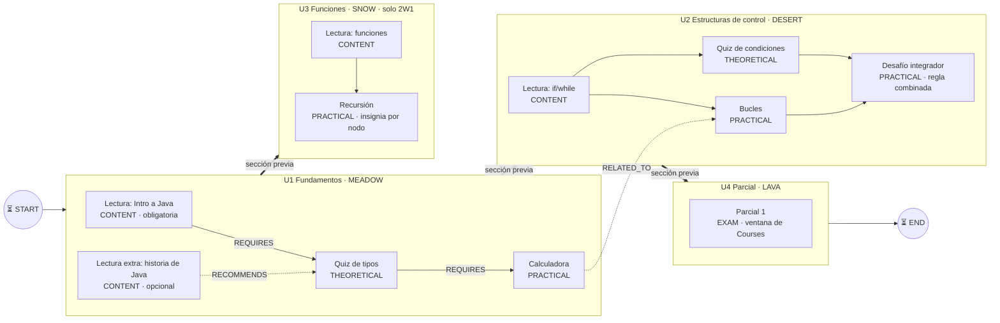

# T-21.1: Guion del curso de demo

> [!info] Para qué sirve
> Define **qué** carga el seed de [[sprints/sprint-3/historias/HT-21 Seed de demo curado|HT-21]] (T-21.2) y **qué** se recorre en la demo (T-21.3). Usa solo lo que hoy está en `develop` de `tpi-roadmap`; lo que todavía no existe está marcado con ⏳.
> Reemplaza al guion del Sprint 1 ([[tareas/T-02-2-GUION-SPRINT-REVIEW|T-02.2]]), cuyo seed (`DemoDataSeeder`) se borró en HT-09.

> [!warning] Antes de aprobarlo
> - ⏳ **START/END (HU-64)** no está en `develop`: el guion los incluye, pero el seed los agrega recién cuando se mergee.
> - **Usuarios demo de G07**: todavía no existen ([[sprints/sprint-3/08-dudas|G7]]). Mientras tanto, los ids van por variable de entorno (ver [[#Usuarios]]).
> - La **comisión** de cada sección y la **ventana del examen** son de Courses (G01): el seed de Roadmap no las crea, las lee. Hay que cargarlas del lado de Courses o con el stub de restricciones.

## Resumen del curso

| Dato | Valor |
|---|---|
| Curso-cohorte | **Programación II — Demo G10** (id fijo, `DEMO_COURSE_ID`) |
| Comisiones (Courses) | **2W1** y **2W2** |
| Roadmaps | 2: **Cursada** (activo) y **Intensivo** (alternativo, misma estructura más corta). `multiple_roadmaps_allowed = true` (HU-57) |
| Curva de niveles | La de Backoffice (PAR-09, E4): nivel 3 = 1200 XP · nivel 5 = 3500 XP · nivel 7 = 7300 XP |
| Duración del recorrido | ~10 minutos (profe 4, alumno 6) |

## Estructura del roadmap «Cursada»

Cada sección es una isla del archipiélago (bioma entre paréntesis). Tipos de nodo de `NodeType`: `CONTENT`, `THEORETICAL_CHALLENGE`, `PRACTICAL_CHALLENGE`, `EXAM`.

### Qué muestra cada parte

| Parte | Función que demuestra | Historia |
|---|---|---|
| U1 → U2 → U4 (flechas gruesas) | Dependencias entre secciones: U2 bloqueada hasta completar U1 (`UNIT_PREREQUISITE_PENDING`) | HU-58 |
| Lectura obligatoria de U1 | Contenido leído antes del quiz (`CONTENT_NOT_READ`) | HU-06 |
| `REQUIRES` / `RECOMMENDS` / `RELATED_TO` | Relaciones con tipo: solo `REQUIRES` bloquea; las otras se ven pero no frenan | HU-65 |
| Desafío integrador de U2 | Regla combinada: **(Quiz de condiciones AND Bucles) OR XP mínimo 1500** | HU-59 |
| U3 solo para 2W1 | Restricción por comisión de Courses: un alumno de 2W2 la ve bloqueada con texto (`GROUP_RESTRICTED`) | HU-44, HU-49 |
| Parcial 1 (EXAM) | Ventana horaria de Courses: fuera de fecha queda bloqueado (`DATE_RESTRICTED`) | HU-49 |
| Recursión (U3) | Insignia del curso por nodo (`SPECIFIC_MANDATORY_NODE`) | HU-20/21 |
| START / END | ⏳ Inicio y fin obligatorios | HU-64 |

### Roadmap «Intensivo»

Mismas secciones U1, U2 y U4 (sin U3), con un nodo por sección. Sirve para mostrar en la demo que el curso tiene **dos roadmaps** y que el profe elige cuál está activo (HU-57). No hace falta recorrerlo.

## Insignias

| Insignia | Origen | Criterio (`BadgeCriterion`) | Quién la tiene en la demo |
|---|---|---|---|
| Primer paso | Sistema | `MIN_XP` 10 | todos menos Dante |
| Sin perder vidas | Sistema | `SECTION_NO_LIVES_LOST` | Ana |
| Maratonista | Profe | `MIN_XP` 3500 | Ana |
| Experto en recursión | Profe | `SPECIFIC_MANDATORY_NODE` (Recursión, U3) | — (Ana la gana en vivo) |
| Nivel 3 | Profe | `LEVEL_REACHED` 3 | Ana, Bruno |

Las del sistema no se pueden editar (DEC-006); las del profe sí (T-30.1).

## Usuarios

Ids por variable de entorno hasta que G07 publique los usuarios demo (`DEMO_TEACHER_ID`, `DEMO_STUDENT_1_ID`…). Mails de referencia: `@demo.tpi`.

| Persona | Rol | Comisión | Dónde está | XP / nivel | Para mostrar |
|---|---|---|---|---|---|
| **Prof. Paula** | Profesor | — | Dueña del curso | — | Editor, mapa, insignias, avance por comisión |
| **Ana** | Alumna | 2W1 | U1 y U2 completas, U3 a medias | 3600 / nivel 5 | Primera del ranking, gana «Experto en recursión» en vivo |
| **Bruno** | Alumno | 2W1 | U1 completa, perdió todas las vidas en Bucles | 1300 / nivel 3 | Nodo bloqueado por vidas (`NO_LIVES`) |
| **Carla** | Alumna | 2W2 | U1 completa | 1250 / nivel 3 | U3 bloqueada por comisión (`GROUP_RESTRICTED`) |
| **Dante** | Alumno | 2W2 | Sin empezar, lectura sin leer | 0 / nivel 1 | Quiz bloqueado por lectura (`CONTENT_NOT_READ`) |
| **Eva** | Alumna | 2W1 **y** 2W2 | U1 completa | 1400 / nivel 3 | Selector de comisión (T-33.1) |
| 7 alumnos más | Alumnos | mitad y mitad | Progreso variado | 0–3000 | Que el ranking tenga zonas (mínimo 10 inscriptos) |

## Recorrido (≈10 min)

### Profesor (≈4 min)

1. **Mapa del curso** (`/roadmap/teacher/course/{id}/map`): las 4 islas, las flechas entre secciones y los tipos de relación. Abrir el desafío integrador y mostrar la **regla combinada**.
2. **Roadmaps del curso**: hay dos (Cursada e Intensivo); Cursada es el activo.
3. **Avance por comisión** (`/roadmap/teacher/progress/{id}`): elegir 2W1 → Ana y Bruno; elegir 2W2 → Carla y Dante.
4. **Insignias del curso** (`/roadmap/badges/{id}`): las del sistema sin «Editar»; editar «Maratonista» (cambiar el ícono) y guardar.
5. **Ranking del profe**: nombres y legajos de todos, con el criterio de desempate.

### Alumno (≈6 min)

1. **Ana** entra al archipiélago: nivel 5, U1 y U2 completas, U3 abierta. Termina **Recursión** → gana **«Experto en recursión»** y la ve en «Mis insignias» con motivo y fecha.
2. **Bruno** abre **Bucles**: bloqueado por vidas, con el motivo en texto.
3. **Carla** (2W2) ve **U3** bloqueada: «Esta unidad no está habilitada para tu comisión».
4. **Dante** intenta el **Quiz de tipos**: primero tiene que leer la lectura obligatoria; la lee y se habilita.
5. **Eva** (dos comisiones) ve el **selector de comisión**; cambia de 2W1 a 2W2 y U3 pasa a bloqueada.
6. Cualquiera intenta el **Parcial 1** fuera de fecha: bloqueado por la ventana de Courses.
7. **Ranking del alumno**: Ana arriba; el resto anónimo, con zonas.

## Qué necesita el seed (para T-21.2)

- [ ] Perfil `demo` separado del productivo; no corre en `prod` (CA1, escenario 3).
- [ ] Idempotente: correrlo dos veces no duplica nada (CA4, escenario 2).
- [ ] Ids de usuarios por variable de entorno (CA3).
- [ ] Curso, 2 roadmaps, 4 secciones, nodos, relaciones, reglas e insignias de este guion.
- [ ] Progreso, XP, vidas e insignias ganadas de cada alumno, según la tabla de [[#Usuarios]].
- [ ] Del lado de Courses (o su stub): comisiones 2W1/2W2, U3 solo para 2W1 y la ventana del Parcial 1.
- [ ] ⏳ START/END cuando se mergee HU-64.

## Pendiente de aprobación

- [ ] El equipo aprueba el curso y los personajes.
- [ ] Confirmar con G01 cómo cargar la comisión de U3 y la ventana del parcial en la demo.
- [ ] Confirmar con G07 si llegan los usuarios demo o seguimos con ids por variable.
